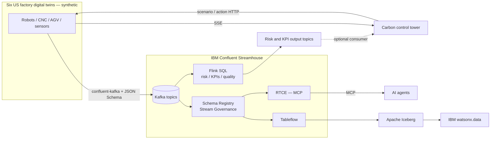

# Factory Pulse — IBM Confluent Streamhouse Showcase

**IBM products**: IBM Confluent (Kafka, Flink, Schema Registry, Stream Governance, Tableflow, Real-Time Context Engine), IBM Carbon, IBM watsonx.data (integration point), IBM watsonx Orchestrate (integration point), IBM Cloud Code Engine

> **⚠ SYNTHETIC DEMONSTRATION DATA ONLY.** Factory locations, assets, incidents, throughput, alerts and KPI values are fictional and intended for demonstration and training. This is not a reference for real industrial safety or plant control.

A full-stack manufacturing showcase that walks through the IBM Streamhouse building blocks — **Stream → Transform → Govern → Serve** — with an IBM Carbon control tower, an animated 3D factory digital twin, and a Python backend that can publish **real Schema Registry–encoded Kafka events** to Confluent Cloud. Everything works in a local simulation mode with no cloud account.

---

## Contents

- [When to use this asset](#when-to-use-this-asset)
- [What it demonstrates](#what-it-demonstrates)
- [Architecture](#architecture)
- [Quick start — local simulation](#quick-start--local-simulation)
- [Connect to Confluent Cloud](#connect-to-confluent-cloud)
- [One-command Confluent Cloud deployment (Terraform)](#one-command-confluent-cloud-deployment-terraform)
- [Container and Code Engine deployment](#container-and-code-engine-deployment)
- [Environment variables](#environment-variables)
- [Backend API](#backend-api)
- [Project layout](#project-layout)
- [Tests](#tests)
- [Security notes](#security-notes)
- [Known gaps in this package](#known-gaps-in-this-package)
- [Documentation](#documentation)
- [IBM references](#ibm-references)

---

## When to use this asset

- You need a working, visual demo of the Streamhouse story (Kafka → Flink → governed schemas → RTCE/MCP and Tableflow/Iceberg) for a manufacturing audience.
- You want a reference for producing JSON Schema–governed events to Confluent Cloud from Python (`confluent-kafka`).
- You want to show Flink SQL recipes (risk signals, shift KPIs, quality alerts) and Confluent Flink Topic Actions alongside live telemetry.
- You want a reference for exposing live state to AI agents through the Confluent RTCE MCP endpoint.

For AI-grounded answers over live and historical data, see the sibling assets [`live-context-for-supply-chain-resilience`](../live-context-for-supply-chain-resilience/) and [`streamhouse-continous-rag`](../streamhouse-continous-rag/).

## What it demonstrates

| Feature | Implementation | Runtime status |
|---|---|---|
| Six US factory sites, site selector, plant map | React; Google Maps JS when a key is set, offline SVG fallback otherwise | Local works; Maps needs a restricted browser key |
| 3D animated factory floor (robot arms, conveyors, AGV) | react-three-fiber / Three.js | Local simulated geometry |
| IoT telemetry, OEE and alerts for 36 robots | Python Flask simulation + Server-Sent Events | Local works |
| Fault injection (bearing, thermal, quality, surge) | UI → backend `/api/simulate` | Local works |
| Real Kafka producer with Schema Registry | `confluent-kafka`, SASL/TLS, JSON Schema key + value subjects | Needs Confluent Cloud credentials |
| Flink SQL recipes | `flink/` scripts shown in the SQL studio view | Run on your Flink compute pool |
| Flink Topic Actions walkthrough | Dedup / mask / transform operators | Configure in Confluent Data Portal |
| Tableflow → Iceberg → watsonx.data | Architecture and runbook | Provision in Confluent and lakehouse |
| Confluent RTCE / MCP | Backend proxy to remote MCP endpoint (`/api/mcp/*`) | Needs eligible RTCE and credentials |
| "AI-style" context answers | Transparent rule-based logic — **not an LLM** | Local works |
| Maintenance / acknowledge actions | Actions UI + optional HTTPS webhook | Local works; webhook is opt-in |

The default **SIMULATION MODE** needs no cloud credentials or Google Maps account.

## Architecture



Full detail: [docs/architecture.md](docs/architecture.md) and [docs/streamhouse-capabilities.md](docs/streamhouse-capabilities.md).

---

## Quick start — local simulation

**Prerequisites:** Python 3.11+, Node.js 20+ with npm, and a WebGL-capable browser.

```bash
cp .env.example .env            # defaults to STREAM_MODE=mock
python scripts/start.py         # installs deps, starts backend + frontend
# macOS/Linux: scripts/start.sh      Windows: scripts\start.cmd
```

| Service | URL |
|---|---|
| UI (Vite dev server) | http://localhost:5173 |
| Backend API | http://localhost:4000 |

`python scripts/start.py --reinstall` forces a fresh `npm install`. Press `Ctrl+C` to stop both servers.

**Demo sign-in:** the UI has a client-side demo login (default user `admin`; see [Security notes](#security-notes)). Override at build time with `VITE_DEMO_USER` / `VITE_DEMO_PASS`.

Suggested walkthrough: [docs/demo-script.md](docs/demo-script.md).

## Connect to Confluent Cloud

1. Create the three Kafka source topics (names are defined in `server/schemas.py`): `factory-iot-telemetry`, `factory-maintenance-events`, `factory-asset-state`.
2. In `.env`, set `STREAM_MODE=kafka` and fill in the Kafka bootstrap server, API key/secret, and Schema Registry URL, key and secret.
3. Restart the app and open http://localhost:4000/api/health. Confirm `stream.status: connected` and that `stream.sent` increases (it increments only after broker acknowledgement).
4. Optionally run the Flink SQL recipes, enable the derived-topic consumer (`KAFKA_CONSUME_DERIVED=true`), Tableflow and RTCE.

Full steps: [docs/cloud-setup.md](docs/cloud-setup.md). Feature coverage: [docs/confluent-feature-matrix.md](docs/confluent-feature-matrix.md).

## One-command Confluent Cloud deployment (Terraform)

On Windows run `deploy\deploy-confluent.cmd`; on macOS/Linux run `./deploy/deploy-confluent.sh` (or `python scripts/deploy.py up`). Supported actions: `up`, `plan`, `retry`, `status`, `destroy`, `run`.

The launcher prompts for a Confluent **Cloud API key and secret** (never stored), asks you to confirm the **billable** plan, then provisions an isolated environment: Kafka cluster, producer/consumer credentials and ACLs, JSON Schema subjects, a Flink compute pool with continuous transformations, Tableflow (Iceberg) and RTCE MCP. It writes a private `.env` and starts the local UI.

- Run `python scripts/deploy.py plan` first and review the plan.
- Run `python scripts/deploy.py destroy` after the demo. **Closing the local app does not stop Confluent charges.**
- Details, permissions, costs and teardown: [docs/one-click-terraform.md](docs/one-click-terraform.md).

> The Terraform plan was not executed in the authoring environment. Treat it as a demo-grade starting point, not a production module.

## Container and Code Engine deployment

**Local container (podman):**

```bash
./deploy/deploy-local.sh          # Windows: deploy\deploy-local.cmd
./deploy/deploy-local.sh logs     # follow logs
./deploy/deploy-local.sh down     # stop and remove
```

Open http://localhost:4000. The single image ([`deploy/Dockerfile`](deploy/Dockerfile)) serves the compiled frontend and the API together (container port `8080`).

**IBM Cloud Code Engine:**

```bash
./deploy/deploy-ce.sh             # `delete` removes the app
```

The script logs in with an IBM Cloud API key, builds the image with podman, pushes it to IBM Cloud Container Registry, converts non-empty `.env` values into a Code Engine secret (excluding `PORT` and `API_KEY`), and creates or updates the application. Requires `ibmcloud login` access plus the `code-engine` and `container-registry` plugins.

Before running, export these **required** values: `REGION`, `RESOURCE_GROUP` and `ICR_IMAGE` (for example `<region>.icr.io/<namespace>/streamhouse-factory-pulse`); the script exits if any is unset. `CE_PROJECT` and `CE_APP_NAME` are optional overrides. Set `API_KEY` (IBM Cloud API key) in `.env` for deployment only; it is not forwarded to the app.

## Environment variables

Defined in [`.env.example`](.env.example). Copy to `.env` (git-ignored). **Server-side secrets must never use the `VITE_` prefix** — `VITE_*` values are bundled into the public frontend.

| Variable | Purpose |
|---|---|
| `PORT`, `SIM_INTERVAL_MS` | Backend port and simulation tick interval |
| `STREAM_MODE` | `mock` (default) or `kafka` |
| `KAFKA_BOOTSTRAP_SERVERS`, `KAFKA_API_KEY`, `KAFKA_API_SECRET` | Confluent Cloud Kafka connection |
| `SCHEMA_REGISTRY_URL`, `SCHEMA_REGISTRY_API_KEY`, `SCHEMA_REGISTRY_API_SECRET` | Schema Registry connection |
| `KAFKA_AUTO_CREATE_TOPICS`, `KAFKA_CONSUME_DERIVED` | Topic creation and derived-topic consumer toggles |
| `KAFKA_RISK_TOPIC`, `KAFKA_KPI_TOPIC` | Flink output topics the backend can consume |
| `ACTION_WEBHOOK_URL`, `ACTION_WEBHOOK_TOKEN` | Optional HTTPS webhook for the maintenance action |
| `RTCE_MCP_ENDPOINT`, `RTCE_MCP_BASIC_TOKEN` | Optional Confluent RTCE MCP endpoint and credential |
| `VITE_GOOGLE_MAPS_API_KEY`, `VITE_GOOGLE_MAPS_MAP_ID` | Optional Google Maps browser key (restrict by referrer) and map ID |
| `API_KEY` | IBM Cloud API key used only by `deploy/deploy-ce.sh` (not in `.env.example`) |

## Backend API

| Route | Method | Purpose |
|---|---|---|
| `/api/health` | GET | Kafka transport status and publish acknowledgements |
| `/api/bootstrap` | GET | Snapshot, sites and supported scenarios |
| `/api/events` | GET | SSE stream: `snapshot`, `alert`, `scenario`, `action`, `cloud`, `flink` |
| `/api/simulate` | POST | `{ "siteId": "DET", "scenario": "bearing", "intensity": 85 }` |
| `/api/control` | POST | `{ "siteId": "DET", "action": "maintenance" }` |
| `/api/context` | POST | `{ "siteId": "DET", "question": "Which robot needs maintenance?" }` |
| `/api/stream-mode` | POST | Switch between simulation and cloud stream mode |
| `/api/stream` | GET | Kafka transport and optional Flink output |
| `/api/mcp/tools` | GET | List RTCE MCP tools (if configured) |
| `/api/mcp/call` | POST | `{ "name": "tool_from_list", "args": {} }` |

## Project layout

```text
streamhouse/
├── frontend/src/        React + Carbon UI (App.jsx), PlantMap, FactoryTwin (3D), twin/ (kinematics, plant profiles),
│                        sim/ (remote + in-browser simulation), sql.js (Flink SQL viewer)
├── server/              Flask API: app.py, simulation.py, kafka.py, schemas.py, context.py, mcp.py, plants.py
├── deploy/              Dockerfile, deploy-local.*, deploy-ce.sh, deploy-confluent.*, requirements.txt
├── scripts/             start.* (local dev), deploy.py (Terraform launcher), backup.*, e2e / SSE test helpers
├── docs/                Architecture, cloud setup, feature matrix, demo script, digital-twin guides, agent spec
├── tests/               simulation.test.js, test_deploy.py
├── .env.example         Placeholder configuration (no real values)
└── MANIFEST.txt         File list from a packaging backup
```

## Tests

```bash
python -m unittest tests/test_deploy.py     # no-network launcher + schema checks
python scripts/e2e_test.py                  # with the backend running on :4000
```

`tests/simulation.test.js` and part of `tests/test_deploy.py` still reference the earlier Node server (`server/src/*.js`), which is not part of this package, so they need updating before they will pass. See [Known gaps](#known-gaps-in-this-package).

## Security notes

- **No real credentials are shipped.** `.env.example` contains empty values and `xxxxx` placeholders; `.env`, Terraform state, plans and `*.tfvars` are git-ignored.
- **Demo login is not authentication.** `frontend/src/components/Login.jsx` compares a default username and password in the browser, and both are visible in the compiled bundle. Set `VITE_DEMO_USER` / `VITE_DEMO_PASS` for any shared deployment and put real authentication in front of it.
- **The Flask API is unauthenticated** and enables CORS for all origins. Do not expose it publicly; place it behind an authenticating gateway.
- **Keep secrets server-side.** Never prefix Kafka, Schema Registry, RTCE or webhook secrets with `VITE_`. Restrict the Google Maps key by HTTP referrer.
- **Terraform state contains generated API secrets** and the generated `.env` contains live credentials. Store them securely and destroy or rotate after the demo. The Terraform manager role is `OrganizationAdmin` for convenience and is not suitable for production.
- **Secrets in Code Engine.** `deploy-ce.sh` places every non-empty `.env` value into a Code Engine secret; review `.env` before deploying.

## Known gaps in this package

- `flink/` (SQL recipes) and `infra/terraform/` are referenced by the docs, `frontend/src/sql.js`, `deploy/Dockerfile` and `scripts/deploy.py` but are **not included**. The frontend build and container build will fail until they are added.
- `frontend/package-lock.json` is referenced by the Dockerfile but is not included.
- `server/requirements.txt` is not present; Python dependencies live in `deploy/requirements.txt`.
- `frontend/package.json` has no `test` or `check` scripts; `tests/simulation.test.js` targets a removed Node server.
- A Vite production build and live Confluent connectivity were not verified in the authoring environment.

## Documentation

| Document | Content |
|---|---|
| [docs/streamhouse-capabilities.md](docs/streamhouse-capabilities.md) | Streamhouse capabilities mapped to Factory Pulse |
| [docs/architecture.md](docs/architecture.md) | Logical and runtime architecture |
| [docs/cloud-setup.md](docs/cloud-setup.md) | Manual Confluent Cloud setup |
| [docs/one-click-terraform.md](docs/one-click-terraform.md) | Terraform launcher, costs, teardown |
| [docs/confluent-feature-matrix.md](docs/confluent-feature-matrix.md) | Confluent feature coverage and caveats |
| [docs/demo-script.md](docs/demo-script.md) | Presenter walkthrough |
| [docs/digital-twin-explained.md](docs/digital-twin-explained.md) | Digital twin and UI internals |
| [docs/watsonx-orchestrate-agent-spec.md](docs/watsonx-orchestrate-agent-spec.md) | watsonx Orchestrate agent integration spec |

## IBM references

- IBM Streamhouse Building Blocks: https://ibm-self-serve-assets.github.io/building-blocks-docs/streamhouse-core/
- IBM Confluent: https://www.ibm.com/products/confluent
- Confluent Cloud documentation: https://docs.confluent.io/cloud/current/
- Confluent Real-Time Context Engine: https://docs.confluent.io/cloud/current/real-time-context-engine/overview.html
- Confluent Tableflow: https://docs.confluent.io/cloud/current/tableflow/overview.html
- Google Maps JavaScript API: https://developers.google.com/maps/documentation/javascript/load-maps-js-api
