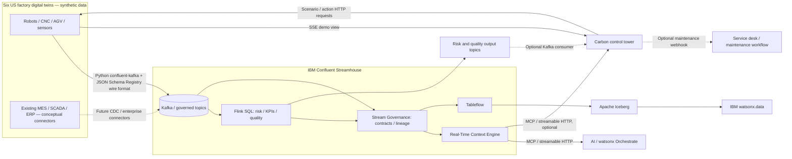

# Factory Pulse — composable IBM Streamhouse reference

This is a technical demonstration, not a reference implementation for real industrial safety or plant control.

## Logical view

## Physical runtime boundaries

- **React frontend:** Vite + React 18 + IBM Carbon Design System + Recharts + Three.js via `@react-three/fiber` & `@react-three/drei`. Google Maps JavaScript API only loads when a browser API key is configured. Without a key, the app clearly labels its illustrative SVG map. The map city coordinates are real, but site identities and facilities are fictional.
- **Python backend:** Python 3.11+ Flask server (`server/app.py`). Owns all synthetic robot state (`server/simulation.py`), actions, SSE snapshots (`/api/events`), rule-based narrative answers (`/api/context`), native Confluent Kafka client (`server/kafka.py` via `confluent-kafka`), Schema Registry integration (`server/schemas.py`), optional Kafka derived & source consumers, and remote MCP client proxy (`server/mcp.py`). All secrets remain server-side.
- **IBM Confluent Cloud:** Kafka cluster (Standard/Dedicated), Stream Governance Essentials / Schema Registry, Apache Flink compute pool, RTCE (Real-Time Context Engine), and Tableflow (Apache Iceberg). Can be provisioned via `infra/terraform/` or connected to existing infrastructure.
- **IBM watsonx.data / watsonx Orchestrate:** Extension points only; no watsonx credentials or integration are shipped in this package.

## Topic contracts

| Topic | Source | Key | Function |
|---|---|---|---|
| `factory-iot-telemetry` | Simulator | `{id: assetId}` | Per-asset temperature, vibration, rpm, energy, quality, health, scenario |
| `factory-asset-state` | Simulator | `{id: assetId}` | Latest asset state for RTCE or Tableflow; configure compaction for RTCE upsert mode if desired |
| `factory-maintenance-events` | Simulator | `{id: eventId}` | Emitted incidents after scenario thresholds |
| `factory-risk-signals` | Flink SQL | Depends on derived table | Threshold risk classification |
| `factory-shift-kpis` | Flink SQL | Depends on derived table | One-minute window aggregations |
| `factory-quality-alerts` | Flink SQL | Depends on derived table | Inspection/quarantine decisions |

The producer registers **JSON Schema (Draft-07)** for each source topic's key and value subjects, and encodes each message using Confluent's wire format (Magic Byte `0x00` + 4-byte Schema ID + JSON payload). This is different from sending schemaless JSON to Kafka via REST.

## Real-time and simulated paths — important truth in demos

1. **Local demo:** All metrics, event timings, robot visuals, rule-based explanation and incident actions come from the local simulation. SSE pushes local snapshots to the browser. Kafka connections and Flink outputs are absent.
2. **Confluent Kafka mode:** Every simulator tick produces *actual schema-encoded messages* to Kafka, counted only after Kafka acknowledgments. The UI still shows locally computed OEE/telemetry until optionally connected to derived Flink topics.
3. **Confluent Flink:** SQL sources are included but must be manually created and started on a provisioned compute pool. Enable `KAFKA_CONSUME_DERIVED=true` to display actual derived output. The rules/SQL run on Confluent, not embedded locally.
4. **Tableflow and RTCE:** Require manual enablement and eligible schemas/cluster/region/storage/RBAC. The frontend's architecture card does not imply those systems are running.
5. **MCP:** The `Discover remote MCP tools` and `Invoke tool` controls call a real endpoint only when it has been configured. The separate `Ask Factory Pulse` section deliberately identifies its answer source as **local demo rules**.
6. **Actions:** Built-in Flink Topic Actions (deduplication, masking, transform) are configured through Confluent's Data Portal. The maintenance command is a *simulated business action* with an optional HTTPS webhook.

## Security considerations before broader distribution

The backend ships intentionally without authentication (for locally hosted demos). **Do not expose it publicly**, as it includes simulator mutation, a user-invoked remote MCP tool proxy, and an optional maintenance webhook. Before deployment to a shared environment, add OIDC login, per-route RBAC, command allow-listing, validation of tool arguments against MCP schemas, CSRF protections, request rate limits, audit trails, CORS allow-list, and safe operator approvals. Restrict Google Maps API keys by HTTP referrer, avoid committing `.env`, and use secrets management for backend Confluent credentials. Never connect these UI actions to a physical PLC or safety-critical controller.
