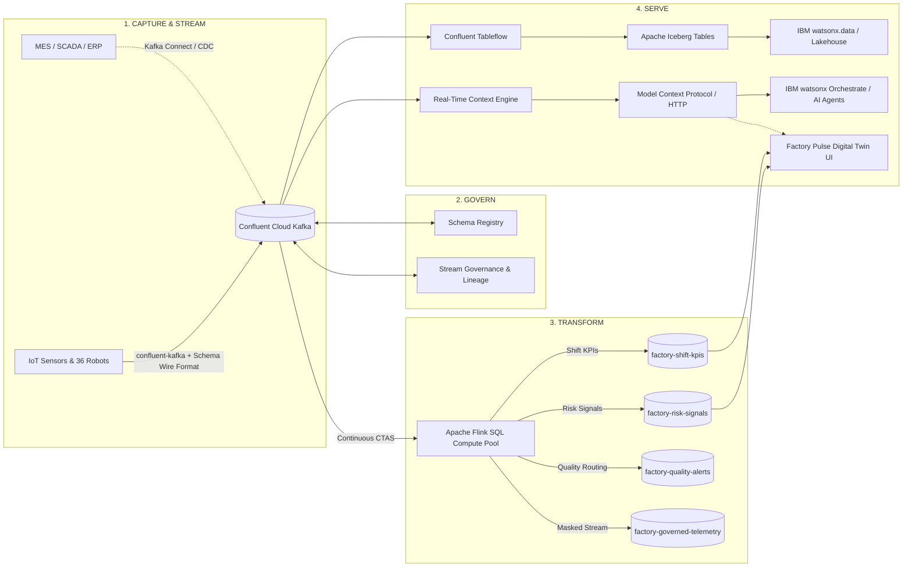

# IBM Streamhouse Capabilities on Confluent Cloud

Factory Pulse is an end-to-end reference application designed specifically to showcase the **IBM Streamhouse** architecture built on **Confluent Cloud**. It demonstrates how modern industrial manufacturing operations transition from siloed batch architectures to a unified, real-time streaming, governance, and intelligence layer.

---

## 1. What is the Streamhouse Architecture?

The **Streamhouse** unifies real-time streaming data pipelines with lakehouse analytical storage and AI context engines. Rather than maintaining separate ETL pipelines for operational dashboards, AI agents, and data lakehouses, Streamhouse establishes a single governed data backbone:

---

## 2. Pillar 1: Stream (Capture & Transport)

### High-Throughput Manufacturing IoT Telemetry
Factory Pulse simulates 6 industrial plants across the United States with 36 robotic workcells operating across diverse manufacturing processes (automotive body welding, EV battery assembly, electronics SMT, appliance assembly, beverage packaging, and aerospace riveting).

### Core Topics & Schema Contracts

| Topic Name | Message Rate | Key Schema | Purpose |
|---|---|---|---|
| `factory-iot-telemetry` | ~12 msgs/min per site (~72/min total) | `{id: string}` | Continuous high-frequency telemetry (vibration, temperature, RPM, power kW, quality score, health, OEE) |
| `factory-asset-state` | Every 3 simulation ticks | `{id: string}` | Compact asset state updates optimized for RTCE state materialization |
| `factory-maintenance-events` | Event-driven on threshold breach | `{id: string}` | Discrete anomaly signals (severity, event type, message, acknowledgment status) |

### Wire-Format Schema Encoding
Rather than schemaless JSON or plain text, the Python backend (`server/kafka.py`) utilizes the official **Confluent Wire Format**:
- Byte 0: Magic Byte (`0x00`)
- Bytes 1–4: 4-byte Big-Endian Schema ID registered in Confluent Schema Registry
- Bytes 5+: Serialized JSON payload matching Draft-07 JSON Schema

---

## 3. Pillar 2: Govern (Schema Registry & Stream Governance)

### Contract-First Architecture
Every topic in Factory Pulse enforces strict schema validation:
- **Keys**: Strongly typed identifier contract (`{ "id": { "type": "string" } }`)
- **Values**: Schema contracts defined in `server/schemas.py` protecting downstream consumers from schema drift or unexpected breaking changes.
- **Compatibility Modes**: Backward and forward compatibility enforced by Confluent Schema Registry.

### Data Governance & Topic Actions
Confluent Cloud Stream Governance allows operators to track end-to-end field lineage and apply governance transformations:
- **Topic Masking**: Masking sensitive batch IDs and identifiers (`flink/05-governed-topic-ctas.sql` creating `factory-governed-telemetry`).
- **Deduplication**: Filtering out duplicate sensor events at the stream layer.
- **Data Portal & Catalog**: Auto-cataloging topics, schemas, tags, and data owners.

---

## 4. Pillar 3: Transform (Apache Flink SQL)

Factory Pulse demonstrates serverless, continuous stream processing using **Confluent Cloud Apache Flink SQL**. Four continuous CTAS (Create Table As Select) jobs run in real time:

### 1. Predictive Risk Detection (`02-risk-ctas.sql`)
Continuously evaluates sensor streams for predictive fault patterns:
- Vibration > 5.2 mm/s $\rightarrow$ `BEARING_RISK`
- Temperature > 72.0°C $\rightarrow$ `THERMAL_RISK`
- Quality Score < 86.0% $\rightarrow$ `QUALITY_RISK`
- Emits structured risk signals to `factory-risk-signals` topic.

### 2. Shift & Minute-Level KPIs (`04-shift-kpis-ctas.sql`)
Aggregates continuous high-frequency streams into 1-minute tumbling windows:
- Computes mean temperature, mean vibration, and mean quality per factory site.
- Computes instantaneous energy consumption in kWh (`SUM(energyKw) / 60.0`).
- Emits aggregated metrics to `factory-shift-kpis` topic.

### 3. Automated Quality Routing (`03-quality-ctas.sql`)
Inspects quality scores and automates batch routing decisions:
- Quality Score < 78.0% $\rightarrow$ `QUARANTINE_BATCH`
- Otherwise $\rightarrow$ `REQUEST_INSPECTION`
- Emits actionable routing instructions to `factory-quality-alerts` topic.

### 4. Governed Telemetry Stream (`05-governed-topic-ctas.sql`)
Produces sanitized downstream streams for external partners and analytics by masking sensitive production batch metadata.

---

## 5. Pillar 4: Serve (Open Lakehouse & Real-Time AI Context)

The Streamhouse architecture serves data simultaneously to operational dashboards, analytical lakehouses, and AI agents without ETL friction.

### Path A: Zero-ETL Open Lakehouse (Confluent Tableflow $\rightarrow$ Apache Iceberg)
- **Tableflow** automatically converts Kafka topics (`factory-iot-telemetry`) directly into **Apache Iceberg** table format in object storage.
- Eliminates brittle batch ETL, Spark jobs, and data pipeline maintenance.
- Iceberg tables are immediately queryable by lakehouse engines including **IBM watsonx.data**, Trino, Presto, DuckDB, and Snowflake.
- Unifies real-time streaming data with historical business intelligence.

### Path B: Real-Time Context Engine (RTCE) & Model Context Protocol (MCP)
- **Confluent RTCE** materializes the latest equipment state from `factory-asset-state` into low-latency memory.
- Exposes equipment state and query tools via **Model Context Protocol (MCP)** over streamable HTTP.
- **AI Agents (IBM watsonx Orchestrate / LangChain / Bob)** dynamically discover available MCP tools (`/api/mcp/tools`) and execute queries (`/api/mcp/call`) without bespoke integration code.
- Enables autonomous agents to answer questions like *"Which robotic arm has elevated vibration in Detroit?"* with real-time ground truth.

### Path C: Closed-Loop Operational Response
- Factory Pulse provides bi-directional control (`/api/control`):
  - **Acknowledge alerts**
  - **Trigger maintenance work orders** (with optional webhook dispatch to IBM Maximo or ServiceNow)
  - **Pause / resume production lines**

---

## 6. Deployment & Demonstration Modes

| Mode | Backend | Kafka Connection | Flink SQL | RTCE & Tableflow |
|---|---|---|---|---|
| **1. UI Local Simulation** | Browser (pure client) | None (Mock) | Browser simulated logic | Simulated Q&A |
| **2. Python Local Server** | Flask (`server/app.py`) | None (Mock SSE) | Browser simulated logic | Rule-based Context Q&A |
| **3. Live Confluent Cloud** | Flask (`STREAM_MODE=kafka`) | Real Confluent Kafka + Schema Registry | Continuous Flink CTAS on Cloud | Live RTCE MCP + Tableflow Iceberg |
| **4. One-Click Terraform** | Automated (`scripts/deploy.py up`) | Fully provisioned Confluent Cloud stack | 4 auto-deployed CTAS jobs | Auto-configured Tableflow & RTCE |

---

## 7. Summary of Capabilities Mapped to Confluent Cloud

| Streamhouse Capability | Confluent Cloud Feature | Factory Pulse Implementation |
|---|---|---|
| **Capture & Ingestion** | Apache Kafka Topics & Connectors | 3 source topics with Python `confluent-kafka` |
| **Contract Enforcement** | Confluent Schema Registry | JSON Schema Draft-07 for keys & values |
| **Stream Processing** | Managed Apache Flink SQL | 4 CTAS statements for risk, KPIs, and quality |
| **Data Governance** | Stream Governance & Flink Topic Actions | Lineage visualization, schema evolution, masked streams |
| **Open Lakehouse Serving**| Confluent Tableflow | Kafka to Apache Iceberg automated conversion |
| **AI Context Serving** | Real-Time Context Engine (RTCE) + MCP | Low-latency state materialization with MCP API proxy |
| **Actionable Operations** | Webhooks & Topic Actions | Incident management and maintenance dispatch |
