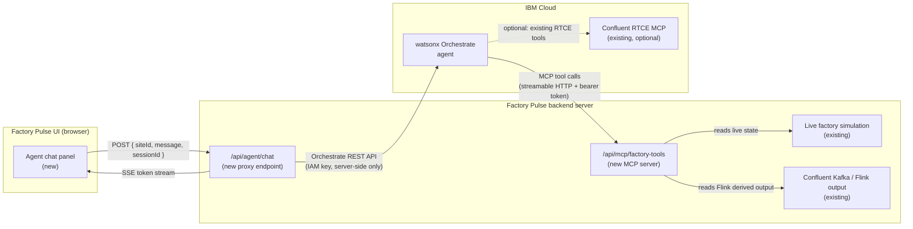

# watsonx Orchestrate Agent — Technical Design Spec

**Project:** Factory Pulse — IBM Confluent Streamhouse  
**Status:** Draft — awaiting developer implementation  
**Version:** 1.1  
**Date:** 2025  

---

## 1. Background & Problem Statement

**Factory Pulse** is a full-stack manufacturing control tower that simulates six US factory sites
(Detroit, Austin, Seattle, Phoenix, Charlotte, Chicago), each running robotic production lines.
Each robot continuously emits IoT telemetry — temperature, vibration, RPM, energy draw, quality
score — and the platform publishes these as governed Kafka events through an IBM Confluent
Streamhouse pipeline.

The application currently has an "AI context" panel where operators can ask natural-language
questions about their factory. Today that panel returns **hard-coded, rule-based answers** — it
does not use a real AI model. The answers are deterministic and the same regardless of actual live
data.

The goal of this integration is to replace those canned responses with a **live watsonx Orchestrate
agent** that:

- Reads **real-time sensor data** from the running simulation before answering.
- Calls structured data tools to fetch specific site status, robot details, maintenance alerts, and
  Flink-derived analytics.
- Returns grounded, dynamic answers that reference actual asset IDs, sensor readings, and
  timestamps from the current moment in the simulation.

---

## 2. Goals & Non-Goals

**Goals:**
- Embed a watsonx Orchestrate agent that operators can chat with directly in the Factory Pulse UI.
- Ground every agent answer in live factory data retrieved at query time via MCP tool calls.
- Expose five typed data tools the agent can discover and call (defined in Section 5).
- Keep a clearly labelled local fallback for demos where Orchestrate is not configured.
- Ensure all credentials remain server-side — nothing sensitive reaches the browser.

**Non-Goals:**
- Replacing the existing Confluent RTCE MCP integration (that remains a parallel concern).
- Connecting the agent to a physical PLC, safety controller, or real production system.
- Multi-turn persistent memory across browser sessions.
- Building new Kafka consumers or Flink SQL jobs specifically for the agent.
- Allowing the agent to trigger control actions (pause line, simulate repair) without a separate
  explicit operator confirmation step.

---

## 3. Architecture Overview

The integration adds three new pieces to the existing application:



**Data flow in plain language:**

1. Operator types a question in the chat panel and selects a factory site.
2. The browser posts the message to `/api/agent/chat` on the backend.
3. The backend forwards it to the watsonx Orchestrate REST API, adding server-side auth.
4. Orchestrate decides which data tools to call. It calls `/api/mcp/factory-tools` via the MCP
   protocol to fetch live sensor data, alerts, and analytics.
5. Orchestrate composes a grounded natural-language answer and streams it back.
6. The backend streams the tokens to the browser as SSE events.
7. The chat panel displays the answer with a clear `SOURCE: WATSONX ORCHESTRATE` label.

---

## 4. New Components Summary

| Component | Type | Purpose |
|---|---|---|
| Agent chat panel | React UI | Chat interface embedded in the "AI context / MCP" tab |
| `/api/agent/chat` | Backend HTTP route | Proxy between browser and Orchestrate; handles streaming and fallback |
| `/api/mcp/factory-tools` | MCP server route | Exposes live factory data as five callable tools |

---

## 5. MCP Data Tools

The agent is registered with one MCP server hosted on the Factory Pulse backend at
`/api/mcp/factory-tools`. All requests to this endpoint must carry a bearer token
(`Authorization: Bearer <FACTORY_MCP_TOKEN>`) — requests without it receive HTTP 401.

The following five tools are the complete initial set.

---

### Tool 1 — `get_site_status`

**Purpose:** Fetch the current live telemetry snapshot for a single factory site. This is the
primary tool for questions about a specific plant's health, OEE, throughput, and robot conditions.

**Input:**

| Parameter | Type | Required | Description |
|---|---|---|---|
| `siteId` | string | Yes | Three-letter factory code: `DET`, `AUS`, `SEA`, `PHX`, `CLT`, or `CHI` |

**Sample tool call:**
```json
{
  "name": "get_site_status",
  "arguments": { "siteId": "DET" }
}
```

**Sample response:**
```json
{
  "id": "DET",
  "name": "Detroit Assembly",
  "city": "Detroit",
  "state": "Michigan",
  "type": "Automotive assembly",
  "lines": 8,
  "oee": 81.4,
  "throughput": 189,
  "status": "warning",
  "scenario": "bearing",
  "robots": [
    {
      "id": "DET-R01",
      "name": "Welding robot",
      "status": "warning",
      "health": 61,
      "rpm": 1420,
      "vibration": 8.7,
      "temperature": 48.2,
      "energyKw": 16.1,
      "quality": 91.3
    },
    {
      "id": "DET-R02",
      "name": "Pick & place",
      "status": "running",
      "health": 98,
      "rpm": 1800,
      "vibration": 1.3,
      "temperature": 36.5,
      "energyKw": 12.0,
      "quality": 99.1
    },
    {
      "id": "DET-R03",
      "name": "Quality scanner",
      "status": "running",
      "health": 97,
      "rpm": 1800,
      "vibration": 1.1,
      "temperature": 35.9,
      "energyKw": 11.8,
      "quality": 99.4
    },
    {
      "id": "DET-R04",
      "name": "Assembly cobot",
      "status": "running",
      "health": 96,
      "rpm": 1795,
      "vibration": 1.4,
      "temperature": 37.1,
      "energyKw": 12.3,
      "quality": 98.8
    },
    {
      "id": "DET-R05",
      "name": "AGV transporter",
      "status": "running",
      "health": 95,
      "rpm": 1790,
      "vibration": 1.2,
      "temperature": 36.8,
      "energyKw": 11.9,
      "quality": 99.0
    },
    {
      "id": "DET-R06",
      "name": "Packaging arm",
      "status": "running",
      "health": 94,
      "rpm": 1788,
      "vibration": 1.3,
      "temperature": 36.6,
      "energyKw": 12.1,
      "quality": 98.9
    }
  ],
  "timestamp": "2025-01-15T14:32:07Z"
}
```

---

### Tool 2 — `get_all_sites_summary`

**Purpose:** Fetch a one-row summary across all six factories simultaneously. Use this for
network-wide questions ("which factory is worst?", "how is the whole network doing?").

**Input:** None required.

**Sample tool call:**
```json
{
  "name": "get_all_sites_summary",
  "arguments": {}
}
```

**Sample response:**
```json
{
  "sites": [
    { "id": "DET", "city": "Detroit",   "oee": 81.4, "scenario": "bearing",  "warnings": 1, "throughput": 189 },
    { "id": "AUS", "city": "Austin",    "oee": 94.4, "scenario": "baseline", "warnings": 0, "throughput": 214 },
    { "id": "SEA", "city": "Seattle",   "oee": 93.6, "scenario": "baseline", "warnings": 0, "throughput": 207 },
    { "id": "PHX", "city": "Phoenix",   "oee": 92.8, "scenario": "baseline", "warnings": 0, "throughput": 203 },
    { "id": "CLT", "city": "Charlotte", "oee": 92.0, "scenario": "baseline", "warnings": 0, "throughput": 198 },
    { "id": "CHI", "city": "Chicago",   "oee": 91.2, "scenario": "baseline", "warnings": 0, "throughput": 192 }
  ],
  "totalThroughput": 1203,
  "sitesWithWarnings": 1,
  "networkOee": 90.9,
  "timestamp": "2025-01-15T14:32:07Z"
}
```

---

### Tool 3 — `get_maintenance_alerts`

**Purpose:** Fetch unacknowledged maintenance events. Use for questions about what needs attention,
what alarms are open, or whether a specific site has active incidents.

**Input:**

| Parameter | Type | Required | Description |
|---|---|---|---|
| `siteId` | string | No | Three-letter factory code. Omit to return alerts across all sites. |
| `limit` | integer | No | Maximum number of alerts to return. Default: 10. |

**Sample tool call:**
```json
{
  "name": "get_maintenance_alerts",
  "arguments": { "siteId": "DET", "limit": 5 }
}
```

**Sample response:**
```json
{
  "alerts": [
    {
      "eventId": "DET-EVT-042",
      "siteId": "DET",
      "assetId": "DET-R01",
      "eventType": "bearing_alarm",
      "severity": "high",
      "message": "Vibration exceeded 8.5 mm/s threshold on welding robot DET-R01. Condition-based maintenance recommended before next shift.",
      "timestamp": "2025-01-15T14:30:11Z",
      "acknowledged": false
    }
  ],
  "total": 1
}
```

**Sample response when no alerts are present:**
```json
{
  "alerts": [],
  "total": 0
}
```

---

### Tool 4 — `get_robot_detail`

**Purpose:** Fetch the full sensor reading and health score for a single named robot asset.
Use this when the operator or agent already knows an asset ID (e.g. `DET-R01`) and wants a
deep reading of that specific machine.

**Input:**

| Parameter | Type | Required | Description |
|---|---|---|---|
| `assetId` | string | Yes | Asset identifier in the format `{SITE}-R{NN}`, e.g. `DET-R01`, `AUS-R03` |

**Sample tool call:**
```json
{
  "name": "get_robot_detail",
  "arguments": { "assetId": "DET-R01" }
}
```

**Sample response:**
```json
{
  "id": "DET-R01",
  "siteId": "DET",
  "siteName": "Detroit Assembly",
  "name": "Welding robot",
  "status": "warning",
  "health": 61,
  "rpm": 1420,
  "vibration": 8.7,
  "temperature": 48.2,
  "energyKw": 16.1,
  "quality": 91.3,
  "scenario": "bearing",
  "timestamp": "2025-01-15T14:32:07Z"
}
```

---

### Tool 5 — `get_flink_derived`

**Purpose:** Fetch the most recent output from Flink streaming analytics for a site — this includes
risk classification signals, one-minute shift KPI windows, and quality alert decisions computed by
the Confluent Flink SQL pipeline. Only available when the application is connected to Confluent
Cloud with derived topic consumption enabled.

**Input:**

| Parameter | Type | Required | Description |
|---|---|---|---|
| `siteId` | string | Yes | Three-letter factory code |

**Sample tool call:**
```json
{
  "name": "get_flink_derived",
  "arguments": { "siteId": "DET" }
}
```

**Sample response when Flink data is available:**
```json
{
  "available": true,
  "siteId": "DET",
  "riskSignal": {
    "level": "HIGH",
    "asset": "DET-R01",
    "reason": "Vibration threshold breach — bearing wear pattern detected",
    "windowEnd": "2025-01-15T14:32:00Z"
  },
  "shiftKpi": {
    "windowStart": "2025-01-15T14:31:00Z",
    "windowEnd":   "2025-01-15T14:32:00Z",
    "throughput": 189,
    "oee": 81.4,
    "rejectRate": 0.087
  },
  "qualityAlert": {
    "triggered": false
  }
}
```

**Sample response when Flink is not connected:**
```json
{
  "available": false,
  "reason": "Confluent Cloud derived topic consumption is not enabled. Connect to Confluent Cloud and set KAFKA_CONSUME_DERIVED=true to activate this data source."
}
```

---

## 6. API Contract

### `POST /api/agent/chat`

The browser sends operator messages to this single endpoint. The backend handles all Orchestrate
communication server-side.

**Request:**
```json
{
  "siteId": "DET",
  "message": "Which robot needs maintenance right now?",
  "sessionId": "b3f1c2d4-e5a6-7890-abcd-ef1234567890"
}
```

| Field | Type | Required | Description |
|---|---|---|---|
| `siteId` | string | Yes | Active factory site (three-letter code) |
| `message` | string | Yes | Operator's natural-language question |
| `sessionId` | string | Yes | Client-generated UUID used for correlation only |

**Response — streaming (preferred):** `Content-Type: text/event-stream`

The response is a Server-Sent Events stream with two event types:

```
event: token
data: {"text": "Based on current telemetry at Detroit Assembly,"}

event: token
data: {"text": " robot DET-R01 (Welding robot) is showing 8.7 mm/s"}

event: token
data: {"text": " vibration — well above the 3.0 mm/s safe threshold."}

event: done
data: {"source": "WATSONX ORCHESTRATE", "sessionId": "b3f1c2d4-...", "toolsUsed": ["get_site_status", "get_maintenance_alerts"]}
```

**Response — non-streaming fallback:** `Content-Type: application/json`

Returned when Orchestrate is not configured. The UI must display the `source` field as a visible
badge so the operator knows they are reading a local rule, not an AI answer.

```json
{
  "source": "LOCAL DEMO RULES — NOT WATSONX ORCHESTRATE",
  "title": "Maintenance risk assessment",
  "risk": "Elevated",
  "answer": "Detroit Assembly has 1 asset above normal thresholds. DET-R01 currently reads 8.7 mm/s vibration and 48.2°C. A condition-based inspection is recommended before the next shift.",
  "evidence": ["Scenario: bearing", "Active assets: 5/6", "Plant OEE: 81.4%"],
  "suggestion": "Inspect affected equipment and schedule maintenance if confirmed."
}
```

---

## 7. Sample Q&A Exchanges

The following examples show how the agent should behave for common operator questions. These can
be used as acceptance criteria during testing.

---

### Q1 — Maintenance question (fault scenario active)

> **Operator:** Which robot needs maintenance right now?

**Tools called by agent:** `get_site_status("DET")`, `get_maintenance_alerts(siteId="DET")`

**Expected agent answer:**
> At Detroit Assembly, robot **DET-R01 (Welding robot)** needs immediate attention. It is currently
> reading **8.7 mm/s vibration** — the normal operating threshold is 3.0 mm/s — and its
> temperature has risen to **48.2°C** with a health score of **61/100**. A bearing wear scenario is
> active. There is one open unacknowledged maintenance alert (DET-EVT-042, severity: high) logged
> at 14:30 UTC. A condition-based inspection is recommended before the next production shift.

---

### Q2 — Maintenance question (no fault active)

> **Operator:** Do any robots need maintenance?

**Tools called by agent:** `get_site_status("DET")`, `get_maintenance_alerts(siteId="DET")`

**Expected agent answer:**
> No maintenance is currently required at Detroit Assembly. All six robots are running within
> normal sensor thresholds — the highest vibration reading is **1.4 mm/s** (DET-R04, Assembly
> cobot), well below the 3.0 mm/s alarm threshold. There are **no open maintenance alerts**.
> Plant OEE is **94.2%** and throughput is **210 units/min**.

---

### Q3 — Quality question

> **Operator:** What is the current quality risk?

**Tools called by agent:** `get_site_status("DET")`, optionally `get_flink_derived("DET")`

**Expected agent answer (quality drift scenario active):**
> Quality risk at Detroit Assembly is **elevated**. A quality drift scenario is currently active.
> The average inspection pass rate across the six robots has dropped to **87.4%**, with
> DET-R03 (Quality scanner) returning the lowest individual score at **84.1%**. Robot DET-R01
> (Welding robot) is also below the 86% acceptance threshold at **85.2%**. Throughput is
> maintained at 201 units/min but the reject rate has risen. Recommendation: review vision
> calibration and quarantine suspect lots from the current batch.

**Expected agent answer (baseline):**
> Quality at Detroit Assembly is within normal bounds. The average inspection pass rate is
> **98.9%** across all six robots. No quality drift is active. OEE is 94.2%. No action required.

---

### Q4 — Energy / consumption question

> **Operator:** Summarize energy consumption at Detroit right now.

**Tools called by agent:** `get_site_status("DET")`

**Expected agent answer:**
> Detroit Assembly is currently drawing an estimated **75.3 kW** across its six robotic assets.
> The highest individual consumer is DET-R01 (Welding robot) at **16.1 kW**, which is elevated
> due to the active bearing wear scenario causing the motor to work harder. Under normal baseline
> conditions, the plant typically runs at approximately **72 kW** total. With 8 active production
> lines at 189 units/min throughput, the current energy-per-unit ratio is higher than baseline.

---

### Q5 — Network-wide question

> **Operator:** Give me a live operations briefing across all factories.

**Tools called by agent:** `get_all_sites_summary()`

**Expected agent answer:**
> Here is the current status across the Factory Pulse network:
>
> - **Detroit (DET):** ⚠ Warning — OEE 81.4%, bearing fault active on DET-R01, 189 units/min
> - **Austin (AUS):** ✓ Healthy — OEE 94.4%, baseline operations, 214 units/min
> - **Seattle (SEA):** ✓ Healthy — OEE 93.6%, baseline operations, 207 units/min
> - **Phoenix (PHX):** ✓ Healthy — OEE 92.8%, baseline operations, 203 units/min
> - **Charlotte (CLT):** ✓ Healthy — OEE 92.0%, baseline operations, 198 units/min
> - **Chicago (CHI):** ✓ Healthy — OEE 91.2%, baseline operations, 192 units/min
>
> **Network total:** 1,203 units/min across 6 sites. **1 site** requires attention.
> Detroit is the only plant outside normal operating thresholds. All other sites are on baseline.

---

### Q6 — Flink analytics question (Confluent connected)

> **Operator:** What does the Flink risk signal say about Detroit?

**Tools called by agent:** `get_flink_derived("DET")`

**Expected agent answer (Flink connected):**
> The latest Flink risk classification for Detroit Assembly (computed at 14:32 UTC) is **HIGH**.
> The signal was triggered by asset **DET-R01** — the continuous vibration threshold breach on
> the welding robot matches a bearing wear pattern in the streaming SQL rules. The one-minute
> shift KPI window ending at 14:32 shows OEE at **81.4%**, throughput **189 units/min**, and a
> reject rate of **8.7%**. No quality alert has been triggered yet.

**Expected agent answer (Flink not connected):**
> Flink-derived analytics are not currently available for Detroit Assembly. The application is
> running in simulation mode without a Confluent Cloud connection. To enable real-time Flink risk
> signals and shift KPIs, connect to Confluent Cloud and enable derived topic consumption.

---

### Q7 — Deep dive on a specific robot

> **Operator:** Tell me everything about robot DET-R01.

**Tools called by agent:** `get_robot_detail("DET-R01")`

**Expected agent answer:**
> **DET-R01 — Welding robot** at Detroit Assembly is currently in **Warning** status.
>
> | Metric | Value | Normal range |
> |---|---|---|
> | Health score | 61 / 100 | ≥ 85 |
> | Vibration | 8.7 mm/s | < 3.0 mm/s |
> | Temperature | 48.2°C | < 42°C |
> | RPM | 1,420 | ~1,800 |
> | Energy draw | 16.1 kW | ~12 kW |
> | Quality pass rate | 91.3% | > 95% |
>
> All four monitored parameters are outside normal bounds. The bearing wear scenario is active,
> which explains the elevated vibration, reduced RPM (motor struggling), higher temperature, and
> increased energy draw. This robot should be prioritised for inspection before the next shift.

---

## 8. Kafka Telemetry Events

The agent's data tools are backed by the same event stream that populates Kafka. Below are
representative samples of the underlying events for context.

### IoT telemetry event — normal (topic: `factory-iot-telemetry`)
```json
{
  "eventId": "evt-DET-AUS-1736953920-0",
  "timestamp": "2025-01-15T14:32:00Z",
  "siteId": "DET",
  "siteName": "Detroit Assembly",
  "assetId": "DET-R02",
  "assetType": "Pick & place",
  "lineId": "LINE-3",
  "scenario": "baseline",
  "temperature": 36.5,
  "vibration": 1.3,
  "rpm": 1800,
  "energyKw": 12.0,
  "qualityScore": 99.1,
  "health": 98,
  "status": "running",
  "batchId": "BATCH-20250115-143"
}
```

### IoT telemetry event — bearing fault (topic: `factory-iot-telemetry`)
```json
{
  "eventId": "evt-DET-R01-1736953927-0",
  "timestamp": "2025-01-15T14:32:07Z",
  "siteId": "DET",
  "siteName": "Detroit Assembly",
  "assetId": "DET-R01",
  "assetType": "Welding robot",
  "lineId": "LINE-1",
  "scenario": "bearing",
  "temperature": 48.2,
  "vibration": 8.7,
  "rpm": 1420,
  "energyKw": 16.1,
  "qualityScore": 91.3,
  "health": 61,
  "status": "warning",
  "batchId": "BATCH-20250115-143"
}
```

### Maintenance event (topic: `factory-maintenance-events`)
```json
{
  "eventId": "DET-EVT-042",
  "timestamp": "2025-01-15T14:30:11Z",
  "siteId": "DET",
  "assetId": "DET-R01",
  "eventType": "bearing_alarm",
  "severity": "high",
  "message": "Vibration exceeded 8.5 mm/s threshold on welding robot DET-R01. Condition-based maintenance recommended before next shift.",
  "acknowledged": false
}
```

### Asset state event (topic: `factory-asset-state`)
```json
{
  "assetId": "DET-R01",
  "siteId": "DET",
  "timestamp": "2025-01-15T14:32:07Z",
  "status": "warning",
  "health": 61,
  "temperature": 48.2,
  "vibration": 8.7,
  "qualityScore": 91.3,
  "scenario": "bearing"
}
```

### Flink risk signal (topic: `factory-risk-signals`)
```json
{
  "siteId": "DET",
  "assetId": "DET-R01",
  "riskLevel": "HIGH",
  "reason": "Vibration threshold breach — bearing wear pattern detected",
  "windowEnd": "2025-01-15T14:32:00Z"
}
```

### Flink shift KPI (topic: `factory-shift-kpis`)
```json
{
  "siteId": "DET",
  "windowStart": "2025-01-15T14:31:00Z",
  "windowEnd": "2025-01-15T14:32:00Z",
  "throughput": 189,
  "oee": 81.4,
  "rejectRate": 0.087
}
```

---

## 9. Factory Sites Reference

| Code | Name | City, State | Industry |
|---|---|---|---|
| `DET` | Detroit Assembly | Detroit, Michigan | Automotive assembly |
| `AUS` | Austin Gigafactory | Austin, Texas | Battery / robotics |
| `SEA` | Seattle Precision | Seattle, Washington | Precision components |
| `PHX` | Phoenix Semicon | Phoenix, Arizona | Electronics |
| `CLT` | Charlotte Manufacturing | Charlotte, North Carolina | Industrial machinery |
| `CHI` | Chicago Distribution | Chicago, Illinois | Packaging / fulfillment |

Each site runs **6 robots** with the following roles:

| Position | Robot type |
|---|---|
| R01 | Welding robot |
| R02 | Pick & place |
| R03 | Quality scanner |
| R04 | Assembly cobot |
| R05 | AGV transporter |
| R06 | Packaging arm |

Asset IDs follow the format `{SITE}-R{NN}` — for example `DET-R01`, `AUS-R04`, `CHI-R06`.

Active fault scenarios the agent may encounter:

| Scenario ID | Name | Effect on telemetry |
|---|---|---|
| `baseline` | Healthy operations | All sensors within normal ranges |
| `bearing` | Bearing wear | Vibration spikes, RPM drops, temperature rises, energy increases |
| `thermal` | Thermal excursion | Temperature and energy spike across the line |
| `quality` | Quality drift | Inspection pass rate drops, reject rate rises |
| `surge` | Demand surge | Throughput and load increase across all assets |

---

## 10. Configuration

The following environment variables must be set on the backend server. They must **never** be
sent to the browser or appear in any API response.

| Variable | Required | Description |
|---|---|---|
| `WATSONX_ORCHESTRATE_URL` | Yes | REST endpoint for the Orchestrate deployment |
| `WATSONX_ORCHESTRATE_API_KEY` | Yes | IBM Cloud IAM API key |
| `WATSONX_ORCHESTRATE_AGENT_ID` | Yes | The specific agent to route messages to |
| `WATSONX_ORCHESTRATE_SPACE_ID` | Optional | Deployment space ID if required by the deployment type |
| `FACTORY_MCP_TOKEN` | Yes | Shared secret that Orchestrate uses to authenticate MCP tool calls |

When `WATSONX_ORCHESTRATE_URL` is absent, the backend falls back to local rule-based answers and
the UI displays a `SOURCE: LOCAL DEMO RULES` badge.

---

## 11. Security Requirements

- **SR-1:** `WATSONX_ORCHESTRATE_API_KEY` and `FACTORY_MCP_TOKEN` must remain server-side only.
  They must not appear in any HTTP response body, header, log line, or browser network request.
- **SR-2:** The MCP tool endpoint (`/api/mcp/factory-tools`) must reject requests without a valid
  `Authorization: Bearer <FACTORY_MCP_TOKEN>` header with HTTP 401.
- **SR-3:** All MCP tool arguments received from Orchestrate must be validated against the tool's
  input schema before execution. Requests with unknown or out-of-range fields must be rejected.
- **SR-4:** The agent may only **read** factory state. Control actions (inject scenario, pause
  line, trigger maintenance) must not be exposed as MCP tools without a separate operator
  confirmation gate in the UI.
- **SR-5:** Apply a rate limit of 30 requests per minute per `sessionId` on `/api/agent/chat`
  to prevent abuse.
- **SR-6:** The `sessionId` field is an opaque correlation ID only. The backend must not use it
  to cross-reference or expose another session's data.

---

## 12. Error Handling

| Failure mode | Expected behaviour |
|---|---|
| `WATSONX_ORCHESTRATE_URL` not configured | Fall back to local rule-based answer; return `source: "LOCAL DEMO RULES"` in response |
| Orchestrate returns HTTP 4xx | Return `{ "error": "Agent unavailable", "fallback": true }` plus a rule-based answer |
| Orchestrate tool call exceeds 10 s | Abort; return partial answer with `"timedOut": true` and `"toolsUsed": []` |
| MCP tool called with invalid `siteId` | Return `{ "error": "Unknown siteId", "valid": ["DET","AUS","SEA","PHX","CLT","CHI"] }` |
| `get_flink_derived` called but Kafka not connected | Return `{ "available": false, "reason": "..." }` — do not return HTTP error |
| Operator submits empty message | Reject client-side before the POST is sent |

---

## 13. Testing Checklist

### Functional
- [ ] Agent answers question 1–7 from Section 7 with values matching current live simulation state.
- [ ] All six site codes (`DET`, `AUS`, `SEA`, `PHX`, `CLT`, `CHI`) work as `siteId` inputs.
- [ ] Answers change when a different fault scenario is active (bearing vs thermal vs quality).
- [ ] `get_flink_derived` returns `available: false` in simulation mode; real data when connected.

### Fallback
- [ ] With `WATSONX_ORCHESTRATE_URL` unset, all questions return local rule-based answers.
- [ ] `SOURCE: LOCAL DEMO RULES` badge is visibly displayed in the UI for fallback answers.
- [ ] Fallback is stable — no crashes, no empty responses.

### Security
- [ ] Requests to `/api/mcp/factory-tools` without the bearer token return HTTP 401.
- [ ] `WATSONX_ORCHESTRATE_API_KEY` does not appear in any browser network response.
- [ ] A tool call with an invalid `siteId` (e.g. `"XXX"`) returns a clear error, not a server crash.

---

## 14. Open Questions

| # | Question | Owner | Status |
|---|---|---|---|
| 1 | Which Orchestrate deployment type will be used — embedded assistant in a space, or standalone agent REST API? The base URL format and auth flow differ between these. | Developer | **TBD** |
| 2 | Should the agent be able to trigger maintenance actions (pause line, schedule repair) with an explicit operator confirmation step? Currently listed as out of scope. | Product | **TBD** |
| 3 | Is the Confluent RTCE MCP endpoint available in the demo environment? If yes, Orchestrate can be registered with both MCP servers simultaneously, giving the agent access to governed stream data in addition to the live simulation. | Demo team | **TBD** |
| 4 | Does the Orchestrate REST API support SSE token streaming, or should the backend buffer the full response before returning it? Affects perceived latency in the UI. | Developer | **TBD** |
| 5 | Should conversation history be maintained server-side across multiple turns, or does Orchestrate's built-in session management handle context? | Developer | **TBD** |
| 6 | What latency is acceptable for an agent response? Local rule answers return in < 50 ms; Orchestrate round-trips with tool calls are expected to take 1–5 seconds. The UI should show a loading indicator for the full duration. | UX | **TBD** |

---

## 15. Recommended Next Steps

1. **Answer open questions 1 and 4** — the Orchestrate deployment type and streaming support
   determine the API call shape in the proxy endpoint.
2. Implement the MCP server with the five tools in Section 5 and verify each tool returns
   correctly shaped JSON against the sample responses above.
3. Implement the proxy endpoint (`/api/agent/chat`) with streaming support and the local fallback.
4. Build the agent chat UI panel; wire it into the existing "AI context / MCP" tab.
5. Add the five configuration variables from Section 10 to the environment configuration file with
   placeholder values and comments.
6. Walk through all seven sample Q&A scenarios in Section 7 with a live Orchestrate connection
   and confirm answers are grounded in real telemetry values.
