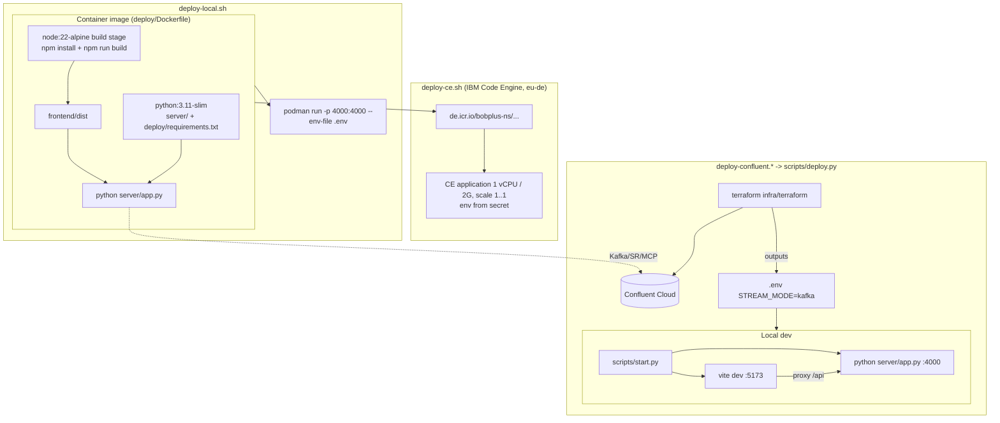
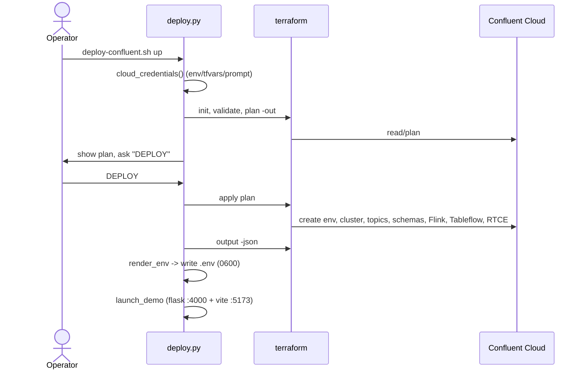
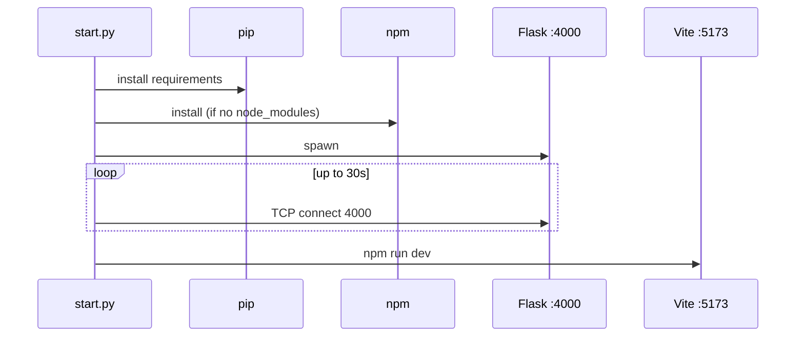
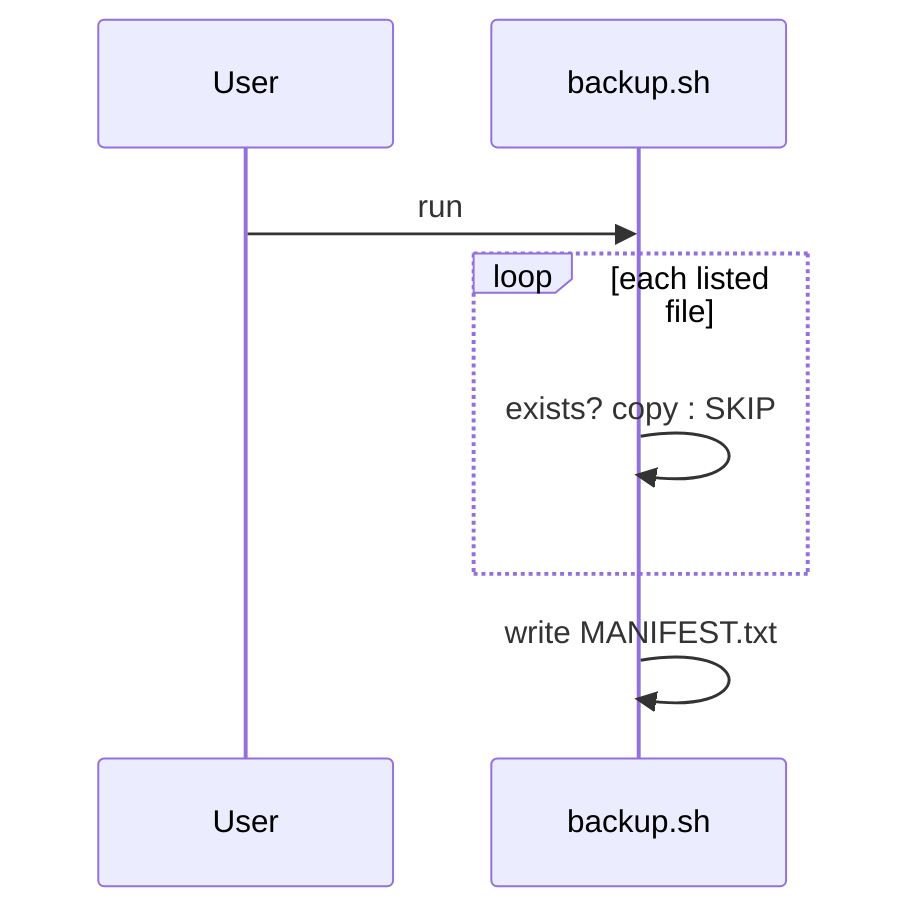

# Deployment & Operations — Technical Design Spec

## 1. Problem Statement

Factory Pulse runs in several modes: a Vite dev server plus Flask backend on a laptop, a single container, IBM Cloud Code Engine, and Confluent Cloud provisioned by Terraform. Each needs a repeatable, secrets-safe path from a clean checkout to a running system. This spec covers the scripts, container image and test tooling that provide those paths.

## 2. Goals & Non-Goals

**Goals**
- One command per target: local dev (`scripts/start.*`), local container (`deploy/deploy-local.*`), Confluent Cloud + UI (`deploy/deploy-confluent.*` → `scripts/deploy.py`), Code Engine (`deploy/deploy-ce.sh`).
- A single multi-stage image that serves the compiled SPA and the Flask API on one port.
- Secrets stay out of git, logs and the browser. Only `VITE_*` values (public by design) are baked into the bundle.
- Default `STREAM_MODE=mock` so the app works with zero cloud credentials.
- Timestamped source backups.

**Non-Goals**
- CI/CD pipelines (none exist in the repo).
- Multi-worker or HA deployment. The simulation and SSE hub are in-process, so run exactly one instance (`MIN_SCALE=MAX_SCALE=1`).
- Remote Terraform state, secret managers, or TLS termination inside the container.

## 3. Architecture Overview



## 4. Component Design

### 4.1 `deploy/Dockerfile`
Multi-stage.
- **Stage `build`** (`node:22-alpine`): `WORKDIR /app/frontend`; copy `package.json` and `package-lock.json`; `npm install --no-audit --no-fund`; copy `frontend/`; copy `flink/` to `/app/flink/` (because `frontend/src/sql.js` imports `../flink/*.sql`, aliased in `vite.config.js`); `ARG`/`ENV` `VITE_GOOGLE_MAPS_API_KEY` and `VITE_GOOGLE_MAPS_MAP_ID` (default empty); `npm run build`.
- **Stage runtime** (`python:3.11-slim`): `WORKDIR /app`; `ENV PORT=8080 STREAM_MODE=mock PYTHONUNBUFFERED=1`; install `deploy/requirements.txt`; copy `server/` and `/app/frontend/dist` → `./frontend/dist`; `EXPOSE 8080`; `HEALTHCHECK` every 30s, timeout 5s, which runs a Python one-liner that GETs `http://localhost:8080/api/health` and expects 200; `CMD ["python","server/app.py"]`.
- The HEALTHCHECK hard-codes 8080. `deploy-local.sh` overrides `PORT=4000`, so the check fails there (see §10).

### 4.2 `deploy/requirements.txt`
`Flask>=3.0,<4.0`, `flask-cors>=4.0,<5.0`, `python-dotenv>=1.0,<2.0`, `confluent-kafka[schemaregistry,json]>=2.4,<3.0`, `mcp>=1.8,<2.0`, `anyio>=3.7`.

### 4.3 `deploy/deploy-local.sh` / `.cmd`
Usage: `deploy-local.sh [up|down|logs]` (default `up`). Env overrides: `IMAGE=factory-pulse`, `NAME=factory-pulse`, `HOST_PORT=4000`, `CONTAINER_ENGINE=podman`.
`up` steps:
1. Fail if the engine is missing or `.env` is absent.
2. Read `VITE_GOOGLE_MAPS_API_KEY` and `VITE_GOOGLE_MAPS_MAP_ID` from `.env` with `env_value()` (sed-based, CRLF-safe, strips quotes, never `source`s the file).
3. `build -t $IMAGE -f deploy/Dockerfile --build-arg ... .`
4. `rm -f $NAME` (ignore errors).
5. `run -d --name $NAME -p $HOST_PORT:4000 --env-file .env -e PORT=4000 $IMAGE`.

`down` runs `rm -f`; `logs` runs `logs -f`. `.cmd` is the Windows equivalent.

### 4.4 `deploy/deploy-confluent.sh` / `.cmd`
Thin wrapper: `cd` to the repo root and `exec python3 scripts/deploy.py up "$@"`.

### 4.5 `scripts/deploy.py` (stdlib only; needs `terraform`, and `npm` to launch the UI)
CLI: `deploy.py [up|plan|retry|status|destroy|run]` (default `up`). Flags: `--name` (default `factory-pulse-demo`), `--region` (default `us-east-2`), `--max-cfu {5,10,20,30,40,50}` (default 5), `--no-flink`, `--no-tableflow`, `--no-rtce`, `--yes`, `--no-launch`.

Key functions:
| Function | Behaviour |
|---|---|
| `cloud_credentials(env)` | Cloud API key and secret from shell `CONFLUENT_CLOUD_API_KEY`/`_SECRET`, else `terraform.tfvars` (`confluent_cloud_api_key/secret`), else interactive prompt (`getpass` for the secret). Sets them in the subprocess env only. |
| `terraform_vars(args, env)` | Sets `TF_VAR_deployment_name`, `region`, `enable_flink`, `enable_tableflow`, `enable_rtce`, `flink_max_cfu` only when the variable is not already in `terraform.tfvars`. Sets `TF_IN_AUTOMATION=1`, `TF_INPUT=0`. |
| `tf_varfile_args()` | `-var-file <tfvars>` if the file exists. |
| `run(cmd, env, cwd, capture)` | `subprocess.run(check=True)`; never prints env or outputs. |
| `render_env(outputs, previous)` | Builds the new `.env` (see §5.2). Raises `RuntimeError` if Kafka bootstrap, Kafka secret or SR secret is missing. |
| `write_private_env(text)` | Writes a temp file in the repo root, `chmod 600` on POSIX, then `os.replace` to `.env`. |
| `import_orphaned_topics()` | Reads `terraform.tfstate`; for each of `factory-iot-telemetry`, `factory-asset-state`, `factory-maintenance-events` not in state as `confluent_kafka_topic.source["<topic>"]`, runs `terraform import` with id `<cluster_id>/<topic>`, using the `admin_kafka` key from state via `IMPORT_KAFKA_*` env vars. Failures are tolerated (topic will be created). |
| `verify_state_permissions()` | POSIX only: `chmod 600` on `*.tfstate*`. |
| `print_status(outputs)` | Prints IDs only (environment, cluster, region, bootstrap, Flink pool, statement names, Tableflow/RTCE flags, MCP endpoint). Never secrets. |
| `launch_demo()` | `npm install` if `frontend/node_modules` is missing; start `python server/app.py` and `npm run dev`; wait on the backend; terminate both on exit. |

Action flows:
- `up`: `init` → `validate` → `plan -out .factory-pulse.tfplan` → show billing caution → require typing `DEPLOY` (unless `--yes`) → `apply plan` → `verify_state_permissions` → `output -json` → write `.env` → `print_status` → `launch_demo` (unless `--no-launch`). The plan file is deleted in a `finally`.
- `plan`: `init`, `validate`, `plan` only.
- `retry`: `init` → `import_orphaned_topics` → `apply -auto-approve` → write `.env` → launch.
- `status`: `terraform output -json` → `print_status`.
- `destroy`: require typing `DESTROY` (unless `--yes`) → `init` → `destroy -auto-approve`. Local `.env` and state are left in place.
- `run`: `launch_demo()` only.
- Exit codes: 0 success; 1 user cancelled; 2 error (RuntimeError, CalledProcessError, OSError, ValueError).

### 4.6 `deploy/deploy-ce.sh` (IBM Cloud Code Engine)
Env-overridable defaults: `CE_APP_NAME=streamhouse-factory-pulse`, `SECRET_NAME=streamhouse-secrets`, `ICR_IMAGE=de.icr.io/bobplus-ns/streamhouse-factory-pulse`, `MIN_SCALE=1`, `MAX_SCALE=1`, `RESOURCE_GROUP=building-blocks-rg`, `CE_PROJECT=streamhouse`, `REGION=eu-de`, `APP_PORT=8080`, `ICR_SECRET_NAME=icr-secret`, `CONTAINER_ENGINE=podman`, `IMAGE_TAG=<yyyymmddHHMMSS>`.
Steps in order:
1. `set -euo pipefail`; resolve the repo root; require `.env`; strip any UTF-8 BOM; `source` it with `set -a`.
2. Require `KAFKA_BOOTSTRAP_SERVERS`, `KAFKA_API_KEY`, `KAFKA_API_SECRET` and an IBM Cloud key (`API_KEY` or `IBM_CLOUD_API_KEY`).
3. `ibmcloud login --apikey ... -r $REGION -g $RESOURCE_GROUP -q`.
4. Select the CE project, or create it and poll up to 18 × 10s for `active`.
5. Install the `container-registry` plugin, `cr region-set`, and add the ICR namespace if missing.
6. Create the CE registry secret (`iamapikey` / API key) if missing.
7. Build a filtered env file: strip CR, keep only `KEY=value` lines with non-empty values, drop `PORT` (reserved by Code Engine) and `API_KEY` (deploy credential). Delete and recreate the CE secret `--from-env-file`.
8. Build for `linux/amd64`, tagged `:$IMAGE_TAG` and `:latest`, with the `VITE_*` build args. Log in to ICR and push both tags.
9. `application create` or `update` with `--image $IMAGE_REF --registry-secret --port 8080 --min-scale --max-scale --cpu 1 --memory 2G --env-from-secret $SECRET_NAME`. The unique tag forces a new revision.
10. `application get` to print the result.

### 4.7 Dev launchers
- `scripts/start.py [--reinstall]`: find a `requirements.txt` (`server/`, root, `deploy/`, in that order) and `pip install -r` it; `npm install` in `frontend/` unless `node_modules` exists or `--reinstall`; start `python server/app.py` from the repo root; poll `127.0.0.1:4000` for up to 30s (0.5s interval); then start `npm run dev` (Vite on 5173). Ctrl+C terminates both. Exits with an error if npm is missing or the backend never comes up.
- `scripts/start.sh` and `start.cmd`: wrappers for `start.py`.

### 4.8 Backups
`scripts/backup.sh` and `scripts/backup.ps1` copy a fixed list of source files (server, frontend sources, docs, deploy, scripts, tests, root config) to `backups/backup_<yyyymmdd_HHMMSS>/` preserving relative paths, print OK or SKIP per file, and write `MANIFEST.txt`. `backup.ps1` hard-codes `C:\Build_Lab\01-Streamhouse-bob\factory-pulse-streamhouse` as the workspace root.

### 4.9 Docker ignore
`.dockerignore` (root) and `deploy/.dockerignore` limit the build context. Re-create them excluding at least `.git`, `node_modules`, `backups`, `infra/terraform/.terraform`, `*.tfstate*`, `.env` and `__pycache__`.

## 5. Data Models

### 5.1 Environment variables (from `.env.example` plus Dockerfile)
| Variable | Default / example | Purpose |
|---|---|---|
| `PORT` | 4000 local, 8080 in image | Flask listen port. Reserved by Code Engine. |
| `SIM_INTERVAL_MS` | 1700 | Simulation tick. |
| `STREAM_MODE` | `mock` (image default) | `mock` or `kafka`. |
| `KAFKA_BOOTSTRAP_SERVERS` | `pkc-xxxxx...:9092` | Broker address with no scheme. |
| `KAFKA_API_KEY` / `KAFKA_API_SECRET` | empty | SASL/PLAIN credentials. |
| `SCHEMA_REGISTRY_URL` / `_API_KEY` / `_API_SECRET` | empty | Schema Registry. |
| `KAFKA_AUTO_CREATE_TOPICS` | false | Let the app create topics. |
| `KAFKA_CONSUME_DERIVED` | false | Consume the Flink output topics. |
| `KAFKA_RISK_TOPIC` / `KAFKA_KPI_TOPIC` | `factory-risk-signals` / `factory-shift-kpis` | Derived topics. |
| `ACTION_WEBHOOK_URL` / `_TOKEN` | empty | Optional maintenance ticket webhook. |
| `RTCE_MCP_ENDPOINT` / `RTCE_MCP_BASIC_TOKEN` | empty | Confluent RTCE MCP (HTTPS only, base64 `key:secret`). |
| `VITE_GOOGLE_MAPS_API_KEY` / `VITE_GOOGLE_MAPS_MAP_ID` | empty | Public build-time values for the map. |
| `API_KEY` / `IBM_CLOUD_API_KEY` | none | IBM Cloud deploy credential (not passed to the app). |
| `CONFLUENT_CLOUD_API_KEY` / `_SECRET` | none | Terraform admin credential. Never written to `.env`. |

The backend README lists further variables (e.g. `KAFKA_CONSUME_SOURCE`). The full set is in `specs/design/backend-server.design.md`.

### 5.2 Generated `.env` (from `render_env`)
First line `# AUTOGENERATED by scripts/deploy.py. DO NOT COMMIT.` Previously existing `NAME=value` lines (names matching `[A-Z][A-Z0-9_]*`) are preserved, then overwritten with:
`STREAM_MODE=kafka`; `KAFKA_BOOTSTRAP_SERVERS` (scheme prefix `SASL_SSL://`, `SSL://` or `PLAINTEXT://` stripped); `KAFKA_API_KEY`, `KAFKA_API_SECRET`; `SCHEMA_REGISTRY_URL`, `SCHEMA_REGISTRY_API_KEY`, `SCHEMA_REGISTRY_API_SECRET`; `KAFKA_AUTO_CREATE_TOPICS=false`; `KAFKA_CONSUME_DERIVED=true` only when `flink_compute_pool_id` is non-empty; `KAFKA_RISK_TOPIC=factory-risk-signals`; `KAFKA_KPI_TOPIC=factory-shift-kpis`; `RTCE_MCP_ENDPOINT` from `mcp_endpoint`; `RTCE_MCP_BASIC_TOKEN=base64("<mcp_global_key>:<mcp_global_secret>")`, or empty if either is missing.
Terraform outputs consumed: `kafka_bootstrap`, `kafka_app_key`, `kafka_app_secret`, `schema_registry_url`, `schema_registry_key`, `schema_registry_secret`, `flink_compute_pool_id`, `mcp_endpoint`, `mcp_global_key`, `mcp_global_secret`, plus (for status) `environment_id`, `cluster_id`, `region`, `flink_statement_ids`, `tableflow_enabled`, `rtce_enabled`.

### 5.3 Image layout
```
/app/server/*.py
/app/frontend/dist/**      # compiled SPA served by Flask
```
No `flink/` or `infra/` content ships in the runtime image (they are used only at build time).

### 5.4 Backup layout
`backups/backup_<ts>/<same relative paths>` plus `MANIFEST.txt` (creation time, timestamp, OK/skip counts, per-file `[OK]`/`[SKIP]`).

## 6. Integration Points

| System | Direction | Protocol | Notes |
|---|---|---|---|
| Terraform CLI | deploy.py → terraform | subprocess | `init/validate/plan/apply/output/import/destroy` in `infra/terraform` |
| Confluent Cloud | Terraform → API | HTTPS | Cloud API key from env, tfvars or prompt |
| IBM Cloud CLI (`ibmcloud`, `ce`, `cr` plugins) | deploy-ce.sh → IBM Cloud | CLI | API-key login |
| IBM Container Registry | push | OCI/HTTPS | `iamapikey` user |
| podman or docker | scripts → engine | CLI | Default `podman`; `CONTAINER_ENGINE=docker` supported by `deploy-local.sh` and `deploy-ce.sh` |
| npm / Vite | start.py, deploy.py | subprocess | Dev server on 5173 |
| Flask API | health probes and tests | HTTP | `/api/health`, `/api/bootstrap`, `/api/events`, `/api/simulate`, `/api/stream-mode` |

## 7. Sequence Diagrams

### One-click Confluent deploy


### Local start


### Backup


## 8. Error Handling & Edge Cases

| Case | Handling |
|---|---|
| Missing `terraform` / `npm` / container engine | Clear error message and non-zero exit. |
| Missing Confluent credentials | Prompt; empty values raise `RuntimeError`. |
| Terraform outputs lack app credentials | `render_env` raises, so `.env` is not overwritten. |
| Partial apply (topics exist but are not in state, giving a 400 "already exists") | `deploy.py retry` imports the three source topics. |
| User does not type `DEPLOY` or `DESTROY` | Cancelled, exit 1. |
| Plan file left over | Deleted in `finally`. |
| `.env` with CRLF, BOM or quotes | `deploy-ce.sh` strips CR and BOM; `deploy-local.sh` `env_value` strips CR and quotes. |
| Empty values in `.env` | Dropped from the Code Engine secret. |
| `PORT` in secret | Filtered out, because Code Engine reserves it. |
| CE project not yet active | Polled up to 3 minutes, then proceeds anyway. |
| Backend does not start within 30s | `start.py` exits with the backend exit code. |
| Ctrl+C | Both child processes terminated. |
| Windows | `chmod` skipped; `npm.cmd` used. |
| State and `.env` contain secrets | `.gitignore` must exclude them. Local state remains after `destroy`. |

## 9. Testing Strategy

| Artifact | Verifies | Run | Status |
|---|---|---|---|
| `tests/test_deploy.py` (unittest, no network) | `render_env` preserves site values, strips scheme, builds the base64 MCP token, sets `KAFKA_CONSUME_DERIVED`; fails closed on missing secrets; there are exactly 6 `factory-(iot-telemetry\|asset-state\|maintenance-events)-(key\|value).json` schemas that are JSON Schema objects with `required ⊆ properties`; `main.tf` contains the expected `confluent_*` resources; `05-governed-topic-ctas.sql` exists | `python -m unittest tests.test_deploy` | `test_terraform_schema_files_match_actual_node_producer` shells to Node and imports the removed `server/src/schemas.js`; it is stale and will fail when Node is present (skipped otherwise) |
| `tests/simulation.test.js` | Legacy Node simulation behaviour | `node --test` | Stale (imports removed `server/src/*.js`) |
| `scripts/e2e_test.py` | Bootstrap `sourceMode`; UI-sim inject; toggle to Kafka; reset; Kafka roundtrip; broadcast suppression in kafka mode; scenario persists across modes | `python scripts/e2e_test.py` against a running backend | Current |
| `scripts/e2e_full_test.py` | All plants × all scenarios in sim and Kafka mode, then reset | same | Current |
| `scripts/sse_test.py`, `scripts/sse_verify_test.py` | SSE snapshot delivery, publisher loop ticking, sim inject triggers broadcast, Kafka roundtrip via bootstrap | same | Current |
| `scripts/browser_path_test.py` | Fresh bootstrap is `sourceMode=sim`; SSE snapshots; inject reflected via SSE; Kafka snapshots | same | Current |
| `scripts/_check_state.py` | Small JSON inspection helper | piped input | Utility |

Gaps to close: Dockerfile build smoke test, `HEALTHCHECK` on non-8080 ports, shell-script lint (`shellcheck`), and a CI workflow running the unittest suite.

## 10. Open Questions & Risks

| # | Item | Owner |
|---|---|---|
| 1 | Port mismatch: image defaults to 8080 with a hard-coded HEALTHCHECK, `deploy-local.sh` forces 4000 (HEALTHCHECK fails locally), `deploy-ce.sh` uses 8080. | TBD |
| 2 | README says the container is on :4000; the Dockerfile exposes 8080. | TBD |
| 3 | `.tfstate`, backups and `.env` appear in the working tree. Confirm `.gitignore` coverage. | TBD |
| 4 | `deploy-ce.sh` hard-codes org-specific defaults (`bobplus-ns`, `building-blocks-rg`). | TBD |
| 5 | `backup.ps1` has a hard-coded absolute path. | TBD |
| 6 | Single-instance constraint: more than one gunicorn worker or CE replica duplicates the simulation and consumers. | TBD |
| 7 | Stale Node-based tests need removal or porting to Python. | TBD |
| 8 | Terraform state with secrets is local only. | TBD |
