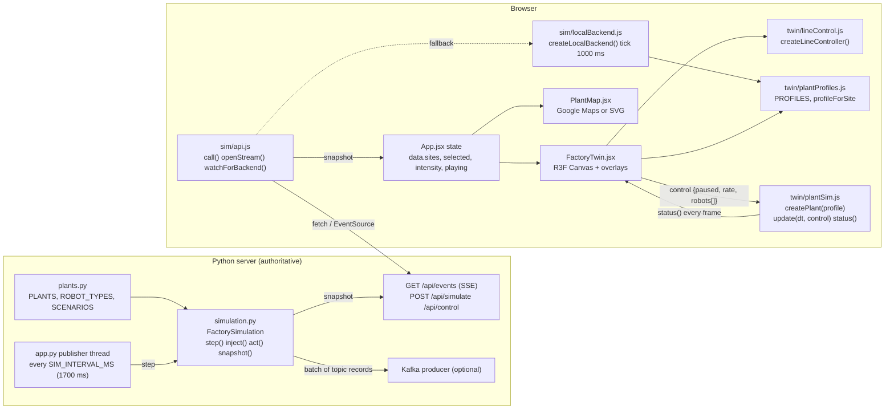
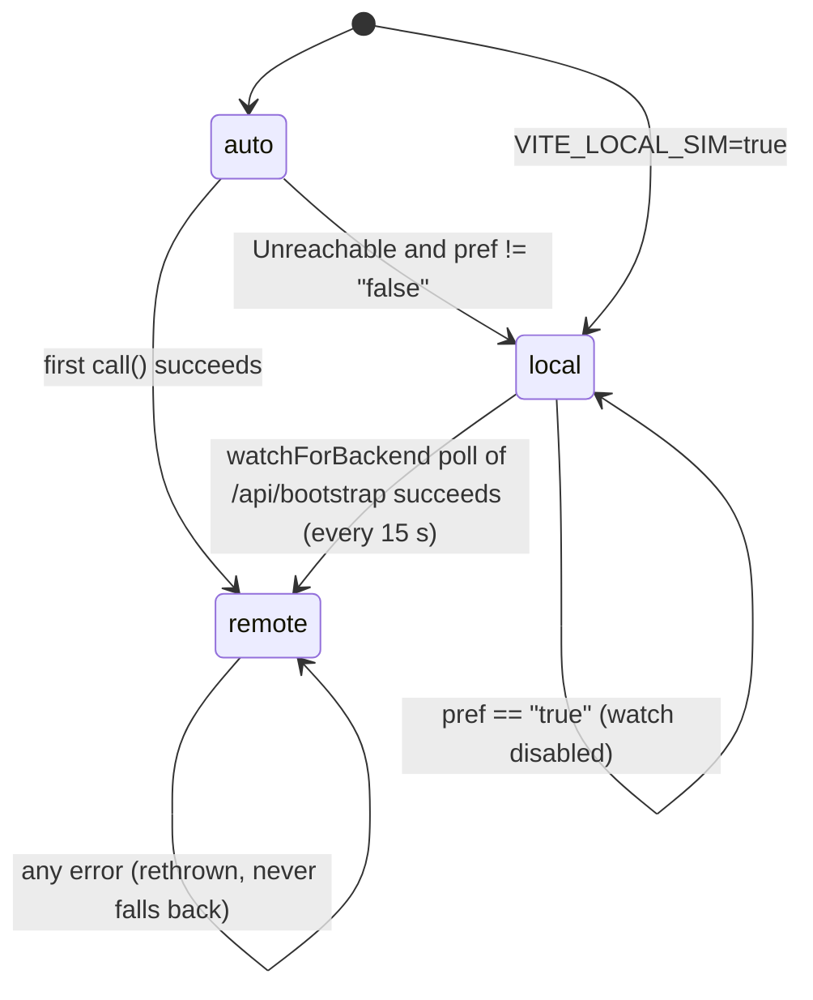
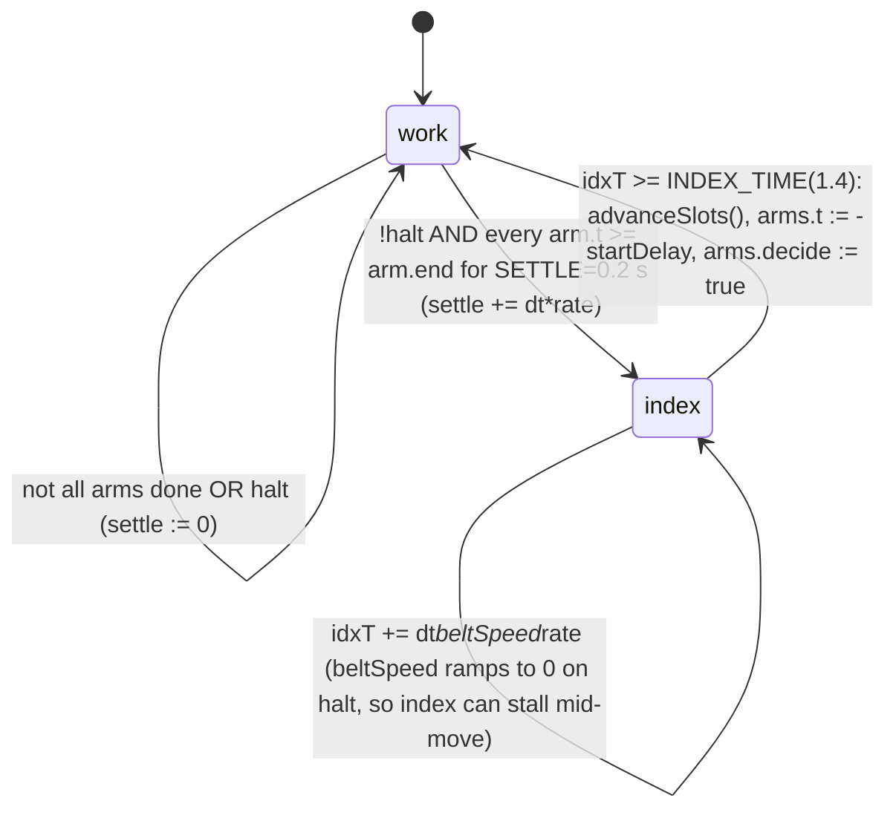
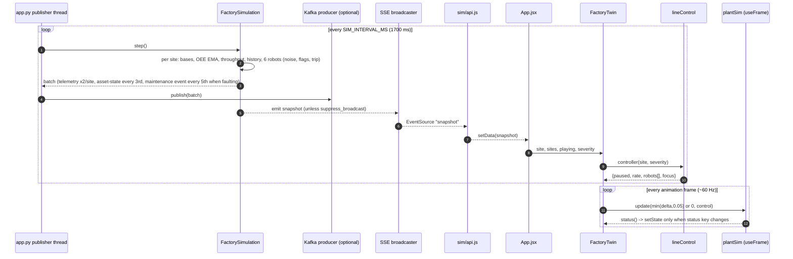
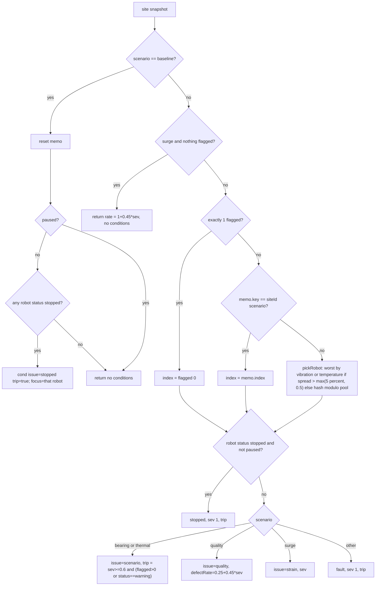
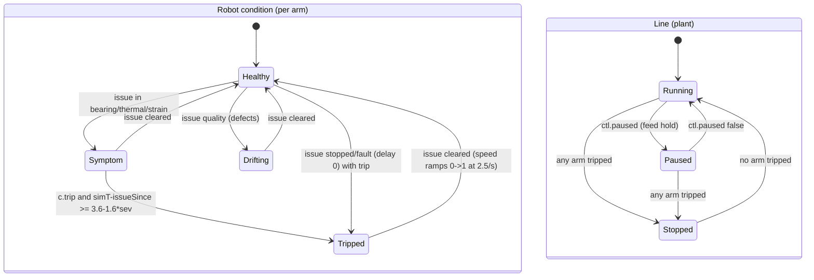

# Factory Pulse Streamhouse — Digital Twin / Simulation Engine Design

| Item | Value |
|---|---|
| Scope | `frontend/src/twin/{lineControl,plantProfiles,plantSim}.js`, `frontend/src/components/{FactoryTwin,PlantMap}.jsx`, `frontend/src/sim/{api,localBackend}.js`, `server/{simulation,plants}.py`, `tests/simulation.test.js`, `docs/digital-twin-*.{md,html}`, `docs/robot-arm-preview*.html` |
| Runtime | Browser: React 18, three `^0.175.0`, `@react-three/fiber ^8.18`, `@react-three/drei ^9.122` (Vite 6). Server: Python 3.11 (Flask app, `FactorySimulation` class) |
| Status | Reverse-engineered from source (as-built). Where this document and code differ, the code wins. Defects/ambiguities are flagged **[NOTE]** and collected in section 10 |
| Verification | The probe numbers in section 5.6 (`end`, `nominalCycle`) were obtained by running `createPlant()` under Node against the shipped profiles; the Python numbers in section 9 by running `FactorySimulation(random=lambda: 0.5)` |

---

## 1. Problem Statement

Factory Pulse needs a **digital twin** of a six-plant manufacturing network that is simultaneously:

1. **A telemetry source.** For 6 plants × 6 robotic assets it produces believable, continuously changing sensor values (temperature, vibration, rpm, energy, quality, health), plant KPIs (OEE, throughput, output) and discrete events/alerts, with *injectable faults* (bearing wear, thermal excursion, quality drift, demand surge) and *operator actions* (pause, resume, maintenance, acknowledge). This is the Python `FactorySimulation` (authoritative when the backend is reachable) and a browser re-implementation (`localBackend.js`) used when it is not.
2. **A physical-looking 3D line.** A WebGL scene shows the selected plant as an *indexing assembly line*: six 6-axis robots with inverse kinematics build a product station by station on a conveyor. The visual line must *react* to the telemetry (a failing robot shudders, glows, trips, and holds the whole conveyor; a quality drift produces visibly mis-built parts that are rejected; a surge speeds the line up).
3. **A geographic selector.** A map (Google Maps or an SVG fallback) shows the six plants coloured by status and selects the plant shown in the twin.

The 3D scene does **not** receive per-frame joint angles from any backend. It receives only a low-rate plant snapshot (`site.scenario`, `site.robots[].status`, …), and a pure function (`lineControl`) translates that into a small `control` object that the 3D engine (`plantSim`) interprets with its own physics-ish animation clock.

---

## 2. Goals & Non-Goals

### Goals

- G1. Deterministic, parameter-driven telemetry model with exact formulas (section 4.1, 4.2) so tests with `random = () => 0.5` are reproducible.
- G2. A browser-only fallback that exposes the **same wire shapes** as the HTTP/SSE backend (`bootstrap`, `simulate`, `control`, `context`, `snapshot` event) so the UI is unaware of the source.
- G3. A 3D engine with **no React dependency** (`createPlant(profile)` returns an object driven with `update(dt, control)`), re-usable for six different plants defined purely by data (`PLANT PROFILES`).
- G4. Line semantics that behave like a real indexing line: a belt indexes one station (3 m) only when **every** robot has finished its program; a tripped robot freezes and holds the whole line (interlock).
- G5. One failure is shown on **one** robot (stable choice) even when the backend flags several or none.
- G6. Smooth, controller-like motion: minimum-jerk interpolation, analytic IK, seeded variation, no popping.
- G7. Resource hygiene: shared geometry/material cache, instanced meshes, `dispose()` on unmount, `dt` clamp.

### Non-Goals

- NG1. No physics engine / collision detection (parts are placed by kinematic scripts only).
- NG2. The 3D scene is not driven by raw sensor values per frame; telemetry values only influence it through `scenario`, `status`, `intensity`.
- NG3. No persistence: simulation state is in-memory only (server process or browser tab).
- NG4. No multi-line per plant in the 3D scene: `lines` (e.g. 8 for DET) is a KPI multiplier, not geometry. Exactly one 6-robot line is rendered.
- NG5. Kafka publishing, schema registry, Flink, MCP are owned by other design documents (`streaming-platform.design.md`, `backend-server.design.md`); only the *event payload shapes* produced by the simulator are specified here.
- NG6. The "AGV", sine-driven robot animation and `Beam/Conveyor/AGV` components described in `docs/digital-twin-explained.md` §10 / `digital-twin-creation-guide.html` are **legacy** and no longer exist in code (see 10).

---

## 3. Architecture Overview



**Layers**

| Layer | Clock | Responsibility |
|---|---|---|
| Telemetry model (server `FactorySimulation.step`) | wall clock, every `SIM_INTERVAL_MS` (default 1700 ms, floor 500 ms in `_startup`) | sensor values, KPIs, alerts, Kafka batch |
| Telemetry model (browser `stepSite`) | `setInterval` 1000 ms (`tickMs`) | same wire shape, simplified model, fallback only |
| Interpretation (`lineControl`) | React render (each new snapshot / each render of `FactoryTwin`) | snapshot → `{paused, rate, robots[], focus}` |
| 3D engine (`plantSim.update`) | `requestAnimationFrame` via R3F `useFrame`, `dt = min(delta, 0.05)` s | robot programs, IK, conveyor indexing, effects, fault visuals |

**Key design decision:** the telemetry tick (1–1.7 s) and the render clock (≈60 Hz) are decoupled. The 3D engine owns its own sim time (`simT`) and its own symptom→trip delay, so a trip appears a few seconds *after* the symptom starts, independent of snapshot cadence; the browser telemetry model replicates the same delay in ticks (`Math.ceil(3.6 − 1.6·sev)`) so the table of sensor values and the 3D scene trip at approximately the same time.

---

## 4. Component Design

### 4.1 `server/plants.py`

Pure data module.

```python
PLANTS: list[dict]   # 6 entries, fields below
ROBOT_TYPES = ["Welding robot", "Pick & place", "Quality scanner", "Assembly cobot", "AGV transporter", "Packaging arm"]
SCENARIOS: list[{id, name, description}]  # baseline, bearing, thermal, quality, surge
```

Data: see 5.1. `oee_base` and `rate` are plant-specific so steady state differs per site. `robots` field (e.g. 12) is *descriptive* only; the simulation always creates exactly **6** robots per site.

### 4.2 `server/simulation.py` — `FactorySimulation`

```python
def clamp(n, a, b) -> number           # max(a, min(b, n))
def r(x, d=1) -> float                 # round(float(x), d)
def now() -> str                       # UTC ISO-8601

class FactorySimulation:
    def __init__(self, random=None)                       # random: () -> [0,1); default random.random
    def subscribe(self, fn) -> unsubscribe_fn             # fn(event: str, payload)
    def emit(self, event, payload)
    def inject(self, site_id, scenario, intensity=75) -> {siteId, scenario, intensity}
    def act(self, site_id, action, robot_id=None) -> action_record
    def step(self) -> list[kafka_record]                  # advances one tick; [] if self.paused
    def snapshot(self) -> dict
    # attributes: tick, paused (global), sites, events, alerts, actions, listeners, last_batch, suppress_broadcast
```

#### 4.2.1 Per-site state (initial)

```python
{ "scenario": "baseline", "intensity": 0, "paused": False, "stopped": False,
  "seed": i,                      # index in PLANTS (0..5)
  "output": 0, "oee": r(oee_base), "history": [],
  "robots": [ { "id": f"{SITE}-R{j+1:02d}", "name": ROBOT_TYPES[j], "status": "running",
                "health": 99 - j, "rpm": 1800, "vibration": 1.2, "temperature": 36,
                "energyKw": 12, "quality": 99.1 } for j in 0..5 ] }
```

#### 4.2.2 `inject(site_id, scenario, intensity=75)`

1. unknown site → `ValueError("Unknown factory")`; scenario not in `{baseline,bearing,thermal,quality,surge}` → `ValueError("Invalid scenario")`.
2. `s.scenario = scenario`; `s.intensity = clamp(float(intensity) if intensity is not None else 75, 1, 100)`; `s.paused = False`.
3. If scenario == `baseline`: `s.stopped = False` (this is how a fault trip is cleared).
4. `emit("scenario", {siteId, scenario, intensity})`; returns the same dict.

> **[NOTE]** Even `baseline` has `intensity ≥ 1` stored; `severity` is computed as 0 for baseline in `step()`, but the snapshot publishes `intensity` as stored (min 1).

#### 4.2.3 `act(site_id, action, robot_id=None)`

Valid actions: `pause | resume | maintenance | acknowledge` (else `ValueError("Invalid action")`).

| Action | Effect |
|---|---|
| `pause` | `s.paused = True` |
| `resume` | `paused=False; stopped=False; scenario="baseline"` (resume also clears any fault!) |
| `maintenance` | `scenario="baseline"; paused=False; stopped=False; robots[*].health = 99` |
| `acknowledge` | every alert with `siteId == site_id` gets `acknowledged = True` |

Result record: `{id: "ACT-<epoch ms>", timestamp, siteId, action, robotId, mode: "simulation"}`; prepended to `self.actions`, capped to 50; `emit("action", result)`.

#### 4.2.4 `step()` algorithm (one tick)

```
if self.paused: return []            # global pause (not exposed by app.py actions)
tick += 1; batch = []; generated = []
for each plant p (order of PLANTS):
  s = sites[p.id]
  severity = 0 if s.scenario == "baseline" else s.intensity / 100
  mod = {baseline:0, bearing:1, thermal:2, quality:3, surge:4}[s.scenario]
  sin = sin(tick / 4 + s.seed)
  line_down = s.paused or s.stopped

  temp_base      = 35 + max(0, severity*51 if mod==2 else severity*8) + sin*1.6
  vibration_base = 1.1 + (severity*7.3 if mod==1 else severity*0.9) + abs(sin)*0.32
  quality_base   = 99.3 - (severity*24 if mod==3 else severity*1.8) + sin*0.35

  target_oee = clamp(p.oee_base - (17*sev if bearing) - (23*sev if thermal) - (21*sev if quality)
                     + (2*sev if surge), 45, 99)
  if s.stopped: target_oee = 0
  s.oee = r(s.oee*0.67 + target_oee*0.33)               # EMA, 1 decimal

  base_rate  = p.rate * p.lines
  throughput = 0 if line_down else round(base_rate * ((1+severity*0.25) if surge else 1) * (s.oee/100))
  s.output  += throughput
  s.history.append({t: tick, output: throughput, oee: s.oee, temp: r(temp_base),
                    vibration: r(vibration_base, 2), quality: r(quality_base)});  keep last 55

  for j in 0..5:                                         # robot j
    noise = (random() - 0.5) * 0.6                       # ∈ [-0.3, +0.3]
    temp  = r(temp_base + noise*3 + j*0.55)
    vib   = r(vibration_base + noise*0.5 + j*0.06, 2)
    rpm   = 0 if line_down else round(1800 + (severity*420 if surge else 0) - severity*95 + sin(tick/2 + j)*25)
    health= clamp(round(99 - (43*sev if bearing) - (30*sev if thermal) - (19*sev if quality) + noise*2 - j*0.5), 15, 100)
    energy= r(1.5 if line_down else 12 + (4.5*sev if surge) + (3*sev if thermal) + j*0.6, 1)
    quality = r(clamp(quality_base + noise, 55, 100), 1)
    flag  = (not line_down) and (temp > 72 or vib > 5.2 or quality < 86)
    if line_down:
        if s.paused: robot.status = "stopped"            # fault-stop (stopped only) leaves status untouched
    else:
        robot.status = "warning" if flag else "running"
    robot.update(temperature=temp, vibration=vib, rpm, health, energyKw=energy, quality)
    if flag and not s.stopped and mod in (1,2) and severity >= 0.6:
        s.stopped = True                                 # PROTECTIVE LINE TRIP (bearing / thermal only)
    if j == (tick+seed) % 6 or j == (tick+seed+3) % 6:   # exactly 2 telemetry records / site / tick
        batch += factory-iot-telemetry record (5.5.1)
  if tick % 3 == 0:  batch += factory-asset-state for robots[0:3]  (5.5.2)
  if (not line_down) and s.scenario != "baseline" and tick % 5 == 0 and severity >= 0.35:
        make alert (5.5.3); alerts.insert(0, alert); alerts = alerts[:45]; generated.append(alert);
        batch += factory-maintenance-events record
self.last_batch = batch
self.events = [telemetry values in batch] + self.events ; keep 90
snapshot = self.snapshot()
if not self.suppress_broadcast: emit("snapshot", snapshot)
for a in generated: emit("alert", a)
return batch
```

Notes:
- `line_down` is evaluated **before** the robot loop. Therefore the trip tick itself still publishes sensors/flags; from the **next** tick onward rpm=0, energy=1.5 kW, throughput=0 and **alerts stop** (see 10).
- A tripped robot keeps `status == "warning"` forever (until baseline/maintenance/resume) because status is no longer recomputed when `line_down`.
- Trip needs `flag` (a reading threshold) *and* `severity ≥ 0.6`. Bearing: `1.1 + 7.3·s + |sin|·0.32 > 5.2` ⇒ flagged from s≈0.53. Thermal: `35 + 51·s + sin·1.6 + noise·3 + j·0.55 > 72` ⇒ needs s ≳ 0.65–0.70, so thermal at 0.60 usually does **not** trip on the server (but would in the browser backend). Quality at `s > ~0.55` flags *all* six robots (quality < 86) but never trips.

#### 4.2.5 `snapshot()`

```
{ tick, timestamp, paused,
  sites: [ { ...PLANT fields, scenario, intensity, paused, stopped, oee, throughput (last history output),
             output, alerts (# unacked for site),
             status: "idle" if paused else ("warning" if stopped or any robot warning else "healthy"),
             robots: [copy], history: [copy ≤55] } ],
  alerts: alerts[:25], actions: actions[:20], recentEvents: events[:32],
  summary: { plants: 6, assets: 36, throughput: Σ site.throughput,
             oee: Σ(site.oee × p.lines) / Σ lines   (1 dp, line-weighted),
             activeAlerts: # unacknowledged (global),
             eventsPerSecond: r(len(last_batch) / (max(250, SIM_INTERVAL_MS) / 1000)) } }
```

### 4.3 `frontend/src/sim/api.js`

```js
export const getMode = () => 'auto' | 'remote' | 'local'
export async function call(path, body?)            // GET if body === undefined else POST /api/<path>
export function watchForBackend(onFound, everyMs = 15000) -> stop()
export function openStream({snapshot, cloud, flink, error}) -> close()
```

State machine (module-level `mode`, initial `'local'` if `import.meta.env.VITE_LOCAL_SIM === 'true'` else `'auto'`):



- `Unreachable` = `fetch` threw, or the response body was not JSON. A JSON error body with `!res.ok` throws a plain `Error(data.error || 'Request failed')` (no fallback).
- `VITE_LOCAL_SIM=false` ⇒ never fall back.
- `openStream`: if `mode === 'local'` → `browserSim().subscribe(handlers)`; else `EventSource('/api/events')` with listeners `snapshot`, `cloud`, `flink` (JSON.parse of `e.data`) and `es.onerror → handlers.error()`.
- `watchForBackend`: on success sets `mode='remote'`, `local.stop()`, drops the local backend, clears the interval, calls `onFound(bootstrapData)` (App re-loads and re-opens the stream).

### 4.4 `frontend/src/sim/localBackend.js`

```js
export const LOCAL_SITES: Array<{id, city, state, lat, lng, profile, name, lines, oee, throughput}>
export function createLocalBackend({ autoStart = true, tickMs = 1000 } = {}) -> {
  call(path, body): Promise,       // 'bootstrap' | 'simulate' | 'control' | 'context' | 'mcp/*' (throws)
  subscribe(handlers): unsubscribe, // sends handlers.cloud(cloud) immediately
  stop(): void,
  _step(emit = true), _sites
}
```

Endpoints:

| `call(path, body)` | Behaviour |
|---|---|
| `bootstrap` | `{snapshot: snapshot(), cloud: {mode:'browser', status:'simulated', derivedConnected:false}, lastDerived:null}` |
| `simulate` | `simulate(body)` then `step()` (immediate UI refresh); returns `{ok:true}` |
| `control` | `control(body)`; returns `{result:{action, siteId, webhookDispatched:false}}` |
| `context` | waits 350 ms (`sleep`) then rule-based answer (regex on question: maintenance/robot/attention/bearing/vibrat → maintenance advice; quality/defect/reject/scrap; energy/power/kw/consum; else operations briefing). Source label `'BROWSER SIMULATION · RULE-BASED ANSWER'` |
| `mcp/tools`, `mcp/call` | throw `Error('The MCP explorer needs the Factory Pulse backend; …')` |
| other | throw `Error('/api/<path> is not available in the browser simulation.')` |

Initialisation: 6 sites from `LOCAL_SITES`, each with 6 robots from `profile.robots` (`id: 'R'+(i+1)`, `name: robot.task`, `baseTemp = 38 + rand·7`, `baseVib = 1.6 + rand·0.8` (`Math.random`)), then `for i<55: step(false)` to pre-fill history, then `setInterval(step, tickMs)` if `autoStart`.

Per-site state: `{def, profile, robots, scenario:'baseline', intensity:0, since:0, target:-1, paused:false, stopped:false, oee:def.oee, throughput:def.throughput, quality:99.3, history:[]}`.

#### `stepSite(s)` (1 tick = 1 s)

```
sev = intensity/100;  elapsed = tick - s.since;  failing = scenario in {bearing, thermal};  target = robots[s.target]
if failing and sev >= TRIP_AT(0.6) and !stopped and !paused and elapsed >= ceil(3.6 - 1.6*sev):
     stopped = true; addAlert("Line stopped: <id> <name> protective stop (<scenario name lower>)", "critical")
running = !paused && !stopped
for each robot i (hit = i == s.target):
   if hit && stopped: continue                        # frozen at the trip
   tT = baseTemp + noise(0.6);  vT = baseVib + noise(0.15)       # noise(a) = (rand-0.5)*2a
   if surge:           tT += 9*sev;  vT += 0.7*sev
   if !running:        tT -= 4;      vT *= 0.3
   if hit && bearing:  vT = baseVib + 2 + 8*sev + noise(0.4);  tT += 6*sev
   if hit && thermal:  tT = baseTemp + 12 + 45*sev + noise(1); vT += 0.6
   k = (hit && scenario != baseline) ? 0.6 : 0.3
   temperature += (tT - temperature) * k ;  vibration += (vT - vibration) * (k + 0.05)
status: hit = (i == target && scenario in {bearing,thermal,quality} && elapsed >= 1)
        robot.status = hit ? 'warning' : paused ? 'stopped' : 'running'
quality += ((quality-scenario ? 99.2 - 16*sev : 99.2) + noise(0.1) - quality) * 0.25
oeeT = def.oee + noise(0.8)
  if quality: oeeT -= 4 + 14*sev
  if failing && !stopped: oeeT -= 3 + 8*sev
  if surge: oeeT -= 2*sev
  if stopped: oeeT = 30
  if paused:  oeeT = s.oee                       # planned stop holds OEE
oee += (oeeT - oee) * (stopped ? 0.08 : 0.2)
rate = (surge ? 1+0.45*sev : 1) * (failing ? 1-0.3*sev : 1) * (quality ? 1-0.1*sev : 1)
thT = running ? def.throughput * rate * (1 + noise(0.03)) : 0
throughput += (thT - throughput) * 0.35
history.push({tick, time: toLocaleTimeString(), oee: r1, vibration: r1(max over robots), temperature: r1(max), throughput: round}); keep 55
```

`simulate({siteId, scenario='baseline', intensity=85})`:
- `baseline` → `restore(s)` (`scenario='baseline'; intensity=0; target=-1; stopped=false; since=tick`) + info alert "Scenario cleared: healthy operations restored" (pre-acknowledged).
- otherwise `scenario`, `intensity = clamp(Number(intensity)||0, 0, 100)`, `since = tick`, `stopped=false`, `target = ROBOT_SCENARIOS.includes(scenario) ? floor(random*6) : -1` (random robot index for bearing/thermal/quality). Unknown scenario ⇒ `TypeError` on `robots[-1]` is avoided only for `surge`; the `msg` lookup throws `Unknown scenario <x>`. Alert severity: `surge` → `'warning'`; `sev ≥ 0.6 && scenario !== 'quality'` → `'critical'`; else `'warning'`.
- Note: `paused` is **not** cleared by `simulate` (the server clears it).

`control({siteId, action})`: `pause` (info alert "Line paused by operator"), `resume` (`paused=false`; **does not** clear `stopped`/scenario; info alert), `maintenance` (`restore(s)`, `paused=false`, ack all of site's alerts, info alert naming the repaired robot), `acknowledge`, else `Error('Unknown action <a>')`; then `step()`.

`siteView(s)`: `status = paused ? 'idle' : (stopped || scenario ∈ {bearing,thermal,quality}) ? 'warning' : 'healthy'` (note: quality or any robot scenario ⇒ warning even before a trip). Robots expose only `{id, name, status, temperature, vibration}` (1 dp). `snapshot()` summary: `oee` is the **unweighted mean** of site OEE; `eventsPerSecond = round(runningRobots*6 + noise(8))`; `assets = 36`; alerts cap 60 stored, `slice(0,50)` published.

#### Relationship / consistency: browser sim vs server sim

| Aspect | Server `FactorySimulation` | Browser `localBackend` | Consistency mechanism |
|---|---|---|---|
| Tick | 1.7 s (env `SIM_INTERVAL_MS`) | 1.0 s (`tickMs`) | UI never assumes the interval |
| Scenarios | baseline/bearing/thermal/quality/surge | same | same ids |
| Robot id | `DET-R01` | `R1` | UI uses `robots[i].id` verbatim; `lineControl` uses index order |
| Robot role | `ROBOT_TYPES[j]` (Welding robot, …) | `profile.robots[j].task` (e.g. "Seam weld") | purely display |
| Which robots fail | all robots shift together (shared `*_base`), server flags several | exactly one random `target` | `lineControl.pickRobot` collapses both to one robot |
| Trip rule | flagged ∧ sev ≥ 0.6 ∧ scenario ∈ {bearing, thermal} | `sev ≥ TRIP_AT` ∧ scenario ∈ {bearing, thermal} ∧ elapsed ≥ ⌈3.6−1.6·sev⌉ ticks | `TRIP_AT` is **imported** by `localBackend` from `lineControl.js` (single constant) |
| Trip visual | n/a (3D engine decides) | n/a | 3D engine uses delay `3.6 − 1.6·sev` seconds |
| Pause | `status='stopped'` on all robots, rpm 0, throughput 0 | `status='stopped'`, throughput → 0 | `lineControl`: `paused = site.paused ∨ site.status==='idle'` |
| Resume | clears stop + scenario | clears pause only | **[NOTE] diverges** |
| OEE | EMA 0.67/0.33 toward plant-specific target, stop ⇒ 0 | EMA 0.2 (0.08 if stopped) toward `def.oee` ± effects, stop ⇒ 30 | KPI display only |
| Summary OEE | line-weighted | unweighted | |
| Telemetry events/Kafka | yes | none | |
| Site ids | DET, AUS, SEA, PHX, CLT, CHI | DET, ATL, AUS, LOU, STL, SEA | `SITE_PROFILE` pins 6 ids; `profileForSite` handles the rest |

---

### 4.5 `frontend/src/twin/lineControl.js`

```js
export const TRIP_AT = 0.6
export const ISSUE_TEXT = { bearing:'Bearing wear', thermal:'Over-temperature', strain:'Overload',
                            quality:'Quality drift', stopped:'Stopped', fault:'Fault' }
export function severityOf(site, fallback) -> number in [0,1]
export function createLineController() -> (site, severityFallback?) => LineControl
```

`LineControl = { robots: (Condition|null)[], paused: boolean, rate: number, focus: number }`
`Condition = { issue: 'bearing'|'thermal'|'strain'|'quality'|'stopped'|'fault', severity: 0..1, trip?: boolean, defectRate?: number }`

Helpers (all module-private): `num(v)` = finite-number-or-0; `clamp01`; `hash(s)` = `[...String(s)].reduce((h,c)=> (Math.imul(h,31)+c.charCodeAt(0))>>>0, 7)`.

`severityOf(site, fallback)`: `raw = site.intensity ?? site.severity ?? site.scenarioIntensity ?? fallback ?? 85`; `n = num(raw)`; `clamp01(n > 1 ? n/100 : n)`. (**[NOTE]** an intensity of exactly `1` is read as 100 %.)

Controller closure holds `memo = {key, index}`.

#### Algorithm `lineControl(site, severityFallback)`

```
robots   = site.robots || [];  scenario = site.scenario || 'baseline';  sev = severityOf(site, fallback)
paused   = !!site.paused || site.status === 'idle'
out      = { robots: robots.map(()=>null), paused, rate: scenario==='surge' ? 1 + 0.45*sev : 1, focus: -1 }
if no robots: return out
flagged  = indices where robot.status in {'warning','stopped'}

if scenario == 'baseline':
    memo = {null, -1}
    if !paused: s = first robot with status 'stopped' ;
        if s>=0: conds[s] = {issue:'stopped', severity:1, trip:true}; out.focus = s
    return out
if scenario == 'surge' and flagged is empty: return out        # pure throughput change, whole line speeds up

key   = `${site.id}|${scenario}`
index = flagged.length == 1 ? flagged[0]
      : memo.key == key     ? memo.index                         # hold the choice until scenario changes
      :                       pickRobot(robots, flagged, scenario, site.id)
memo  = {key, index}
r = robots[index]
if r.status == 'stopped' and !paused:               c = {issue:'stopped', severity:1, trip:true}
elif scenario in {'bearing','thermal'}:             c = {issue:scenario, severity:sev,
                                                          trip: sev >= TRIP_AT && (flagged.length>0 || site.status==='warning')}
elif scenario == 'quality':                         c = {issue:'quality', severity:sev, defectRate: 0.25 + 0.45*sev}
elif scenario == 'surge':                           c = {issue:'strain',  severity:sev}
else:                                               c = {issue:'fault', severity:1, trip:true}
conds[index] = c; out.focus = index
```

`pickRobot(robots, flagged, scenario, siteId)`:
```
pool   = flagged.length ? flagged : all indices
metric = bearing→'vibration' ; thermal|surge→'temperature' ; else null
if metric: vals = pool.map(i => num(robots[i][metric]));
           if (max-min) > max(0.05*|max|, 0.5): return pool[argmax]      # one robot clearly worst
return pool[ hash(`${siteId}|${scenario}`) % pool.length ]               # stable per plant
```

Key properties: (a) at most one robot carries a condition; (b) the choice is sticky across snapshots; (c) trip only for `bearing|thermal` when `sev ≥ 0.6` and the backend actually flags something (or site status is `warning`); (d) the 3D trip additionally waits for the engine's own delay (4.7.3).

`ISSUE_TEXT` also gives the label used in tags and the banner. `lineControl` **never reads** `site.stopped`; it infers a stop via `status`/`flagged`.

### 4.6 `frontend/src/twin/plantProfiles.js`

```js
export const SITE_PROFILE = { DET:'automotive', ATL:'battery', AUS:'electronics', LOU:'appliance', STL:'beverage', SEA:'aerospace' }
export const PROFILES = [automotive, battery, electronics, appliance, beverage, aerospace]   // this order
export function profileForSite(site, sites = []) -> profile
```

`profileForSite`:
1. `!site` → `PROFILES[0]`.
2. `SITE_PROFILE[site.id]` valid → that profile.
3. `used` = profile ids pinned to sites **present in the list**; `free = PROFILES − used`; `pool = free.length ? free : PROFILES`; `unpinned` = sites in `sites` without a pin (or `[site]` if the list is empty); `i = unpinned.findIndex(id)`; result = `pool[(i ≥ 0 ? i : hash(site.id)) % pool.length]`.
   Example (Python backend: DET, AUS, SEA, PHX, CLT, CHI): pinned DET→automotive, AUS→electronics, SEA→aerospace; free = battery, appliance, beverage; PHX→battery, CLT→appliance, CHI→beverage.

Profile schema and contents: section 5.2–5.4. The product-builder DSL (`k` = kit from `makeKit`, see 4.7.1) is part of the contract: `product.base(k, g)`, `items[*].make(k) → THREE.Group`, `features` are declarative.

### 4.7 `frontend/src/twin/plantSim.js` — 3D engine

```js
export const BELT_TOP = 0.57, PITCH = 3.0, ROBOT_Z = 2.0, FEED_TOP = 0.55
export const ARM = { BASE_H:0.3, H_S:1.2, L1:1.4, L2:1.15, FL:0.16, TIP:0.34, D:0.5 }
export function programFeatures(P) -> string[]                 // bead → P.features ; else [P.feature]
export function createPlant(profile, { seed = 7 } = {}) -> Plant

Plant = {
  group: THREE.Group,                  // add to scene (name `plant-<profile.id>`)
  profile,
  update(dt: seconds, ctl?: {paused, rate, robots}),
  status() -> { state:'running'|'paused'|'stopped', faulted:number[], warnings:number[],
                units, rejects, cycle, rate, phase:'work'|'index' },
  dispose(),
  nominalCycle: number,                // max(arm.end) + SETTLE + INDEX_TIME
  robots: [{ index, task, station, side, label:[stationX, 3.15, side*ROBOT_Z] }],
  _debug: { arms, parts, partAt, stationSlot, maxYBefore, sample, simT }
}
```

Module constants (exact):

| Const | Value | Meaning |
|---|---|---|
| `SLOT_X0` | −13.5 | x of slot 0 |
| `NUM_SLOTS` | 9 | slots 0..8 → x = −13.5 … 10.5 (slot 9 = 13.5 is inside outfeed hood) |
| `PITCH` | 3.0 m | index distance = one station |
| `INDEX_TIME` | 1.4 s | duration of one belt index at full speed |
| `SETTLE` | 0.2 s | all-done dwell before an index starts |
| `BELT_LEN` | 29.2 | conveyor length |
| `BELT_TOP` | 0.57 | belt surface y |
| `FEED_TOP` | 0.55 | feeder table top y |
| `ROBOT_Z` | 2.0 | robot base at z = ±2 |
| `BASE_H, H_S` | 0.3, 1.2 | pedestal height; shoulder pivot height |
| `L1, L2A, L2B, L2` | 1.4, 0.66, 0.49, 1.15 | upper arm; elbow→roll joint; roll joint→wrist; elbow→wrist |
| `FL, TIP, D` | 0.16, 0.34, 0.5 | wrist→flange; flange→tool tip; wrist→tip |
| `BEAD_GAP` | torch 0.02, glue 0.015, tape 0.004 | tool tip height above bead |
| `BEAD_SPEED` | torch 0.9, glue 0.8, tape 1.0 m/s (default 0.85) | seam travel speed |

#### 4.7.1 Kit, helpers, particles

- `clamp(v,a,b)`, `V3`, `approach(v,target,rate,dt)` (linear slew), `minJerk(u) = u³(10 + u(−15 + 6u))` with `u` clamped to [0,1].
- `seeded(seed)`: LCG `s = (imul(s,1664525) + 1013904223) >>> 0; return s / 4294967296` (`seed>>>0 || 1`). Used for *gameplay* randomness (start delay, defects). Visual-only effects use `Math.random()`.
- `makeKit()` returns a memoising factory: `add(geo, mat, parent, pos, rot)` (shadows on), `group`, `geo/mat(key, make)`, `box/cyl/sphere/plane/ring/torus`, materials `paint(c, rough=0.45)` (metalness .25), `metal(c, rough=0.3)` (.85), `glow(c, i)`, `flat(c, opacity)` (MeshBasic, DoubleSide, depthWrite iff opaque), `hub(r,len,mat,parent,pos)` (cylinder rotated π/2 about z so its axis is local X — the visible hinge axis equals the rotation axis), `decal` (rotated −π/2 about x, no shadow), `paintable(mesh)` (sets `userData.paint`).
- `makeParticles(parent, {color,size,opacity,count})`: ring buffer of `Float32Array` pos/vel + `life`, additive-blended `THREE.Points` (`frustumCulled=false`). `emit(p, n, fn)` where `fn()` returns `[vx,vy,vz,life]`. `update(dt, gravity, drag, floorY, bounce)`: `k = max(0, 1 − drag·dt)`; `vx,vz *= k`; `vy = vy·k − g·dt`; integrate; floor clamp (bounce: `vy *= −0.3`, `vx,vz *= 0.5`; else zero); dead particles parked at y = −50.
  Instances: `sparks` (count 120, `#ffc861`, size .05, opacity 1; gravity 9.8, drag 0, floor `BELT_TOP+0.08`, bounce), `mist` (160, `#9ec5ff` → set to the spray colour when a sprayer exists, size .07, opacity .3; gravity 0.4, drag 1.6, floor BELT_TOP), `heatFx` (160, `#ff7a2f`, size .13, opacity .5; gravity −0.15 (rises), drag 0.6, floor 0).

#### 4.7.2 Scene construction (`createPlant`)

Theme `T = {...DEFAULT_THEME, ...profile.theme}` (DEFAULT_THEME: bg `#071827`, floor `#16293b`, grid `#1a3550`, lane `#19d2e6`, robot `#f97316`, shell `#d5dde5`, joint `#2b3644`, accent `#f97316`, conveyor `#2a3e52`, rail `#b2c2ce`, belt `#1a2635`, cleat `#2c4459`, beltStyle `'belt'`, hood `#24384c`, feeder `#22364a`, frame `#0c1c2d`, strip `#cfe8ff`, sun `#f0f4ff`, sunIntensity 2.6, ambient 0.7, hemiSky `#c8e0ff`, hemiGround `#1c2b3d`, hemi 1.05, fill `#ffa953`, fence false).

**Environment** (`buildEnvironment`): `AmbientLight(T.sun, T.ambient)`; `HemisphereLight(hemiSky, hemiGround, hemi)`; sun `DirectionalLight(T.sun, T.sunIntensity)` at (4,14,8), shadow map 2048², ortho bounds L/R ±17, T/B ±11, near 1, far 45, `bias −0.0004`, `normalBias 0.02`; fill `PointLight(T.fill, 6, 14)` at (8,5,5); floor `PlaneGeometry(40,24)` (paint T.floor, roughness .9, no shadow cast); `GridHelper(40, 80, T.grid, T.grid)` y .003 opacity .45; two lane decals 29×0.06 at z = ±0.98 (`flat(T.lane, .35)`); far-side steel frame (4 columns 0.24×7.2×0.24 at x = ±4.2, ±12.6, z = −5.2; beams 25.6×.26×.26 at y 7.2 and 25.6×.12×.12 at y 3.2); three strip `PointLight(T.strip, 14, 14)` at (−8|0|8, 6.6, 0); optional safety fence (`T.fence`) at z = −3.4: yellow posts 0.08×1.6×0.08 every 2 m for x ∈ [−12, 12], mesh panels 1.92×1.35×.02 (`flat('#9fb3c8', .1)`), top rail 24.2×.05×.05 at y 1.6.

**Conveyor** (`buildConveyor`): frame box `BELT_LEN × (roller ? .14 : .18) × 1.5` at y .38/.42; rails (T.rail metal) 29.2×.22×.1 at y .54, z ±0.7; legs (0.1×0.34×0.14) every 1.5 m for x ∈ [−14.25, 14.25] at z ±0.55.
- `beltStyle:'roller'` — `InstancedMesh` of cylinders r=.05, length 1.26 every `SP = .25` m for x ∈ [−14.5, 14.5], rotated each frame about z by `−beltPos / R` (rollers turn as the load moves; recomputed only when `beltPos` changes).
- `'belt'` / `'slat'` — belt surface box 29.2×.06×1.26 at y .54 and instanced cross-ticks (`plane(slat ? .025 : .05, 1.2)` every `SP = slat ? .15 : .6` m, y .573) in a holder group whose `position.x = ((beltPos % SP) + SP) % SP` (scrolling illusion).
- Hoods at `x = ±13.1`: box 3.0×1.2×1.9 (`T.hood`), black opening plane 1.5×.75 on the inner face, and a **status band** (box .06×.08×1.92 at `x=±11.62`, y 1.62; own `MeshStandardMaterial`, shared by both hoods) recoloured every frame (4.7.6).

**Product parts**: `NUM_SLOTS = 9` part groups (`makePart`) created once; part `k` starts at slot `k`, `x = SLOT_X0 + k·PITCH`. Features whose producing station slot `< k` are `complete()`d so the line starts "already running" with partially built parts downstream. `partAt(station)` = part whose `slot == stationSlot[station]`.

**Slots**: `stationX = profile.stations || [-7.5,-4.5,-1.5,1.5,4.5,7.5]`; `stationSlot[i] = round((x − SLOT_X0)/PITCH)`; default → slots 2..7; automotive (`[-7.5,-1.5,4.5]`) → slots 2,4,6.

**Feature stage/height bookkeeping**: `featureStage[id]` = station of the robot that produces it; `featureTop(f)`: bead → `from.y + size[0]/2`; item → `at.y + item.h`; points → `max(point.y) + POINT_STYLE[style].h`; else 0. `maxYBefore(stage)` = max over features produced at stations `< stage` of `featureTop`, seeded with `product.baseTop`; used so carried items/scan/spray heights clear what is already built.

Feature runtime state objects (`part.feats[id]`) by `kind`:

| kind | visual | methods |
|---|---|---|
| `bead` | scaled box mesh in a holder at `from`, rotated `−atan2(dz,dx)`; `hot` beads use an emissive material (`#ff7a1a`) | `set(p)` (visible if p>.001, scale.x = max(p,.001)·len), `heatUp()` (heat=1, emissive 3), `cool(dt)` (heat −= .35·dt), `flaw()` (colour `#2a2420`), `reset`, `complete` |
| `item` | `product.items[f.item].make(kit)` placed at `f.at`, hidden | `set(bool)`, `misplace({x,z}, yaw)`, `reset`, `complete` |
| `points` | one mesh per point from `POINT_STYLE` (`screw` h .016, `bolt` .02, `rivet` .01, `hole` .003), hidden | `show(i)`, `skew(i)` (y += .014, rotation.z = .55), `reset`, `complete` |
| `status` | sphere r .035, emissive `#fbbf24` | `set('pass'|'fail'|other)` → `#22c55e`/`#ff3b30`/`#fbbf24`; `reset` amber; `complete` green |
| `paint` | lerps colour of every mesh with `userData.paint` (materials cloned per part) from original to `f.color` | `set(p)`, `reset`, `complete` |

**Feeders** (robots with `program.kind === 'place'`): table box `(item.w+.2) × FEED_TOP × (item.d+.2)` at `(stationX + feeder.dx, FEED_TOP/2, side·feeder.dz)` + black decal; `spawnFeed(feed, instant)` makes an item at `FEED_TOP` (instant) or at `low = FEED_TOP − item.h − .01` rising over **0.9 s** with `minJerk` (`updateFeeder`). After a pick, `refillAt = simT + 0.9`.

**Robots** (`buildRobot`, per `profile.robots[i]` at `(stationX[station], 0, side·2)`; root yawed `0` for side −1, `π` for +1 so local +Z faces the belt). Hierarchy: base disc/bolts/pedestal + accent torus → `j1` (waist, yaw about Y, at y=.3) → `j2` (shoulder, at `H_S − BASE_H` above j1; hub = bearing material) → `j3` (elbow at `L1`) → `j4` (forearm roll at `L2A`) → `j5` (wrist pitch at `L2B`) → `j6` (flange at `FL`) → tool. Per-robot `MeshStandardMaterial`s: `body` (T.robot, metal .25/rough .42, emissive), `joint`, `bearing` (both T.joint, metal .85/rough .35) so one robot can glow independently. `shell` = body if `T.shell === T.robot` else shared paint. Extras: three-lamp stack light at local (−0.7, 1.22/1.35/1.48, −0.55) (colours `#24d7b4`, `#f1c21b`, `#ff3b30`, base emissive 0.05); floor safety ring (`ring(.78,.9)`, `#fcd34d`, opacity .28), accent ring (`ring(.64,.67)`), two hidden vibration ripple rings (`ring(.62,.68,48)`, `#ffb020`).

Tools (`buildTool`; every tool points +Y with tip at y = `TIP`): `torch` (arc sphere r .05, additive; `update(on)` opacity .7+rand·.3, scale .7+rand·.7), `glue` (bead-coloured dot), `tape` (roll rotating `−dt·9`), `cups` (4 vacuum cups at grip `[±cx, ±cz]`, `it.grip ?? [clamp(w/2−.07,.06,.3), clamp(d/2−.07,.05,.22)]`; cup emissive 1.4 when on), `scanner` (box + glow strip + additive triangular fan L=.57, W=.4 + scan line; fan colour `#a78bfa`→`#ff4d4f` when the part under it is defective; opacity `0.16 + 0.06·sin(40t)`), `driver`/`drill`/`riveter` (bit spins `+= dt·45` when on), `sprayer` (cone r .16 length .3, colour = paint feature colour). `tool.update(on, dtScaled, time, fail)` is called each frame with `dt·max(speed,.2)·rate`.

#### 4.7.3 Robot motion programs (`buildProgram`)

Each robot gets a **timeline** of tool-tip keyframes `{t, p: Vector3, on, tilt, ev?, ease?}` built with:

```
timeline(start, tilt):  keys = [{t:0, p:start, on:false, tilt}]
  to(p, dur, opts)  -> t += dur; push {t, p, ...opts}
  auto(p, opts)     -> to(p, clamp(0.28 + 0.4*dist(last, p), 0.3, 0.95), opts)
  hold(dur, opts)   -> to(last, dur, opts)
  finish()          -> forward-fills `on` and `tilt` across keys
```
`S(dx,dy,dz) = V3(stationX + dx, BELT_TOP + dy, dz)`; `ready = S(place ? sign(feeder.dx)·0.3 : 0, 1.1, side·0.9)`; start tilt = `P.tilt ?? (tool==='torch' ? 0.3 : 0)`. Every program ends `tl.auto(ready)`. `end = tl.t` (program duration).

| kind | keyframe script |
|---|---|
| `bead` | for each feature: tipDy = `from.y + size[0]/2 + gap`; `a`,`b` = S(from/to xz, tipDy); `auto(a+0.2y)` → `to(a, .25, on:true)` → `to(b, |ab|/speed, ease:'lin', on:false)` (record `t0` before, `t1` after) → `to(b+0.2y, .22)` |
| `place` | F = (feeder.x, FEED_TOP + item.h, feeder.z), Fup = F+0.4y; tipDy = `f.at.y + item.h`; transferDy = `max(tipDy + .35, maxY + item.h + .15)`: `auto(Fup)` → `to(F,.3,{on:true, ev:'pick'})` → `hold(.15)` → `to(Fup,.3)` [tLift] → `auto(S(at.x, transferDy, at.z))` [tOver] → `to(placeTip, .42, {on:false, ev:'place'})` → `hold(.12)` → `to(S(at.x, tipDy+.3, at.z), .3)` [tAfter] |
| `scan` | `h = maxY + .5`, `span = product.length/2 + .05`, `z = P.z ?? 0`: `auto(S(−span,h,z))` → `hold(.2,{on:true})` → `to(S(span,h,z), 2.0)` → `hold(.2,{on:false, ev:'pass'})` |
| `points` | per point i: `above = S(p.x, p.y+.15, p.z)`; `auto(above)` → `to(S(p.x, p.y + head, p.z), .18, {on:true, ev:'pt'+i})` → `hold(dwell,{on:false})` → `to(above,.15)`; `dwell = P.dwell ?? (drill .24 | riveter .2 | else .3)` |
| `spray` | `h = maxY + .38`, `span = P.span ?? .5`, passes `zs = P.passes ?? [-.2,0,.2]`: `auto(S(-span,h,zs[0]))` → `hold(.1,{on:true})` [t0] → for each pass j: (j>0: `to(S(x,h,z),.3)`), flip x, `to(S(x,h,z), 2·span/0.85, 'lin')` → [t1] → `hold(.05,{on:false})` |

`sample(keys, t)`: before first key → first; inside segment `[a,b)` → `e = b.ease==='lin' ? u : minJerk(u)`, `p = lerp(a.p,b.p,e)`, `tilt = lerp`, `on = a.on`; after last → last. (A shared module vector `_s` is returned — callers must copy.)

#### 4.7.4 Inverse kinematics (`solveIK(arm, target, tilt, extraYaw)`)

Planar 2-link elbow-up solution in the arm's vertical plane:

```
p   = target in robot-local space (arm.invRoot)
yaw = atan2(p.x, p.z);  r = hypot(p.x, p.z)
wu  = r - D*sin(tilt);  wv = p.y - H_S + D*cos(tilt)         # wrist pivot, D back along tool axis
dRaw= hypot(wu, wv);    d  = clamp(dRaw, |L1-L2|+1e-4, L1+L2-1e-4);  arm.reachMargin = min(.., L1+L2-dRaw)
gamma = atan2(wu, wv)
alpha = acos(clamp((L1² + d² - L2²)/(2·L1·d), -1, 1))
beta  = acos(clamp((L1² + L2² - d²)/(2·L1·L2), -1, 1))
a2 = gamma - alpha;  a3 = π - beta
j1.rotation.y = yaw;  j2.rotation.x = a2;  j3.rotation.x = a3;  j4.rotation.y = 0
j5.rotation.x = π - tilt - a2 - a3                           # holds tool angle
j6.rotation.y = yaw + extraYaw                               # grippers stay square to belt
```

Unreachable targets saturate (clamped `d`) rather than fail.

#### 4.7.5 Line state machine and `update(dt, ctl)`

Plant-level variables: `phase ∈ {'work','index'}`, `idxT`, `settle`, `beltSpeed`(0..1), `beltPos`, `units`, `rejects`, `lastIndexAt`, `cycle`, `simT`.



`halt = ctl.paused || any arm.tripped`.

`update(dt, ctl = {})` in order:

1. `simT += dt`; `rate = clamp(ctl.rate ?? 1, 0.25, 3)`; `conds = ctl.robots || []`.
2. **Condition bookkeeping** for each arm `a` with `c = conds[a.index]`:
   `issue = c?.issue || null`; on change: `a.issue = issue; a.issueSince = simT`; `severity = clamp(c.severity,0,1)`; `defectRate = clamp(c.defectRate,0,1)`;
   `delay = (issue ∈ {stopped, fault}) ? 0 : 3.6 − 1.6·severity`;
   `a.tripped = !!issue && !!c.trip && (simT − issueSince ≥ delay)`;
   `a.symptom = issue ∈ {bearing, thermal, strain} ? issue : null`.
   (Symptom shown for 3.6 s at 0 severity down to 2.0 s at 1.0 severity before the protective stop.)
3. **Robots** (each arm):
   - if `a.decide`: `decideCycle(a)`; `decide=false`.
   - `derate = bearing 0.6 | thermal 0.8 | 1`; `a.speed = approach(a.speed, (paused||tripped) ? 0 : derate, tripped ? 6 : 2.5, dt)`.
   - if `phase==='work'`: `a.t = min(a.end, a.t + dt·a.speed·rate)`.
   - `k = sample(a.keys, a.t)`; for a defective `place` cycle add `dOff · placeBlend` to `k.p` and `extraYaw = dYaw · blend`; `solveIK`.
   - **Bearing shake**: `a.shake = approach(shake, symptom==='bearing' && !tripped ? 1 : 0, 3, dt)`; amplitude `amp = shake·(0.012 + 0.026·severity)·(0.45 + 0.55·min(1, speed/0.6))`; `j1.rot.y += 0.7·amp·sin(41·simT)`, `j2.rot.x += amp·sin(57·simT + 1.3)`, `j3.rot.x += 0.8·amp·sin(49·simT + 2.1)`.
   - **Events**: for keys with `ev` and `prevT < key.t ≤ t` → `onEvent`; `prevT = t`.
   - Program hooks (beads/spray progress, flaws) in work phase → `toolOk`; `on = k.on && speed > 0.15 && toolOk`; `tool.update(on, dt·max(speed,.2)·rate, simT, scannerAndPartDefective)`.
   - Torch effects: 2 sparks per frame at the tip (random direction, speed .6–2.2 horizontal, +.4–2.0 up, life .25–.7 s). Sprayer: 3 mist particles/frame (down −.7…−1.3, life .45–.8 s).
   - **Heat**: `heatTarget = thermal ? 0.45 + 0.55·severity : strain ? 0.35 : 0`; `a.heat = approach(heat, target, target > heat ? 0.35 : 0.25, dt)`. If `heat > 0.2`: track the hottest arm; emit a heat particle with probability `heat·0.9` at a random point on the j2–j3 segment (life 1.0–1.8 s).
   - **Body colour**: `body.color = bodyBase.lerp(hotBase #2a0c04, heat·0.85)`; if `heat>0.01` → emissive `#ff4a12` body `heat·1.15`, joint `heat·1.8`; else if tripped → emissive `#ff2a1a` body `0.22 + 0.18·sin(6·simT)`; else 0. Bearing emissive: amber `#ffb020` pulsing `0.8 + 0.8|sin(9t)|` while wearing, red 1.6 once tripped.
   - **Ripples** (visible when `shake > 0.05`): `u = (1.4t + 0.5i) % 1`; scale `1 + 1.6u`; opacity `(1−u)·0.55·shake`.
   - **Stack light** (emissive = 0.05 + value): tripped → red `blinkFast ? 2.6 : 0.15`; symptom → amber `blinkFast ? 2.2 : 0.2`; paused → amber `blinkSlow ? 2.0 : 0.2`; some other arm tripped and this arm finished (`a.t ≥ a.end`) → amber 1.6; `issue==='quality'` → amber 1.2 + green 0.6; else green `on ? 2.4 : 1.1`. `blinkFast = (3·simT) % 1 < .5`, `blinkSlow = (1.2·simT) % 1 < .5`. Ring colour red `#ff3b30` (tripped), `#ffb020` (symptom) else `#fcd34d`; ring opacity `tripped ? 0.45 + 0.3 sin(6t) : 0.28`.
   - Feeder update.
4. **Lights**: weld point light (`#ffd27a`, distance 4, decay 2) at each torch tip, intensity `4 + rand·4` while the tool is on else 0; `faultLight` (`#ff3b30`, dist 7) over the first tripped robot at y 2.4, intensity `6 + 4 sin(6t)`; `heatLight` (`#ff6a2a`, dist 6) at the hottest arm's elbow, intensity `heat·(5 + sin(3t))`.
5. **Line control** per 4.7.5 state machine. On entering `index`: `cycle = simT − lastIndexAt` (if any), `lastIndexAt = simT`. `beltSpeed = approach(beltSpeed, halt ? 0 : 1, halt ? 3 : 2, dt)`. During `index`: `prev = minJerk(idxT/1.4)`; `idxT = min(1.4, idxT + dt·beltSpeed·rate)`; `e = minJerk(idxT/1.4)`; `beltPos += (e − prev)·PITCH`; on completion `advanceSlots()`, `phase='work'`, `e=0`, each arm `t = prevT = −startDelay()`, `decide=true`.
6. Part positions: `p.g.position.x = SLOT_X0 + (p.slot + e)·PITCH`; `cool(dt)` for heated beads; `conveyor.update(beltPos)`; particle updates.
7. **Hood band colour**: tripped → `blinkFast ? #ff3b30 : #3a0c0c`; else paused → `#f1c21b`; else `rate > 1.05` → `#3b82f6`; else `#24d7b4` (written to both `color` and `emissive`).

`startDelay() = 0.08 + rand()·0.5` (so arms are not in lockstep). `advanceSlots()`: every part `slot++`; if `slot ≥ 9` the part counts as `rejects++` if `p.defect` else `units++`, all features `reset()`, `defect=false`, `slot=0` (teleport from the outfeed hood to the infeed hood).

`status()`:
```
state   = any arm.tripped ? 'stopped' : ctlPaused ? 'paused' : 'running'
faulted = indices of tripped arms;  warnings = indices with symptom && !tripped
units, rejects, cycle = measured index-to-index time || nominalCycle, rate, phase
```

#### 4.7.6 Quality-drift (defect) mechanics

At the start of each work cycle `decideCycle(a)`: `a.defect = kind !== 'scan' && a.defectRate > 0 && rand() < a.defectRate` (seeded LCG). If defective choose `dOff = (sgn·(0.035 + rand·0.03), 0, (rand − .5)·0.05)`, `dYaw = sgn·(0.12 + rand·0.14)`, `defBead = floor(rand·beads.length)`, `defPoint = floor(rand·points)`.

Per kind the defect manifests as:
- `place`: item placed with `misplace(dOff, −dYaw)`; the offset blends in during carry via `placeBlend` (0 until `tLift`, `minJerk` ramp to 1 at `tOver`, hold 1 until `tAfter`, then ramp back to 0 until `end`).
- `bead`: the chosen bead stops at 60 % (`cap = 0.6`), tool switches off at cap, bead gets `flaw()` colour.
- `spray`: coat capped at 50 % (patchy), flagged at `u ≥ 0.99`.
- `points`: chosen fastener `skew(i)` (cross-threaded, left proud).
- Any defect → `markDefect(part)`: `part.defect = true`; if the plant has **no** `scan` robot, the status sphere is set to `fail` immediately (in-process flag); otherwise a downstream `scan` `pass` event sets `fail` (red) vs `pass` (green) from `part.defect` and the scanner fan turns red. The part exits and is counted in `rejects`.

#### 4.7.7 `dispose()`

Traverses `root`, collects unique geometries/materials, disposes `InstancedMesh`es, geometries, materials.

---

### 4.8 `frontend/src/components/FactoryTwin.jsx`

```jsx
export default function FactoryTwin({ site, sites = [], playing = true, severity })   // severity = UI slider (0–100)
function PlantScene({ profile, control, onStatus, tags })                              // inside <Canvas>
```

Behaviour:
- `profile = useMemo(() => profileForSite(site, sites), [site?.id, sites ids joined by '|'])`.
- One `createLineController()` per component instance (in a `useRef`); each render: `ctl = controller(site, severity)`; `control.current = {...ctl, playing}`.
- `PlantScene`: `plant = useMemo(() => createPlant(profile), [profile])` (so selecting a different plant disposes the old scene via `useEffect` cleanup and builds a new one). `useFrame((_, delta) => { plant.update(c.playing ? Math.min(delta, 0.05) : 0, c); s = plant.status(); key = state|faulted|warnings|units|rejects|cycle.toFixed(1)|rate.toFixed(2); if (key !== last) { last = key; onStatus(s) } })` — React state is updated only when the status key changes (not every frame).
- `useEffect(() => setStatus(null), [profile])`.
- Scene: `<color attach="background" args={[T.bg]}/>`, `<fogExp2 args={[T.bg, 0.022]}/>`, `<primitive object={plant.group}/>`, per-robot drei `<Html position={r.label} center zIndexRange={[20,0]} style={{pointerEvents:'none'}}>` tag, `<OrbitControls makeDefault enablePan maxPolarAngle={π/2.15} minPolarAngle={0.25} minDistance={5} maxDistance={32} target={[0,0.9,0]}/>`.
- Canvas: `shadows`, `dpr={[1, 1.65]}`, `camera={{position:[1.2,7.4,14.2], fov:42, near:0.1, far:120}}`, `gl={{antialias:true, alpha:false}}`; wrapper `div.twin-canvas role="img"` with aria-label describing the profile line and plant.
- **Tags** per `profile.robots[i]` (`r = site.robots[i]`, `c = ctl.robots[i]`, `id = r?.id || 'R'+(i+1)`; `reading` = `"<temperature>°C"` for thermal/strain or `"<vibration> mm/s"` for bearing):
  - tripped (`status.faulted` includes i) → tone `fault`, headline `'STOPPED'` if issue `stopped` else `'PROTECTIVE STOP'`, detail `ISSUE_TEXT · reading`;
  - bearing/thermal/strain condition → tone `warn`, headline `c.trip ? 'FAULT DEVELOPING' : 'PREDICTIVE ALERT'`;
  - quality with `defectRate ≥ 0.2` → `warn`, `'QUALITY DRIFT'`, detail `'Process out of tolerance'`;
  - else tone `''`.
- **Banner** precedence: `stopped` → `LINE STOPPED` (`<ids> <issue> · conveyor held by interlock`); `paused` → `LINE PAUSED` (`Feed hold · all motion stopped`); `status.warnings.length` → `FAULT DEVELOPING`(if any warning robot has `trip`) / `PREDICTIVE ALERT` (`… · line still running`); `site.scenario==='quality' && ctl.focus ≥ 0` → `QUALITY DRIFT`; `ctl.rate > 1.05` → `DEMAND SURGE` (`Line rate <round(rate·100)>%`); else `LINE RUNNING`. Footer `GOOD <units> · REJECT <rejects> · CYCLE <cycle.toFixed(1)> s`.
- Overlays: top `DIGITAL TWIN / <site.id> <PROFILE LINE UPPERCASE>`, bottom hint `↻ Drag to orbit · Right-drag to pan · Scroll to zoom` and `● Kinematics active` / `Ⅱ Motion paused`.

**Rendering/animation loop approach:** no custom `requestAnimationFrame`; R3F's render loop invokes `useFrame` once per frame. All motion is **sim-time based** (`simT`, per-arm `t`), not wall-clock based; `dt` is clamped to 50 ms so tab-switch gaps don't teleport the sim; `playing=false` passes `dt=0`, freezing all kinematics while the loop still renders (camera orbit still works). Everything is plain Three.js objects owned by `createPlant` and mounted via `<primitive>` (imperative scene graph; React does not reconcile its children).

### 4.9 `frontend/src/components/PlantMap.jsx`

```jsx
export default function PlantMap({ sites, selected, onSelect })   // sites[i]: {id,name,lat,lng,status}
```

- **Mode**: Google Maps when `import.meta.env.VITE_GOOGLE_MAPS_API_KEY` is set and no `mapError`; else SVG fallback. Legend `.map-key`: Operational (healthy) / Attention (warning) / Paused (idle). Maps tag `GOOGLE MAPS PLATFORM`. Errors: `window.gm_authFailure` → message about key/billing/referrer `http://localhost:5173/*`; script `onerror` → "Google Maps failed to load…".
- **Google mode**: script `https://maps.googleapis.com/maps/api/js?key=<encoded>&callback=__factoryPulseMapsReady` (id `google-maps-js`, async); map `center {38.1, −97.4}`, `zoom 4`, optional `mapId` (`VITE_GOOGLE_MAPS_MAP_ID`), dark `styles` (geometry `#12283a`, label fill `#7b9bb0`, label stroke `#101e2e`, water `#071727`, roads/POI off), no street-view/fullscreen/map-type controls. One `Marker` per site (re-created on every `sites/selected` change): circle symbol, fill `warning #ff746a | idle #a8a8a8 | else #20d9bb`, stroke `#082134` weight 3, `scale 12` if selected else 9; click → `onSelect(id)`.
- **SVG fallback**: `viewBox="0 0 960 510"`, background `#0b2030`, grid pattern 34×34 (`#284153`, .8 px, opacity .35), land path (gradient `#193a4a → #173244`, stroke `#3d6a7c` 2.2) plus dashed meridian/parallel guide path (`#4a7283`, opacity .36, dash `3 7`) — path data is in the source file and must be reproduced verbatim. Projection:
  `x = 64 + (lng − (−125)) / ((−66) − (−125)) · 836`, `y = 55 + (50 − lat) / (50 − 24) · 395`.
  Marker group (role=button, tabIndex 0, Enter selects, aria-label `Select <name>`): optional pulse circle (selected only, r animates `20;32;20` over 2.4 s, indefinite, fill = status colour opacity .13), ring circle `r = 13 | 9.5`, fill `#0c2636`, stroke status colour width 3.2; inner dot r 4.7; label `site.id` at `(x+15, y−12)`, font `IBM Plex Sans, Arial`, 17 px/700 white if selected else 14 px/500 `#b7cfdb`. SVG status colours: `warning #ff867a | idle #9aabbc | healthy #24d7b4`. Caption "NORTH AMERICA / OPERATIONS GRID" and "ILLUSTRATIVE · NOT GOOGLE MAPS".

### 4.10 Prototype documents (`docs/robot-arm-preview*.html`, `digital-twin-*`)

- `robot-arm-preview.html` (v1): standalone Three.js page, 6 robots with *hand-written sine/phase* animation ("approach → weld → retract", pick&place, laser sweep, press strokes), belt speed 1.3 u/s with 5 parts, camera FOV 46, `BELT_Y 0.63`. Superseded.
- `robot-arm-preview-v2.html` (**the direct prototype of `plantSim.js`**): introduces the exact constants (`BELT_TOP .57`, `PITCH 3`, `STATION_X [-7.5…7.5]`, `SLOT_X0 -13.5`, `NUM_SLOTS 9`, `ROBOT_Z 2`, `FEED_TOP .55`, arm lengths, `solveIK` w/o `extraYaw`), indexing line with fixed `DWELL 4.8 s + INDEX 1.4 s` (production replaced the fixed dwell with "all programs finished + SETTLE") and hand-keyed waypoint arrays (`K(t, p, {on, ev})`). A re-implementer may use it as a stand-alone sandbox.
- `digital-twin-explained.md` / `digital-twin-creation-guide.html`: narrative docs; several numeric claims are **stale vs code** (throughput formula, baseline OEE ~96 %, `AGV`/`Beam` components, camera positions, enablePan false) — see 10.

---

## 5. Data Models

### 5.1 Server plants (`server/plants.py`)

| id | name | city, state | lat, lng | type | lines | robots (descr.) | region | asset | oee_base | rate (u/min/line) |
|---|---|---|---|---|---|---|---|---|---|---|
| DET | Detroit Assembly | Detroit, Michigan | 42.3314, −83.0458 | Automotive assembly | 8 | 12 | MIDWEST | EV body shop | 93.0 | 8 |
| AUS | Austin Gigafactory | Austin, Texas | 30.2672, −97.7431 | Battery / robotics | 6 | 14 | SOUTH | Battery module line | 89.0 | 5 |
| SEA | Seattle Precision | Seattle, Washington | 47.6062, −122.3321 | Precision components | 5 | 10 | WEST | CNC fabrication | 86.0 | 12 |
| PHX | Phoenix Semicon | Phoenix, Arizona | 33.4484, −112.0740 | Electronics | 7 | 16 | WEST | Electronics assembly | 94.0 | 40 |
| CLT | Charlotte Manufacturing | Charlotte, North Carolina | 35.2271, −80.8431 | Industrial machinery | 6 | 11 | EAST | Machine tool assembly | 90.0 | 4 |
| CHI | Chicago Distribution | Chicago, Illinois | 41.8781, −87.6298 | Packaging / fulfillment | 4 | 9 | MIDWEST | Smart packaging | 96.0 | 60 |

Scenario catalogue: `baseline` "Healthy operations"; `bearing` "Bearing wear" (vibration increases before a predictive maintenance alarm); `thermal` "Thermal excursion"; `quality` "Quality drift"; `surge` "Demand surge".

### 5.2 Browser sites (`LOCAL_SITES`)

| id | city/state | lat, lng | profile | name | lines | oee | throughput (u/min) |
|---|---|---|---|---|---|---|---|
| DET | Detroit, MI | 42.33, −83.05 | automotive | Detroit Body Shop | 3 | 91 | 64 |
| ATL | Atlanta, GA | 33.75, −84.39 | battery | Atlanta Battery Works | 2 | 88 | 48 |
| AUS | Austin, TX | 30.27, −97.74 | electronics | Austin Electronics | 4 | 93 | 120 |
| LOU | Louisville, KY | 38.25, −85.76 | appliance | Louisville Appliance Park | 3 | 89 | 72 |
| STL | St. Louis, MO | 38.63, −90.2 | beverage | St. Louis Bottling | 2 | 92 | 180 |
| SEA | Everett, WA | 47.98, −122.2 | aerospace | Everett Aerostructures | 1 | 86 | 12 |

Robot `{id:'R1'..'R6', name: profile.robots[i].task, baseTemp ∈ [38,45), baseVib ∈ [1.6,2.4), temperature, vibration, status}`.

### 5.3 Plant profile schema (`plantProfiles.js`)

```ts
Profile = {
  id: string, name: string, line: string,
  theme: { bg, floor, grid, lane, robot, shell, joint, accent, conveyor, rail, belt, cleat?,
           beltStyle: 'roller'|'belt'|'slat', hood, feeder, frame, strip, sun, fill, fence?: boolean },
  stations?: number[],                       // x positions (m); default [-7.5,-4.5,-1.5,1.5,4.5,7.5]
  product: {
    baseTop: number, length: number,         // height after base; length along x
    base(k, g): void,                        // builds the carrier/base on part group g
    items: { [name]: { w, h, d, grip?: [cx, cz], make(k): Group } },
    features: { [id]: Feature }
  },
  robots: Array<{ station: number, side: -1|1, task: string, program: Program }>   // exactly 6 in all shipped profiles
}
Feature =
  | { kind:'bead', from:[x,y,z], to:[x,y,z], size:[h,w], color, hot?: true }
  | { kind:'item', item: name, at:[x,y,z] }
  | { kind:'points', style:'screw'|'bolt'|'rivet'|'hole', points: [x,y,z][] }
  | { kind:'status', at:[x,y,z] }
  | { kind:'paint', color }
Program =
  | { kind:'bead', tool:'torch'|'glue'|'tape', features:string[], tilt? }
  | { kind:'place', feature, feeder:{dx, dz}, tilt? }
  | { kind:'points', tool:'driver'|'drill'|'riveter', feature, dwell?, tilt? }
  | { kind:'scan', feature, z? }
  | { kind:'spray', feature, passes?:number[], span?:number }
```
Coordinates: metres in the part frame (x along belt, z across, y up from belt top). Item origin = bottom centre. `side −1` = far side, `+1` = near (camera) side.

### 5.4 The six profiles (exact)

| id | name / line | theme (bg, robot, shell, accent, lane, beltStyle, fence) | stations | baseTop / length |
|---|---|---|---|---|
| `automotive` | Automotive body shop / Body-in-white subframe line | `#0b1016`, `#ff7a1a`, `#ff7a1a`, `#ffb057`, `#fbbf24`, roller, **fence** | `[-7.5,-1.5,4.5]` (3 cells × 2 robots) | 0.2 / 1.2 |
| `battery` | EV battery plant / Battery module line | `#06140f`, `#eef2f6`, `#eef2f6`, `#22d3ee`, `#34d399`, belt | default | 0.17 / 1.16 |
| `electronics` | Electronics assembly / Control-unit (ECU) line | `#090c18`, `#2f6bf0`, `#dfe6ee`, `#93c5fd`, `#818cf8`, slat | default | 0.05 / 1.0 |
| `appliance` | Appliance plant / Washer final-assembly line | `#0f1216`, `#f2c418`, `#f2c418`, `#fde68a`, `#facc15`, belt | default | 0.06 / 1.0 |
| `beverage` | Beverage bottling / Case-packing line | `#0b1618`, `#14b8a6`, `#e2e8f0`, `#5eead4`, `#e2e8f0`, slat | default | 0.1 / 0.76 |
| `aerospace` | Aerospace structures / Wing-panel riveting line | `#0d1012`, `#5b6470`, `#d1d5db`, `#a3e635`, `#a3e635`, belt, **fence** | default | 0.085 / 1.24 |

Other theme keys per profile (floor, grid, joint, conveyor, rail, belt, cleat, hood, feeder, frame, strip, sun, fill) are listed verbatim in `plantProfiles.js` lines 50–357 and must be copied exactly (e.g. automotive: floor `#1b222c`, grid `#2a3442`, joint `#2b2f36`, conveyor `#353b44`, rail `#9aa4ae`, belt `#b5bec8`, hood `#2d333c`, feeder `#2b313a`, frame `#11161d`, strip `#ffe2bf`, sun `#ffe9d1`, fill `#ff9f43`).

**Robot lists** (index = order = `site.robots[i]`; `st` = station index; `side`; tool/kind; feeder offsets `dx,dz`):

| Plant | i | st | side | task | program |
|---|---|---|---|---|---|
| automotive | 0 | 0 | −1 | Seam weld | bead/torch `seamFar` |
| | 1 | 0 | +1 | Seam weld | bead/torch `seamNear` |
| | 2 | 1 | −1 | Load cross-member | place `xmemA`, feeder (−1.3, 1.45) |
| | 3 | 1 | +1 | Load cross-member | place `xmemB`, feeder (1.3, 1.45) |
| | 4 | 2 | −1 | Joint weld | bead/torch `jointAF, jointBF` |
| | 5 | 2 | +1 | Joint weld | bead/torch `jointBN, jointAN` |
| battery | 0 | 0 | −1 | Dispense thermal paste | bead/glue `paste1,2,3` |
| | 1 | 1 | −1 | Place cell stack | place `cellsA`, (1.3, 1.5) |
| | 2 | 2 | −1 | Place cell stack | place `cellsB`, (1.3, 1.5) |
| | 3 | 3 | +1 | Place busbar | place `busbar`, (1.35, 1.45) |
| | 4 | 4 | +1 | Bolt busbar | points/driver `bolts` (4 pts) |
| | 5 | 5 | +1 | End-of-line test | scan `eol` |
| electronics | 0 | 0 | −1 | Load PCB | place `pcb`, (1.3, 1.45) |
| | 1 | 1 | −1 | Place processor | place `chip`, (1.2, 1.4) |
| | 2 | 2 | −1 | Fit heatsink | place `heatsink`, (1.2, 1.4) |
| | 3 | 3 | −1 | Fasten PCB | points/driver `screws` (4 pts) |
| | 4 | 4 | −1 | AOI inspection | scan `aoi` |
| | 5 | 5 | −1 | Fit cover | place `cover`, (1.35, 1.45) |
| appliance | 0 | 0 | −1 | Load motor | place `motor`, (1.3, 1.45) |
| | 1 | 1 | +1 | Bolt motor | points/driver `bolts` (4 pts) |
| | 2 | 2 | −1 | Fit cabinet | place `housing`, (1.35, 1.5) |
| | 3 | 3 | +1 | Powder coat | spray `coat`, passes [−.2,0,.2], span .5 |
| | 4 | 4 | −1 | Final inspection | scan `qc` |
| | 5 | 5 | +1 | Box unit | place `carton`, (1.45, 1.55) |
| beverage | 0 | 0 | +1 | Load bottle pack | place `packA`, (1.3, 1.45) |
| | 1 | 1 | −1 | Load bottle pack | place `packB`, (1.3, 1.45) |
| | 2 | 2 | +1 | Fill-level vision | scan `inspect` |
| | 3 | 3 | −1 | Sleeve case | place `sleeve`, (1.35, 1.5) |
| | 4 | 4 | +1 | Tape seal | bead/tape `tape` |
| | 5 | 5 | −1 | Apply label | place `label`, (1.2, 1.4) |
| aerospace | 0 | 0 | +1 | Apply sealant | bead/glue `seal1, seal2` |
| | 1 | 1 | +1 | Load stringer | place `stringerA`, (1.45, 1.45) |
| | 2 | 2 | +1 | Load stringer | place `stringerB`, (1.45, 1.45) |
| | 3 | 3 | −1 | Drill | points/drill `holes` (8 pts) |
| | 4 | 4 | −1 | Rivet | points/riveter `rivets` (8 pts) |
| | 5 | 5 | −1 | Prime | spray `primer`, passes [−.25,0,.25], span .6 |

Feature geometry (positions, bead sizes, colours, point arrays: `bottleGrid` = x ∈ {−.075, .075} × z ∈ {−.225, −.075, .075, .225}; `rivetRows` 8 points at x ∈ {±.15, ±.45}, z = ±.217, y .097; automotive `hot:true` beads colour `#6b7785`; paint colours `coat #3f6f9f`, `primer #b5c449`; carton helper `carton(w,h,d,{color:'#b98a5a', tape, band})`) are verbatim in `plantProfiles.js` and are normative. The beverage bottle is a `LatheGeometry` profile `[[0,0],[.058,0],[.062,.012],[.062,.2],[.05,.24],[.024,.28],[.022,.31],[0,.31]]` (18 segments), 8 instanced bottles + red caps `#dc2626`, glass `#7a3e12`.

### 5.5 Server wire records

#### 5.5.1 `factory-iot-telemetry` (value; key `{id: assetId}`)
```json
{ "eventId": "<SITE>-<tick>-<j>", "timestamp": "<ISO>", "siteId": "DET", "siteName": "Detroit Assembly",
  "assetId": "DET-R01", "assetType": "Welding robot", "lineId": "LINE-<j%3+1>", "scenario": "baseline",
  "temperature": 36.2, "vibration": 1.3, "rpm": 1800, "energyKw": 12.0, "qualityScore": 99.1, "health": 99,
  "status": "running", "batchId": "BATCH-<int(tick/12)+1001>" }
```
#### 5.5.2 `factory-asset-state` (every 3rd tick, robots 0..2)
`{assetId, siteId, timestamp, status, health, temperature, vibration, qualityScore, scenario}`
#### 5.5.3 Alert / `factory-maintenance-events`
```
alert = { id: "AL-<SITE>-<tick>", timestamp, siteId, siteName, assetId: robots[0].id,
          type: {bearing:"BEARING_RISK", thermal:"OVERHEAT", quality:"QUALITY_DRIFT", surge:"CAPACITY_PRESSURE"},
          severity: intensity >= 70 ? "critical" : "warning",
          message: {bearing:"Abnormal spindle vibration detected", thermal:"Temperature exceeds safe operating envelope",
                    quality:"First-pass yield is trending below target", surge:"Line utilization above planned capacity"},
          acknowledged: false }
event value = { eventId: alert.id, timestamp, siteId, assetId, eventType: alert.type, severity, message, acknowledged: false }
```
Retention: alerts 45 (snapshot 25), events 90 (snapshot `recentEvents` 32), actions 50 (snapshot 20), history 55 per site.

### 5.6 Line state (3D engine) — derived values (probe, three 0.175, seed 7)

Per-arm program duration `end` (s) and plant `nominalCycle = max(end) + 0.2 + 1.4`:

| Plant | arm `end` (robots 0..5) | `nominalCycle` | `stationSlot` |
|---|---|---|---|
| automotive | 3.05, 3.05, 4.05, 4.05, 3.10, 3.14 | 5.65 | 2,4,6 |
| battery | 7.18, 4.06, 4.01, 4.07, 5.15, 3.86 | 8.78 | 2..7 |
| electronics | 4.10, 4.09, 4.04, 5.73, 3.85, 4.04 | 7.33 | 2..7 |
| appliance | 4.02, 5.29, 4.00, 5.69, 3.81, 4.02 | 7.29 | 2..7 |
| beverage | 4.02, 3.99, 3.78, 4.01, 2.71, 4.11 | 5.71 | 2..7 |
| aerospace | 5.78, 4.08, 4.19, 9.04, 8.72, 6.53 | 10.64 | 2..7 |

(These are outputs of the program builder and serve as acceptance values for a re-implementation, ±0.02 s.) The actual measured `cycle` is larger by the per-cycle `startDelay` (0.08–0.58 s) and any derate (bearing symptom ×0.6 time dilation, thermal ×0.8), and is divided by `rate`.

Runtime control object consumed by `plant.update`:
```ts
control = { paused: boolean, rate: number /*clamped 0.25..3*/, playing?: boolean,
            robots: Array<null | { issue: 'bearing'|'thermal'|'strain'|'quality'|'stopped'|'fault',
                                   severity: 0..1, trip?: boolean, defectRate?: 0..1 }> }
```

### 5.7 Browser snapshot (shape-compatible subset)

```
{ timestamp, tick, summary: { throughput, oee, activeAlerts, eventsPerSecond, assets },
  alerts: [{ id:'local-<n>', timestamp, siteId, message, severity:'info'|'warning'|'critical', acknowledged }],
  sites: [{ id, name, city, state, lat, lng, type: profile.name, asset: profile.line, lines, status,
            scenario, intensity, paused, alerts, oee, throughput, quality,
            robots: [{ id, name, status, temperature, vibration }], history: [{ tick, time, oee, vibration, temperature, throughput }] }] }
```
Differences from server: no `stopped`, `output`, `recentEvents`, `actions`, `health/rpm/energyKw/quality` per robot; `history` keys `temperature`/`throughput` vs server `temp`/`output`/`quality`.

### 5.8 Constants cheat-sheet

| Domain | Constant |
|---|---|
| Warning thresholds (server) | temp > 72 °C, vibration > 5.2 mm/s, quality < 86 % |
| Trip | severity ≥ 0.6 (`TRIP_AT`), scenario ∈ {bearing, thermal} |
| Alert emission | every 5 ticks, severity ≥ 0.35, not `line_down`, scenario ≠ baseline; "critical" iff `intensity ≥ 70` |
| Surge | rate factor `1 + 0.45·sev` (3D), `1 + 0.25·sev` (server throughput), rpm +420·sev, energy +4.5·sev |
| OEE EMA | server 0.67/0.33 clamp [45,99], stop ⇒ target 0; browser 0.2 (0.08 stopped), stop ⇒ target 30 |
| Quality defect rate | `0.25 + 0.45·sev` |
| Symptom→trip delay | 3D: `3.6 − 1.6·sev` s; browser: `ceil(3.6 − 1.6·sev)` ticks; `stopped`/`fault` ⇒ 0 |
| Derate | bearing 0.6, thermal 0.8 |
| Speed slew | 2.5 /s (6 /s on trip); belt 2 /s up, 3 /s down |
| History length | 55 |

---

## 6. Integration Points

| # | From → To | Contract |
|---|---|---|
| I1 | `App.jsx` → `sim/api.js` | `call('bootstrap')` (initial), `call('simulate', {siteId, scenario, intensity})`, `call('control', {siteId, action})`, `call('context', {siteId, question})`; `openStream({snapshot, cloud, flink, error})`; `watchForBackend(cb)`; `getMode()` |
| I2 | `api.js` → server | `GET /api/bootstrap`, `GET /api/events` (SSE `snapshot|cloud|flink`), `POST /api/simulate` (body `siteId, scenario, intensity` default 75), `POST /api/control` (`siteId, action, robotId?`), `POST /api/context`; `app.py` publisher thread calls `sim.step()` then `cloud.publish(batch)` (sim-only mode: `sim.emit('snapshot')` triggers SSE broadcast; Kafka mode: `suppress_broadcast = kafka_wanted and kafka_live`, the UI is then driven by the Kafka consumer round-trip) |
| I3 | `api.js` → `localBackend.js` | `call`, `subscribe`, `stop` |
| I4 | `localBackend.js` → `lineControl.js` | imports `TRIP_AT` (single source of truth for the trip threshold) |
| I5 | `localBackend.js` → `plantProfiles.js` | imports `PROFILES` to size robots and name them by `task` |
| I6 | `App.jsx` → `FactoryTwin` | props `site` (snapshot site), `sites` (all), `playing` (Pause/Resume animation toggle), `severity` (UI slider `intensity`, default 85, slider range 20–100) |
| I7 | `FactoryTwin` → `lineControl` | `controller(site, severity)` once per render |
| I8 | `FactoryTwin` → `plantSim` | `createPlant(profile)`, `update(dt, control)`, `status()`, `dispose()`, `plant.group`, `plant.robots[].label/task` |
| I9 | `App.jsx` → `PlantMap` | `sites`, `selected`, `onSelect(id)` → `choose(id)` (sets `selected`, clears AI answer) |
| I10 | Server sim → Kafka | `step()` return value `list[{topic, key:{id}, value}]` consumed by `cloud.publish` (topics `factory-iot-telemetry`, `factory-asset-state`, `factory-maintenance-events`) |
| I11 | Env | `SIM_INTERVAL_MS` (default 1700; publisher floor 500 ms; `eventsPerSecond` floor 250 ms), `VITE_LOCAL_SIM` (`true`/`false`/unset), `VITE_GOOGLE_MAPS_API_KEY`, `VITE_GOOGLE_MAPS_MAP_ID` |
| I12 | UI "fault injection lab" | scenario select + severity slider (`min 20 max 100`, default 85) + "Inject scenario"/"Restore healthy state" + "Pause line"/"Resume line" + "Simulate repair" (`maintenance`) |

Contract between the telemetry model and the twin (what `lineControl` actually reads from `site`): `id`, `scenario`, `intensity`/`severity`/`scenarioIntensity`, `paused`, `status` (`'idle'`, `'warning'`), `robots[i].status` (`'warning'|'stopped'`), `robots[i].vibration`, `robots[i].temperature`, `robots[i].id`. Robot order must equal `profile.robots` order and robot count must be ≥ the profile's robot count (extra tags use `R<i+1>` fallbacks).

---

## 7. Diagrams

### 7.1 Simulation tick (server) and snapshot → twin



### 7.2 Fault injection (bearing, severity 85 %) — end-to-end

```mermaid
sequenceDiagram
  autonumber
  actor Op as Operator
  participant App
  participant API as api.js
  participant Sim as Server FactorySimulation
  participant LC as lineControl
  participant PS as plantSim
  Op->>App: choose "Predictive bearing wear", severity 85, click Inject
  App->>API: call('simulate', {siteId, scenario:'bearing', intensity:85})
  API->>Sim: POST /api/simulate -> inject() (scenario, intensity=85, paused=false)
  Note over Sim: next tick: vib_base = 1.1+0.85*7.3+|sin|*0.32 ≈ 7.3 > 5.2, all robots flagged -> status warning
  Sim->>Sim: flag and sev>=0.6 and mod in (1,2) -> stopped = true (next ticks: rpm 0, throughput 0, OEE target 0)
  Sim-->>App: snapshot {scenario:'bearing', intensity:85, status:'warning', robots[*].status:'warning'}
  App->>LC: site
  LC->>LC: flagged = all; pickRobot (vibration spread < 0.5 -> hash(siteId|bearing) % n); memo
  LC-->>PS: robots[k] = {issue:'bearing', severity:.85, trip:true}
  PS->>PS: symptom: derate 0.6, shake, amber bearing glow, ripples, amber stack light
  Note over PS: after 3.6-1.6*0.85 = 2.24 s -> tripped
  PS->>PS: speed -> 0 (6/s), red body pulse, faultLight, band blinks red, other arms finish then wait (amber)
  PS-->>App: status {state:'stopped', faulted:[k]} -> banner LINE STOPPED, tag PROTECTIVE STOP
  Op->>App: Simulate repair (control 'maintenance')
  App->>Sim: act('maintenance') -> scenario baseline, stopped=false
  Sim-->>App: snapshot baseline
  App->>LC: baseline -> memo reset, robots all null
  LC-->>PS: no conditions -> tripped=false, belt resumes (rate 2/s ramp), arms restart
```

### 7.3 Line-control decision (`lineControl`)



### 7.4 Plant line phase and per-robot trip states



### 7.5 Robot cycle and conveyor index (one cycle)

```mermaid
sequenceDiagram
  participant Arm as Each arm (6)
  participant Line as Line controller (update)
  participant Belt as Conveyor + parts
  Line->>Arm: phase=work, t := -startDelay (0.08–0.58 s), decide := true
  loop work phase
    Arm->>Arm: t += dt*speed*rate; sample keys; solveIK; events pick/place/pass/ptN
    Arm->>Belt: build feature progress on part at its station slot
  end
  Arm-->>Line: all t >= end (and not halted) for SETTLE 0.2 s
  Line->>Belt: phase=index, idxT=0, cycle = simT - lastIndexAt
  loop index phase (1.4 s at full speed)
    Belt->>Belt: e = minJerk(idxT/1.4); beltPos += (e-prev)*3.0; parts x = -13.5+(slot+e)*3
  end
  Belt->>Belt: advanceSlots(): slot++; slot>=9 -> count good/reject, reset features, slot=0
  Line->>Arm: phase=work (restart)
```

### 7.6 Robot arm rendering / animation pipeline (per frame, per arm)

```mermaid
flowchart LR
  T[a.t advances by dt*speed*rate] --> S["sample(keys,t): minJerk lerp of tip p, tilt, on"]
  S --> D{"defective place cycle?"}
  D -- yes --> D1["p += dOff*placeBlend; yaw += dYaw*blend"]
  D -- no --> IK
  D1 --> IK["solveIK: yaw, 2-link (L1, L2) elbow-up, wrist = pi - tilt - a2 - a3"]
  IK --> SH{"bearing symptom?"}
  SH -- yes --> SH1["add sinusoidal shake on j1/j2/j3 (41/57/49 rad/s)"]
  SH -- no --> EV
  SH1 --> EV["fire events with prevT < key.t <= t"]
  EV --> PH["program hooks: bead/spray growth, defects, tool on/off"]
  PH --> FX["tool.update + particles (sparks, mist, heat) + lights"]
  FX --> VIS["heat colour, bearing glow, ripples, stack light, safety ring, hood band"]
```



### 7.7 API mode selection

See the state diagram in 4.3.

---

## 8. Error Handling & Edge Cases

**Server `FactorySimulation`**
- `inject`/`act` raise `ValueError` for unknown site / scenario / action; the HTTP layer maps to error JSON (owned by backend design). `intensity=None` → 75; any value is clamped 1–100 (`float()` of a non-numeric string raises `ValueError`).
- `act` with unknown `robot_id` is accepted and echoed (not validated).
- `step()` returns `[]` if global `self.paused` (no tick increment); publisher loop catches any exception, prints `Publish error:` and continues.
- Empty history → `throughput = 0` in snapshot.
- Fault trip is sticky: only `inject(...,'baseline')`, `act('resume')` or `act('maintenance')` clear it. `pause` during a trip leaves `stopped=True`; `resume` then clears both.
- Pause sets robot status `stopped` and also changes `site.status` to `idle`; a tripped (not paused) line stays `warning`.
- `suppress_broadcast` (Kafka mode) means `emit("snapshot")` is skipped; consumers must not rely on it.

**API/local**
- Non-JSON response ⇒ `Unreachable` (proxy HTML error pages trigger fallback only before the first success).
- After the first successful remote call the browser sim can **never** take over again in that page session (prevents flip-flopping); conversely `watchForBackend` silently upgrades local → remote and tears down the local timer.
- `localBackend.call('simulate')` with unknown scenario throws `Unknown scenario …` after having already mutated `scenario/intensity/target` (state is left inconsistent); `find(siteId)` throws `Unknown site <id>`; `context`/`mcp/*` as above.
- `control('maintenance')` on a site without target (`target = −1`) → `r` undefined → generic message "Maintenance check completed".
- `simulate` for `surge` sets `target = −1` ⇒ `s.robots[-1]` is `undefined`; the code guards by evaluating message lazily only for the matching scenario (`surge` message does not dereference `r`).

**lineControl**
- No robots ⇒ returns neutral control. Non-numeric readings coerce to 0. `memo` is cleared on baseline only; switching site resets via a different `key` (`siteId|scenario`) — but the controller instance is per `FactoryTwin` mount and shared across site changes (key includes site id so no cross-talk).
- Several flagged robots **and** a metric spread ≤ `max(5 % of max, 0.5)` ⇒ deterministic hash choice, so the highlighted robot is stable but arbitrary.
- `surge` with flagged robots (e.g. surge at high temp from other effects) picks one robot and shows `strain` (heat 0.35 glow) while the whole line also runs at `rate`.
- Paused hides `stopped` conditions (a pause sets all robots `stopped` — must not be reported as faults).

**3D engine**
- Unreachable IK targets are clamped (`d` clamp, `acos` clamp) — no NaN; `reachMargin` retained for diagnostics.
- A tripped robot never completes (its `t` stops advancing as `speed → 0`), so `arms.every(t ≥ end)` is false and the belt ramps to 0 (even mid-index: `idxT` advances at `dt·beltSpeed·rate`, so the part stalls where it is; on recovery it continues).
- Other arms continue until `t = end`, then wait with amber light 1.6.
- Pause mid-index freezes the belt through `beltSpeed` slew (decel 3/s), pause mid-work freezes arms through `speed` slew (2.5/s) — not instant.
- `rate` is clamped 0.25–3 (both for arms and belt/settle). `rate > 1.05` turns the hood band blue.
- `dt` clamp 0.05 s prevents large jumps after tab throttling; `playing=false` ⇒ `dt=0` so `simT` is frozen (trip delays do not elapse while paused).
- Swapping `profile` disposes the previous scene (`useEffect` cleanup) and resets status to `null`.
- Feeder `pick` event with empty feed (`a.feed.obj == null`) returns silently; refill after 0.9 s.
- Hot beads use per-part emissive materials so flaw/heat colours never leak across parts; paint features clone materials per part; geometry/materials shared through the kit cache are disposed once (Set).
- Part counts (`units`) start at 0; initial pre-built parts that exit during the first cycles count as good units regardless of defect state.

**PlantMap**
- Maps script load is idempotent via the `google-maps-js` id; unmount deletes the global callback; marker array is cleared before re-creation. Missing/invalid key falls back to SVG (`mapError` set by auth failure / script error).

---

## 9. Testing Strategy

### 9.1 What `tests/simulation.test.js` asserts (Node `node:test`)

Imports `../server/src/simulation.js` and `../server/src/schemas.js`; helper `sim = () => new FactorySimulation({ random: () => 0.5 })` (deterministic noise = 0).

1. **"six factories, all baseline and 36 robotic assets"** — `snapshot().sites.length === 6`, `summary.assets === 36`, `summary.activeAlerts === 0`.
2. **"synthetic telemetry includes events keyed for Kafka Schema Registry"** — `step()` returns events; the first `factory-iot-telemetry` has `typeof key.id === 'string'`, `typeof value.vibration === 'number'`, `typeof value.siteId === 'string'`; `events.length >= 12`.
3. **"bearing fault triggers critical risk and reduces OEE"** — `inject('DET','bearing',90)`, 10 steps: DET `status === 'warning'`, `oee < 90`, `alerts` contains a DET alert with `severity === 'critical'`, `lastBatch.length > 0`.
4. **"repair restores healthy state and acknowledges incidents separately"** — `inject('AUS','thermal',95)`, 6 steps: `summary.activeAlerts > 0`; `act('AUS','acknowledge')` ⇒ `activeAlerts === 0`; `act('AUS','maintenance')`, `step()` ⇒ AUS `scenario === 'baseline'`.
5. **"bad plant/scenario/action rejected"** — `inject('XYZ','bearing')`, `inject('DET','wrong')` and `act('DET','factory-reset')` all throw.
6. **"all outbound Kafka topics have registered key and value schema definitions"** — `KEY_SCHEMA.properties.id.type === 'string'`; `VALUE_SCHEMAS` has entries for `factory-iot-telemetry`, `factory-maintenance-events`, `factory-asset-state`.

### 9.2 Verified state of the suite against the current Python engine

- The test file targets the **legacy Node** modules `server/src/*.js`, which **no longer exist** (`server/src` is absent; the server is Python). The suite therefore fails at import today.
- Running the equivalent Python (`FactorySimulation(random=lambda: 0.5)`):
  - test 1 equivalent passes: 6 sites, 36 assets, 0 active alerts;
  - test 2 equivalent passes: tick-1 `step()` returns **12** records (6 sites × 2 telemetry; asset-state first appears on tick 3);
  - test 3: `status == 'warning'`, DET `oee == 2.4` (<90) pass; but **`alerts` is empty ⇒ the critical-alert assertion fails** because the fault trips the line on tick 1 and alerts are suppressed when `line_down` (see 10);
  - test 4: `activeAlerts` is **0** after 6 steps ⇒ first assertion fails for the same reason;
  - test 5 equivalent passes (`ValueError`).
  - test 6 depends on `schemas.py` (not part of this engine).
- Recommended: port the suite to `pytest` (`tests/test_simulation.py`) and decide the intended semantics for alerts during a trip (either emit a one-off "protective stop" alert at the trip tick, or relax test 3/4 to a sub-trip severity such as 55 %).

### 9.3 Recommended additional tests (derived from the specified behaviour)

Python engine: `step()` increments tick, OEE EMA converges toward `oee_base`; `target_oee` clamp [45,99]; `stopped` ⇒ rpm 0, energy 1.5, throughput 0, OEE→0; `act('pause')` ⇒ status `idle`, robots `stopped`; `resume`/`maintenance` clear `stopped`; telemetry robots chosen = `(tick+seed)%6` and `(tick+seed+3)%6` (always 2 distinct); `factory-asset-state` only on ticks divisible by 3; alert cadence every 5 ticks with `severity ≥ 0.35`; caps (history 55, alerts 45, events 90, actions 50); `eventsPerSecond` formula.

`lineControl` (pure, easy to unit test with `node:test`): baseline-with-stopped robot ⇒ `stopped/trip`; paused hides stop; surge unflagged ⇒ `rate = 1 + 0.45·sev`, no conditions; one flagged ⇒ that robot; several flagged ⇒ worst by vibration only if spread > `max(.05·max, .5)`; memo stickiness until scenario changes; `severityOf` conversions (0.85, 85, undefined → 0.85); `trip` iff `sev ≥ 0.6` and flagged/warning; quality `defectRate = 0.25 + 0.45·sev`.

`profileForSite`: pinned sites; unpinned assignment for the Python site list (PHX→battery, CLT→appliance, CHI→beverage); empty `sites`; all pins taken ⇒ falls back to all profiles.

`plantSim` (Node with `three`, no WebGL needed): `createPlant` for each profile produces 6 arms with `end` within ±0.02 s of the table in 5.6; running `update(1/60)` for ≥ `nominalCycle + 2 s` increments `status().units` only after slots wrap; tripped robot holds `phase === 'work'` forever and `state === 'stopped'`; `paused` ⇒ `state === 'paused'`; `rate` clamp; IK round-trip (forward kinematics of `j1..j5` reaches target within 1 mm for reachable points); determinism with a fixed `seed`; `dispose()` frees all geometries.

`localBackend` (`createLocalBackend({autoStart:false})` + `_step`): pre-filled history 55; bearing at 85 trips after `ceil(3.6−1.6·0.85) = 3` ticks and adds a critical alert; maintenance restores baseline; `simulate` clamps intensity 0–100; `context` regexes.

`api.js`: fallback to local when `fetch` rejects before any success; no fallback after a success; `VITE_LOCAL_SIM` modes; `watchForBackend` switches and stops the local timer.

---

## 10. Open Questions & Risks

1. **Alerts vanish on trip (server).** `step()` computes `line_down` before the robot loop, then `s["stopped"]` is set inside it; from the next tick `not line_down` is False, so no `*_RISK/OVERHEAT` alerts are ever generated for trip-level faults (severity ≥ 0.6 bearing, ≥ ~0.7 thermal), contradicting the documented behaviour and failing tests 3/4. Decide: emit a "protective stop" alert/maintenance event at trip time.
2. **Legacy test target.** `tests/simulation.test.js` imports non-existent `server/src/*.js`. Port to Python or restore.
3. **Browser vs server divergence.** `resume` semantics (server clears fault + scenario; browser only unpauses), summary OEE weighting, robot-id format, single random target vs shared signals, OEE stop target (0 vs 30), per-tick interval (1.0 vs 1.7 s) and trip timing (ticks vs seconds). A single shared spec/golden-file test would prevent drift.
4. **Site/profile mismatch on the Python backend.** `AUS` is "Battery / robotics" but pinned to `electronics`; `PHX` (Electronics) receives `battery`; `SEA` is "Precision components/CNC" but gets `aerospace`; `CLT`/`CHI` map by list order, not by type. `SITE_PROFILE` comment acknowledges ATL/LOU/STL are browser-only ids.
5. **Server `health` is stateless.** `health` is recomputed from the scenario every tick, so `maintenance`'s `health = 99` reset is overwritten at the next tick and wear never accumulates (no degradation memory, no time-to-failure model).
6. **`lineControl` reads `site.status`/robot `status`, not `site.stopped`.** With the server, a tripped robot status remains `warning` (not `stopped`) so the 3D trip is driven solely by `scenario + intensity ≥ 0.6 + flagged` plus the engine's timer; thermal at 60–68 % does not flag robots on the server (⇒ no trip in 3D) while the browser backend would trip. Also, after the server trips, UI robot status stays `warning` while rpm = 0.
7. **`intensity === 1` is treated as 100 %** by `severityOf` (`n > 1 ? n/100 : n`); server minimum is 1.
8. **Documentation drift.** `docs/digital-twin-explained.md` / `creation-guide.html` describe an older design: throughput `lines × 16 × oee/98` (actual: `rate × lines × oee/100`), baseline OEE ~96 % (actual: per-plant `oee_base`), sine-animated robots, `AGV`/`Beam`/`Conveyor` components, camera `[12,12,15]`/`[0,9,16]`, `enablePan=false` (actual: `[1.2,7.4,14.2]`, pan enabled, FOV 42, distance 5–32), 12 columns/gantry, tone mapping ACES (not set in R3F `Canvas`). Use the code as truth.
9. **Wall-clock coupling.** `sim time` freezes when `playing=false` or tab hidden (`dt` clamp), but the telemetry model keeps running, so after a long pause a trip may be reported by telemetry while the 3D scene has not yet reached its delay.
10. **Performance.** ~9 parts × (many small meshes) + 6 robots × ~60 meshes + 3 strip lights, 1 sun w/ 2048² shadow map, up to 7 dynamic point lights (3 strip + fill + weld/fault/heat). Mobile GPUs may struggle; `dpr` capped 1.65. Consider LOD or disabling shadows on low-end devices.
11. **Randomness.** Gameplay randomness uses the seeded LCG (`seed=7`) but effects use `Math.random`; `localBackend` uses `Math.random` everywhere ⇒ not reproducible. Shared RNG injection (like the Python `random` parameter) would make browser tests deterministic.
12. **Server `robots` count in plants (12, 14, …) is cosmetic** — always 6 simulated; summary `assets` is 36, which may confuse readers of the plant table.
13. **Memory/duplicates in `FactoryTwin`.** The line controller is created once per component mount and mutated during render (impure render); React StrictMode double-render could double-evaluate `memo` (idempotent by design, but worth noting).
14. **Accessibility.** Twin canvas has a single `role="img"` label; tag/banner text is in DOM overlays (`role="status"` banner) but robot tags are `pointer-events:none` and not focusable.
15. **PlantMap re-creates all Google markers on every snapshot** (each tick) — flicker/GC risk; consider updating marker icons in place.
