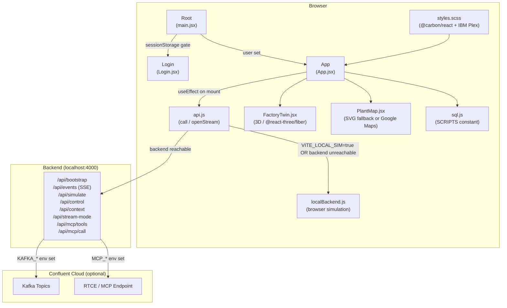
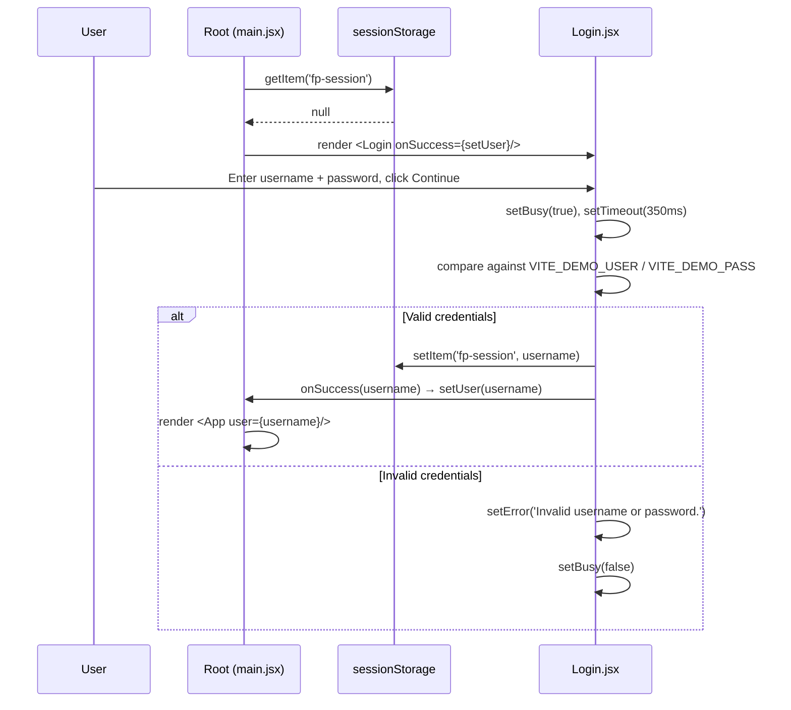
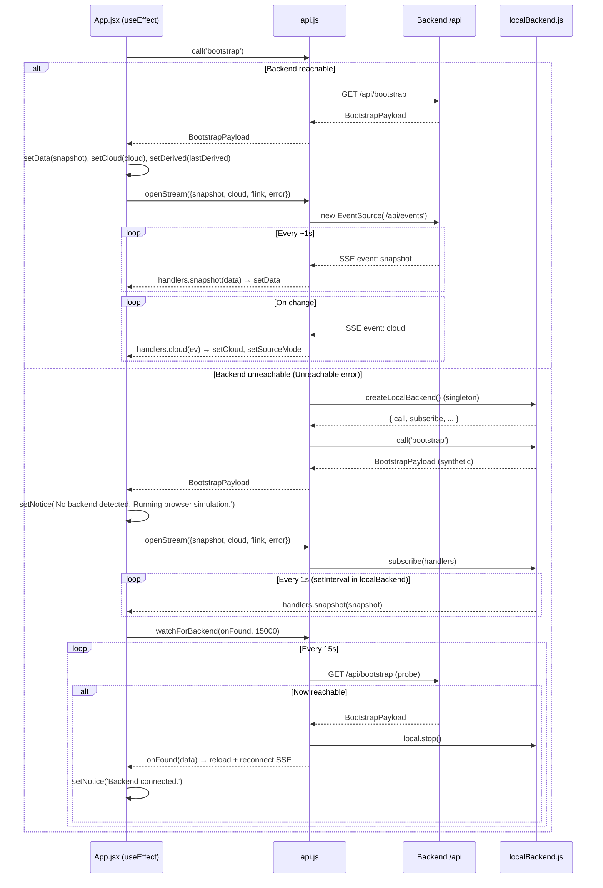
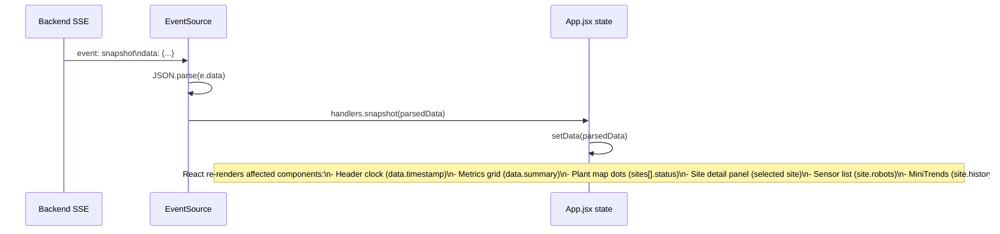
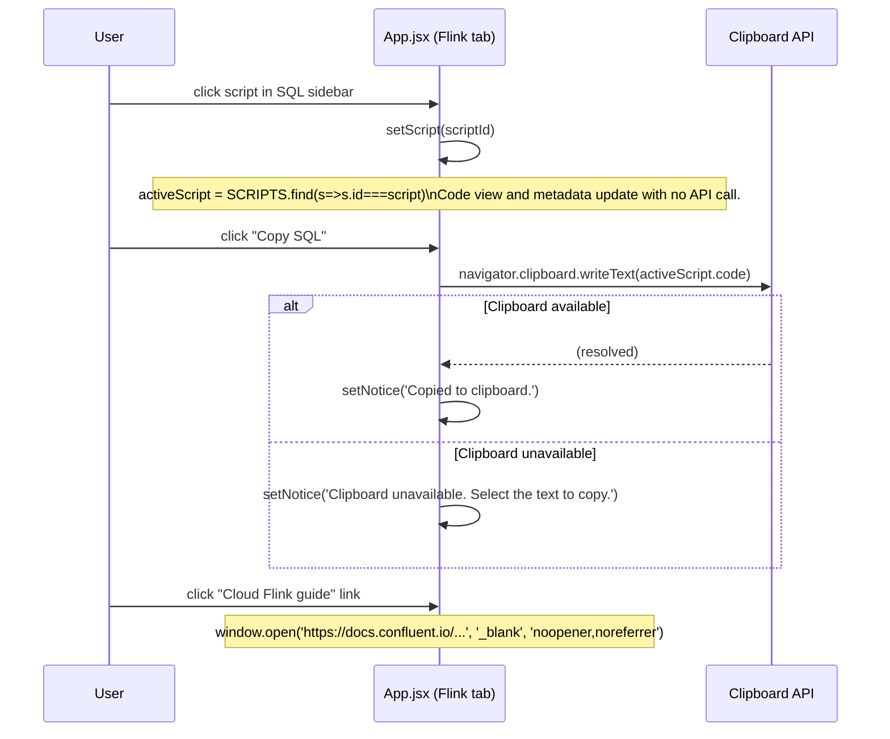

# Factory Pulse — Frontend UI Design Specification

> **Version:** 1.0  
> **Scope:** `frontend/` (React + Vite SPA)  
> **Purpose:** Complete enough that a front-end developer could rebuild the UI from scratch without touching the original source code.

---

## Table of Contents

1. [Problem Statement](#1-problem-statement)
2. [Goals & Non-Goals](#2-goals--non-goals)
3. [Architecture Overview](#3-architecture-overview)
4. [Component Design](#4-component-design)
5. [Data Models](#5-data-models)
6. [Integration Points](#6-integration-points)
7. [Sequence Diagrams](#7-sequence-diagrams)
8. [Error Handling & Edge Cases](#8-error-handling--edge-cases)
9. [Testing Strategy](#9-testing-strategy)
10. [Open Questions & Risks](#10-open-questions--risks)
11. [UI/UX Specification](#11-uiux-specification)

---

## 1. Problem Statement

Factory Pulse is a technical sales demonstration that needs to show, in a single browser session, how IBM Confluent Streamhouse collects IoT telemetry from a simulated manufacturing network, streams it through Apache Kafka, transforms it with Flink SQL, governs it with Stream Governance, and serves it to AI agents via Real-Time Context Engine (RTCE) and Model Context Protocol (MCP).

The UI must work **completely offline** (no backend, no cloud credentials) as a browser-only simulation, and must **automatically upgrade** to live data when a backend process becomes reachable, and **further upgrade** to real Kafka topic data when Confluent Cloud credentials are configured. A developer audience must be able to see real data payloads, real SQL, and real MCP tool calls alongside the animated factory visualisation.

---

## 2. Goals & Non-Goals

### Goals

- Deliver a full-fidelity, self-contained single-page React application that requires zero server-side configuration to run (browser simulation mode).
- Provide a smooth, automatic upgrade path: `browser simulation → local backend → Kafka live data`.
- Visualise a fictional network of six US manufacturing plants as an animated 3D digital twin plus a geographic map.
- Surface four Flink SQL recipes that a developer can copy and deploy to Confluent Cloud without modification.
- Demonstrate the MCP / RTCE integration by proxying real MCP tool calls through the backend (never exposing credentials to the browser).
- Render consistently across desktop viewport widths ≥ 730 px.

### Non-Goals

- Production-grade authentication (login is a demo gate; credentials are visible in the browser bundle).
- Mobile-first layout (below 730 px some panels are hidden or collapsed but the app is not optimised for phone use).
- Real-time multi-user collaboration or session sharing.
- Accessibility compliance beyond basic ARIA labelling and keyboard navigation of map markers.
- Persistent user data or server-side session state.
- Unit-tested simulation physics (the twin engine in `frontend/src/twin/` is covered by a separate agent's spec).

---

## 3. Architecture Overview



**Key architectural decisions:**

- **No external state library.** All state lives in flat `useState` calls inside the `App()` function component.
- **Transparent fallback.** `api.js` is the single gateway for all API calls and SSE. The calling code in `App.jsx` never references `localBackend.js` directly.
- **Digital twin engine isolation.** `frontend/src/twin/` (plantSim, plantProfiles, lineControl) is consumed _only_ by `FactoryTwin.jsx`. `App.jsx` passes a `site` snapshot object and the twin derives its animation state independently. The twin reads from `localBackend.js`'s `PROFILES` and `TRIP_AT` constants — the only cross-boundary imports.
- **Vite proxy.** The dev server proxies `/api/*` to `http://localhost:4000`, so the frontend never needs to know the backend port, and CORS is not a concern in development.

---

## 4. Component Design

### 4.1 `main.jsx` — Application entry point

**Responsibility:** Mount the React tree; implement the session gate.

**State:**
- `user: string | null` — initialised from `sessionStorage.getItem('fp-session')`. `null` → show Login; truthy → show App.

**Rendering behaviour:**
- Renders `<React.StrictMode>` with a single `Root` function component.
- `Root` reads sessionStorage on first render; no async work. If `user` is non-null, renders `<App user={user} onSignOut={signOut}/>`, otherwise renders `<Login onSuccess={setUser}/>`.
- `signOut` removes the session key from `sessionStorage` and sets `user = null`.

**Imports:** `App`, `Login`, `styles.scss`.

---

### 4.2 `Login.jsx` — Splash-screen authentication gate

**Responsibility:** Present branded login form; validate credentials client-side; store session key.

**Props:** `{ onSuccess: (username: string) => void }`

**Internal state:**
- `username: string` — controlled text input
- `password: string` — controlled password input
- `error: string` — validation or auth failure message
- `busy: boolean` — disables submit while 350 ms setTimeout simulates a round-trip

**Credential source:** `VITE_DEMO_USER` env var (default `"admin"`) and `VITE_DEMO_PASS` (default `"factorypulse"`). Both are baked into the bundle at build time — this is a demo gate only.

**Session persistence:** On success, writes `username` to `sessionStorage` under key `fp-session` (exported as `SESSION_KEY`), then calls `onSuccess(username)`.

**Layout:** Two-column CSS Grid (`45fr 55fr`). Left panel (`.login-brand-panel`) is dark (`#0f1923`) with a dot-grid background drawn in CSS, logo mark, tagline, feature bullet list, and technology badge row. Right panel (`.login-form-panel`) is white with a centered 420 px wide card containing Carbon `TextInput`, `PasswordInput`, `Button`, and `InlineNotification`.

**Responsive:** Below 820 px stacks vertically (`grid-template-columns: 1fr`); mono sub-labels in feature list hidden; brand badges hidden.

**UI components used:** `@carbon/react`: `Button`, `TextInput`, `PasswordInput`, `InlineNotification`. `lucide-react`: `ArrowRight`, `Factory`, `Activity`, `RadioTower`, `Workflow`, `ShieldCheck`.

**Static feature list:**
| Icon | Label | Detail |
|------|-------|--------|
| `Activity` | Real-time telemetry | 36 synthetic assets · 6 US plants |
| `RadioTower` | IBM Confluent Kafka | Durable event backbone · governed schemas |
| `Workflow` | Apache Flink SQL | Continuous streaming intelligence |
| `ShieldCheck` | Stream Governance | Lineage, discoverability & RTCE/MCP |

---

### 4.3 `App.jsx` — Root application shell + all tab panels

**Responsibility:** Fixed three-zone shell (header, sidebar, main), all seven tab panels, all global state, all API calls.

**Props:** `{ user: string, onSignOut: () => void }`

#### 4.3.1 Global state (all `useState` in App function body)

| Variable | Type | Initial | Updated by |
|----------|------|---------|-----------|
| `tab` | `string` | `'overview'` | Sidebar nav clicks, story step buttons |
| `data` | `SnapshotPayload \| null` | `null` | Bootstrap + SSE `snapshot` events |
| `cloud` | `CloudStatus \| null` | `null` | Bootstrap + SSE `cloud` events |
| `selected` | `string` | `'DET'` | SitePicker, PlantMap marker click |
| `scenario` | `string` | `'baseline'` | Scenario `<select>` in twin tab |
| `intensity` | `number` | `85` | Range slider in twin tab |
| `playing` | `boolean` | `true` | Pause/Resume button in twin toolbar |
| `notice` | `string` | `''` | API call results; cleared by toast × button |
| `script` | `string` | `'risk'` | SQL sidebar script selection |
| `focusBlock` | `string` | `'transform'` | Architecture node clicks, flow step clicks |
| `question` | `string` | `QUESTIONS[0]` | Prompt chip clicks, chat input onChange |
| `answer` | `ContextAnswer \| null` | `null` | `/api/context` response |
| `thinking` | `boolean` | `false` | `true` while `/api/context` in-flight |
| `tools` | `McpTool[] \| null` | `null` | `/api/mcp/tools` response |
| `mcpStatus` | `'idle'\|'loading'\|'connected'\|'error'` | `'idle'` | MCP discover/invoke calls |
| `toolName` | `string` | `''` | MCP tool `<select>` |
| `toolArgs` | `string` | `'{}'` | MCP arguments `<textarea>` |
| `toolResult` | `object \| null` | `null` | `/api/mcp/call` response |
| `derived` | `object \| null` | `null` | Bootstrap + SSE `flink` events |
| `busy` | `boolean` | `false` | `true` during any mutation call |
| `sourceMode` | `'sim'\|'kafka'` | `'sim'` | `DataBadge` toggle + bootstrap/cloud event |

#### 4.3.2 Mount effect (bootstrap + SSE + backend watcher)

Called once on mount with `[]` dependency. Sequence:
1. Calls `call('bootstrap')` → receives `{ snapshot, cloud, lastDerived }`.
2. Sets `data`, `cloud`, `derived`, `sourceMode` from bootstrap payload.
3. Opens SSE stream via `openStream()` with handlers for `snapshot`, `cloud`, `flink`, `error`.
4. If `getMode() === 'local'` (browser simulation active), shows fallback notice and starts `watchForBackend()` which polls every 15 s for a real backend; on success, replaces local data with live data and reconnects SSE.
5. Cleanup function closes SSE and stops the backend watcher.

#### 4.3.3 Derived values (computed from state, not stored)

- `sites = data?.sites || []`
- `site = sites.find(s => s.id === selected) || sites[0]`
- `networkWarning = sites.filter(s => s.status === 'warning').length`
- `activeScript = SCRIPTS.find(s => s.id === script) || SCRIPTS[1]`
- `block = FLOW.find(x => x.id === focusBlock) || FLOW[2]`

#### 4.3.4 API action handlers

| Handler | Method | Endpoint | Sets |
|---------|--------|----------|------|
| `inject(sc, value)` | POST | `/api/simulate` | `scenario`, `notice`, `busy` guard |
| `control(action)` | POST | `/api/control` | `notice`, `busy` guard |
| `ask(q)` | POST | `/api/context` | `answer`, `thinking` guard |
| `toggleSource(mode)` | POST | `/api/stream-mode` | `sourceMode`, `notice` |
| `discover()` | GET | `/api/mcp/tools` | `tools`, `toolName`, `mcpStatus` |
| `invoke()` | POST | `/api/mcp/call` | `toolResult`, `mcpStatus` |
| `copy(text)` | — | `navigator.clipboard` | `notice` |

#### 4.3.5 Primitive components (defined at module scope in App.jsx)

These are function components defined _above_ the `App` function, not in separate files:

**`Dot({ status })`**  
Renders `<span className="status-dot {status}"/>`. `status` values: `'healthy'` (green `#42be65`), `'warning'` (amber), `'idle'` (gray).

**`Status({ status })`**  
Wraps `Dot` + human label: `'healthy'→'Operational'`, `'warning'→'Attention'`, `'idle'→'Paused'`. CSS class `.site-status.{status}`.

**`PanelHeading({ eyebrow, title, action? })`**  
Renders `.panel-heading` with a `.eyebrow` div (10 px mono, uppercase) + `<h3>` title + optional right-aligned `action` slot (accepts any ReactNode — typically a `Status`, badge, or link button).

**`MetricCard({ icon, label, value, unit, trend, detail })`**  
`.metric-card` with `.metric-head` (label + icon), `.metric-value` (large number + unit), `.metric-foot` (trend in `.positive` + detail). Icon is a Lucide component passed as prop.

**`MiniTrends({ history, keyName, stroke, height })`**  
Recharts `AreaChart` inside `ResponsiveContainer`. `history` is the `SiteView.history` array. `keyName` is the field to plot (valid values: `oee`, `vibration`, `temperature`, `throughput`). `stroke` is the line/gradient colour. Animation disabled (`isAnimationActive={false}`). Tooltip uses dark background `#172838`.

**`SitePicker({ sites, selected, onSelect })`**  
Row of `<button>` elements. Active button has class `.selected` (bg `#e8f0ff`, text `#0043ce`, blue border). Each button renders `Dot + city + site-id` (site ID in IBM Plex Mono 9 px).

**`DataBadge({ cloud, sourceMode, onToggle })`**  
Header stream control containing a `UI SIM` / `KAFKA` toggle and a `.connection-tag` badge. Badge variants:
- `.cloud-live` (bg `#003a2e`, green text `#42be65`) — when `sourceMode='kafka'` AND `cloud.mode='kafka'` AND `cloud.status='connected'`
- `.cloud-fallback` (bg `#3a2a06`, amber text) — when `sourceMode='kafka'` but kafka not live
- `.mock` (bg `#343434`, gray text) — all other cases

**`Bar({ value, color })`**  
`.bar-track` → `.bar-fill` with `width: ${clamp(0,100,value)}%`. Default colour `#0f9ed5`.

#### 4.3.6 Tab panels

**Boot screen** — shown while `data === null`. Full-viewport dark (`#161616`) with centered Carbon `Loading` spinner and "Initializing manufacturing network…" text.

**Toast** — shown while `notice !== ''`. `role="status"` div with Info icon, message, and × close button. Appears below the page-top bar, above all tab content.

**`tab === 'overview'` — Command Center**
Layout (top to bottom):
1. **Hero** (`.hero`): Two-column flex. Left: eyebrow, H2, paragraph, CTA button → navigates to `twin` tab. Right: `.hero-decoration` — CSS animated orbital rings with `Factory` icon and three orbit labels (`STREAM`, `TRANSFORM`, `SERVE`).
2. **Metrics grid** (`.metrics-grid`, 4-col auto-fill at 200 px min): Four `MetricCard` instances using `data.summary` fields: throughput, oee, activeAlerts, eventsPerSecond.
3. **Overview grid** (`.overview-grid`, `1.8fr 0.8fr`): 
   - Left: `.network-panel` — `PanelHeading` + `PlantMap` + plant strip pills (`.plant-pill`) with Dot + city + OEE%. Clicking a pill calls `choose(id)`.
   - Right: `.pulse-panel` — selected site detail: plant mini-icon, site name/type/city, OEE bar (`Bar` component with `#0f62fe`), live operations insight text (conditional on site.status), quick-scenario buttons (bearing, thermal shortcuts), Carbon `Button` → navigates to twin tab.
4. **Flow strip** (`.under-flow`, `.flow-steps`): Five `FLOW` items rendered as click-target buttons. Clicking navigates to the architecture tab and sets `focusBlock`.

**`tab === 'twin'` — Digital Twin**
Layout (top to bottom):
1. **Toolbar** (`.twin-toolbar`): `SitePicker` on left; running-robot count, pause/resume `playing` toggle on right.
2. **Twin layout** (`.twin-layout`, `1.8fr 300px`):
   - Left: `.twin-stage` — dark bg (`#091c2d`). Header with site/city eyebrow + tally (robots/lines/3D SCENE). `FactoryTwin` component. Bottom info bar (asset name, drag hint).
   - Right: `.twin-side` — `PanelHeading` with plant health, OEE/throughput KPI row, separator, **Fault Injection Lab** (scenario `<select>`, intensity `<input type="range" min=20 max=100>`, inject Carbon `Button`), control row (pause line / simulate repair buttons), separator, **Live Sensor Stream** list (`site.robots` map showing Dot + robot ID + name + temperature + vibration readings as text).
3. **Bottom grid** (`.twin-bottom-grid`, 2-col): Two `MiniTrends` panels — vibration (stroke `#36afc6`, height 145) and OEE (stroke `#8f77d3`, height 145), both reading `site.history`.

**`tab === 'architecture'` — Streamhouse**
Layout:
1. Intro block (`.architecture-intro`): tagline, H2, paragraph.
2. `.arch-surface` (dark `#0c2031` panel): Five `.arch-node` buttons (one per FLOW step) connected by `.arch-join` arrows. Clicking sets `focusBlock`. Active node has focused class with `#78a9ff` top border. Below: two `.outcome` cards (analytical path: Tableflow → Iceberg; operational path: RTCE → MCP → agents).
3. `.arch-detail` panel: Shows deep-dive for the focused `block` (FLOW item). Name, description, detail note, IBM reference link.
4. `.arch-principles`: Three principle cards (Governed, Continuously current, Open & composable).

**`tab === 'flink'` — Flink SQL Studio**
Layout:
1. Intro (`.studio-top`): H2, paragraph, "4 SQL recipes" badge.
2. `.sql-studio` (2-col grid `235px 1fr`):
   - Left sidebar: list of SCRIPTS as clickable buttons; active has `#0f62fe` left border; help note.
   - Right: `activeScript` detail — eyebrow, H3 title, description, "Copy SQL" button (calls `copy(activeScript.code)`), `<pre><code>` view in dark bg (`#161c27`), status bar.
3. `.flink-output` panel: Shows `derived` as JSON `<pre>` if available, otherwise empty-state with deploy instructions.

**`tab === 'actions'` — Decision & Action Center**
Layout:
1. Intro block.
2. `.actions-grid` (2-col): 
   - Left: Confluent Flink Topic Actions panel — three action-option rows (Deduplicate, Mask, Transform) with links to Confluent docs.
   - Right: Business Actions panel — plant state card (Status component + alert count + Kafka producer status), three `.action-cta-list` buttons: Schedule maintenance → `control('maintenance')`, Acknowledge incidents → `control('acknowledge')`, Generate critical event → `inject('bearing', 90)`.
3. Event trace (`.event-feed`): `data.alerts` table showing TIME, PLANT, EVENT, SEVERITY columns. Latest 9 alerts. Carbon `Tag` for severity (`red` for critical, `gray` for acked, `warm-gray` otherwise).

**`tab === 'context'` — AI Context / MCP**
Layout (`.context-grid`, `1.1fr 0.9fr`):
- Left: `.chat-panel` — context display showing selected site, prompt chips (four preset questions), answer display area (avatar + card with source/title/answer/evidence/suggestion on `answer !== null`; placeholder BrainCircuit graphic otherwise), freeform chat input (`<input>` + `<button>` send, Enter key submits).
- Right: `.mcp-panel` — RTCE/MCP explanation, feature outline, "Discover remote MCP tools" button → `discover()`, dynamic tool selector + args textarea + Invoke button → `invoke()` (only shown after tools loaded), result `<pre>` display.

**`tab === 'story'` — Demo Playbook**
Layout:
1. `.story-hero` (dark `#102237` banner): persona/trigger/outcome tags.
2. `.story-steps` (2-col grid): Six `STEPS` entries as clickable buttons. Clicking sets `tab` to `step.tab`; step 03 also calls `inject('bearing', 85)`.
3. `.final-story` panel: Business outcome summary + three value-row checkmarks.

#### 4.3.7 Static data constants in App.jsx

- **`NAV`** — 7 navigation entries `{ id, label, icon }`.
- **`FLOW`** — 5 Streamhouse pipeline steps `{ id, step, tag, name, product, desc, detail }`.
- **`QUESTIONS`** — 4 preset context questions (strings).
- **`STEPS`** — 6 demo playbook steps `{ no, title, body, tab }`.

---

### 4.4 `FactoryTwin.jsx` — 3D scene component

**Responsibility:** Render an animated three.js scene for the selected plant using `@react-three/fiber` / `@react-three/drei`. Display robot-health overlays and a line-status banner.

**Props:**
| Prop | Type | Description |
|------|------|-------------|
| `site` | `SiteView \| undefined` | Current plant snapshot from App state |
| `sites` | `SiteView[]` | All plants (used to compute profile key) |
| `playing` | `boolean` | Whether animation is running |
| `severity` | `number` | Intensity 20–100 from App state |

**Internal state:**
- `status: SceneStatus | null` — updated each animation frame by `PlantScene` via `onStatus` callback. Reset to `null` on profile change.

**How it consumes the twin engine (`frontend/src/twin/`):**
- `profileForSite(site, sites)` from `plantProfiles.js` — returns a `PlantProfile` object based on `site.id` (memoised on `site?.id` and `siteKey`).
- `createLineController()` from `lineControl.js` — returns a controller function. Called once (via `useRef`), then invoked each render with `(site, severity)` to derive per-robot fault assignments and line rate multiplier.
- `createPlant(profile)` from `plantSim.js` — creates the three.js scene graph. Called inside `PlantScene` (memoised on `profile`); disposed on unmount via `useEffect`.
- `ISSUE_TEXT` from `lineControl.js` — human-readable fault descriptions used in overlay labels.
- `PROFILES` from `plantProfiles.js` — consumed by `localBackend.js` to build robot arrays; NOT directly imported into FactoryTwin.

**`PlantScene` inner component (only rendered inside `Canvas`):**
- Calls `plant.update(delta, control)` on every frame (`useFrame`).
- Compares a serialised status key; only calls `onStatus(s)` when the key changes (prevents excessive React re-renders).
- Renders `plant.group` (the three.js Object3D tree) as `<primitive>`.
- Renders HTML overlays via `@react-three/drei` `Html` for each robot at its `r.label` position: `.robot-tag` with tone class (`warn`, `fault`, or empty).

**Robot tag logic:**
- `tone: 'fault'` — robot index is in `status.faulted` array.
- `tone: 'warn'` — robot has an active bearing/thermal/strain issue above warning threshold but not yet tripped.
- `tone: ''` — healthy.
- `headline` and `detail` contain fault type + sensor reading (temperature °C or vibration mm/s).

**Line banner logic (`.twin-overlay.line-status`):**
| `banner.tone` | Condition | Border colour |
|--------------|-----------|---------------|
| `running` | Default | `#24d7b4` |
| `stopped` | `status.state === 'stopped'` | `#ff4d4f` (blinks) |
| `paused` | `status.state === 'paused'` | `#f1c21b` |
| `warning` | `status.warnings.length > 0` | `#f1c21b` (blinks) |
| `surge` | `ctl.rate > 1.05` | `#4589ff` |

**Overlays:** Three absolute-positioned `.twin-overlay` divs (`.top`, `.line-status`, `.bottom`). Camera: `position [1.2, 7.4, 14.2]`, `fov 42`. `OrbitControls` with `maxPolarAngle = π/2.15`, `minDistance 5`, `maxDistance 32`, `target [0, 0.9, 0]`. DPR `[1, 1.65]`, shadows enabled.

---

### 4.5 `PlantMap.jsx` — Geographic plant map

**Responsibility:** Render a US map with interactive plant markers. Uses Google Maps if `VITE_GOOGLE_MAPS_API_KEY` is set; falls back to an inline SVG illustration.

**Props:**
| Prop | Type | Description |
|------|------|-------------|
| `sites` | `SiteView[]` | All plant snapshots |
| `selected` | `string` | Currently selected site ID |
| `onSelect` | `(id: string) => void` | Callback when a marker is clicked |

**Internal state:**
- `mapError: string` — set if Google Maps API key is rejected or the script fails to load.

**Refs:**
- `mapRef` — DOM ref for the Google Maps container div.
- `gmRef` — holds the `google.maps.Map` instance.
- `markersRef` — holds the array of `google.maps.Marker` instances for cleanup.

**Google Maps mode:**
- Triggered when `VITE_GOOGLE_MAPS_API_KEY` is defined.
- Script injected dynamically into `document.head` via a `<script>` tag with `callback=__factoryPulseMapsReady`.
- Custom dark map styles applied: geometry `#12283a`, water `#071727`, roads and POIs hidden.
- Each site rendered as a `CIRCLE` symbol marker. Selected marker scale 12, others 9. Colours: `#ff746a` (warning), `#a8a8a8` (idle), `#20d9bb` (healthy).
- `gm_authFailure` global handler sets `mapError`.

**SVG fallback mode:**
- A hardcoded continental US SVG path at `viewBox="0 0 960 510"`.
- Plant positions computed with `coords(lat, lng)` — a linear projection from `(lonMin=-125, lonMax=-66, latMin=24, latMax=50)` mapped to pixel bounds `x∈[64,900]`, `y∈[55,450]`.
- Selected marker: animated `<circle>` (pulsing `r` from 20→32→20, 2.4 s) behind the marker. Role `button`, `tabIndex=0`, `onKeyDown` handles Enter.
- Map key legend below map: Operational / Attention / Paused with `.key-dot` colour swatches.

---

### 4.6 `sql.js` — Flink SQL script registry

**Responsibility:** Import four Flink SQL files as raw strings and export them as the `SCRIPTS` array.

**Exports:** `SCRIPTS: SqlScript[]`

Each `SqlScript`:
```js
{
  id: string,       // 'create' | 'risk' | 'kpis' | 'quality'
  title: string,
  description: string,
  code: string      // raw SQL content
}
```

SQL files imported using Vite's `?raw` import modifier:
- `../flink/01-create-tables.sql` → `id: 'create'`
- `../flink/02-risk-signal.sql` → `id: 'risk'`
- `../flink/03-shift-kpis.sql` → `id: 'kpis'`
- `../flink/04-quality-alerts.sql` → `id: 'quality'`

---

### 4.7 `sim/api.js` — API gateway with automatic fallback

**Responsibility:** Single entry point for all `/api` calls and the SSE stream. Transparently switches between remote backend and browser simulation.

**Exported functions:**

**`getMode(): 'auto' | 'local' | 'remote'`**  
Returns current connection mode. Used by `App.jsx` to decide whether to show the offline notice.

**`call(path: string, body?: object): Promise<object>`**  
If `mode === 'local'` → delegates to `browserSim().call(path, body)`.  
Otherwise attempts `fetch(/api/${path})` — GET if `body` is undefined, POST with JSON body otherwise.  
On `Unreachable` error (network failure, not HTTP error) AND `mode !== 'remote'` AND `VITE_LOCAL_SIM !== 'false'` → sets `mode = 'local'` and retries via browser sim.  
Once `mode = 'remote'` is set by a successful call, it never falls back again.

**`openStream(handlers: StreamHandlers): () => void`**  
If `mode === 'local'` → delegates to `browserSim().subscribe(handlers)`.  
Otherwise opens an `EventSource('/api/events')` and maps:
- `snapshot` event → `handlers.snapshot(JSON.parse(e.data))`
- `cloud` event → `handlers.cloud(JSON.parse(e.data))`
- `flink` event → `handlers.flink(JSON.parse(e.data))`
- `onerror` → `handlers.error()`
Returns a cleanup function that calls `es.close()`.

**`watchForBackend(onFound: (bootstrap) => void, everyMs = 15000): () => void`**  
Polls `remote('bootstrap')` every `everyMs`. On success: sets `mode = 'remote'`, stops local simulation, clears interval, calls `onFound(data)`. Returns cleanup that clears the interval.

**Environment variable overrides:**
- `VITE_LOCAL_SIM=true` — always use browser simulation (never try remote).
- `VITE_LOCAL_SIM=false` — never fall back (throw on backend unreachable).

---

### 4.8 `sim/localBackend.js` — Browser simulation engine

**Responsibility:** Full in-browser implementation of all backend endpoints and the SSE event stream. Runs six plants × six robots at 1 Hz producing synthetic telemetry, alerts, and OEE history without any server.

**Exported function:** `createLocalBackend({ autoStart?, tickMs? }): LocalBackend`

**Simulation constants:**
- 6 plants (Detroit, Atlanta, Austin, Louisville, St. Louis, Everett) with fixed baseline OEE and throughput.
- History window: 55 ticks.
- Robot initial values: baseTemp 38–45 °C, baseVib 1.6–2.4 mm/s (randomised on create).
- Fault scenarios: `bearing`, `thermal`, `quality` affect a single randomly-chosen robot; `surge` affects the whole line.
- Trip condition: same rule as `lineControl.js` — severity ≥ `TRIP_AT`, elapsed ticks ≥ `ceil(3.6 - 1.6 * sev)`. When tripped, `s.stopped = true`, critical alert added.

**Implemented endpoints (via `call(path, body)`):**
- `bootstrap` → `{ snapshot, cloud, lastDerived: null }`
- `simulate` → validates scenario, assigns target robot, adds alert, calls `step()`
- `control` → pause/resume/maintenance/acknowledge, calls `step()`
- `context` → rule-based answers keyed on question keyword matching (`mainten|robot`, `quality|defect`, `energy|power`, default briefing)
- `stream-mode` — NOT implemented; throws
- `mcp/tools` / `mcp/call` — NOT implemented; throws "needs backend"

**SSE equivalent (`subscribe(handlers)`):**
- Adds `handlers` to a `Set<StreamHandlers>`.
- Every tick, calls `handlers.snapshot(snapshot())` for all registered listeners.
- Returns cleanup function that removes handlers from the set.
- Emits `handlers.cloud(cloud)` immediately on subscribe.
- Does NOT emit `flink` events (derived topic requires real backend).

**Cloud object in browser mode:**
```js
{ mode: 'browser', status: 'simulated', derivedConnected: false }
```

**Pre-seeding:** On construction, runs 55 ticks with `emit = false` so the UI sees a full trend history on first render.

---

## 5. Data Models

### 5.1 Bootstrap response

```typescript
interface BootstrapPayload {
  snapshot: SnapshotPayload;
  cloud: CloudStatus;
  lastDerived: object | null;  // last Flink derived-topic message if backend has KAFKA_CONSUME_DERIVED=true
}
```

### 5.2 SSE snapshot payload (also used as `data` state in App.jsx)

```typescript
interface SnapshotPayload {
  timestamp: string;     // ISO 8601
  tick: number;          // monotonic counter since backend start
  sites: SiteView[];
  summary: {
    throughput: number;        // sum of all site throughputs, units/min
    oee: number;               // average OEE %, 1 decimal
    activeAlerts: number;      // count of unacknowledged alerts
    eventsPerSecond: number;   // synthetic events/sec ≈ running_robots × 6
    assets: number;            // total robot count (always 36)
  };
  alerts: Alert[];             // latest 50, newest first
}
```

### 5.3 Site view (element of `SnapshotPayload.sites`)

```typescript
interface SiteView {
  id: string;               // 'DET' | 'ATL' | 'AUS' | 'LOU' | 'STL' | 'SEA'
  name: string;             // e.g. 'Detroit Body Shop'
  city: string;
  state: string;            // 2-letter abbreviation
  lat: number;
  lng: number;
  type: string;             // plant profile name, e.g. 'Automotive'
  asset: string;            // production line name, e.g. 'Body & frame line'
  lines: number;            // active production lines count
  status: 'healthy' | 'warning' | 'idle';
  scenario: string;         // 'baseline' | 'bearing' | 'thermal' | 'quality' | 'surge'
  intensity: number;        // 0–100
  paused: boolean;
  alerts: number;           // count of unacknowledged alerts for this site
  oee: number;              // Overall Equipment Effectiveness %, 1 decimal
  throughput: number;       // integer, units/min
  quality: number;          // first-pass yield %, 1 decimal
  robots: RobotView[];
  history: HistoryPoint[];  // last 55 ticks
}
```

### 5.4 Robot view

```typescript
interface RobotView {
  id: string;          // 'R1'–'R6'
  name: string;        // task name from plant profile, e.g. 'Welding'
  status: 'running' | 'warning' | 'stopped';
  temperature: number; // °C, 1 decimal
  vibration: number;   // mm/s, 1 decimal
}
```

### 5.5 History point

```typescript
interface HistoryPoint {
  tick: number;
  time: string;            // locale time string
  oee: number;             // 1 decimal
  vibration: number;       // peak across all robots, 1 decimal
  temperature: number;     // peak across all robots, 1 decimal
  throughput: number;      // integer
}
```

### 5.6 Alert

```typescript
interface Alert {
  id: string;              // 'local-{seq}' in browser sim; backend may use UUID
  timestamp: string;       // ISO 8601
  siteId: string;
  message: string;
  severity: 'info' | 'warning' | 'critical';
  acknowledged: boolean;
}
```

### 5.7 Cloud status (SSE `cloud` event / Bootstrap `cloud` field)

```typescript
interface CloudStatus {
  mode: 'browser' | 'kafka' | 'local';
  status: 'simulated' | 'connected' | 'disconnected' | 'error' | 'configuration_required';
  sourceMode?: 'sim' | 'kafka';
  derivedConnected?: boolean;
}
```

### 5.8 Context answer (`/api/context` response)

```typescript
interface ContextAnswer {
  source: string;        // e.g. 'BROWSER SIMULATION · RULE-BASED ANSWER'
  title: string;
  answer: string;
  evidence: string[];    // short fact strings, e.g. 'Vibration 4.2 mm/s'
  suggestion: string;
}
```

### 5.9 `/api/simulate` request body

```typescript
interface SimulateBody {
  siteId: string;
  scenario: 'baseline' | 'bearing' | 'thermal' | 'quality' | 'surge';
  intensity: number;  // 0–100
}
```

### 5.10 `/api/control` request body

```typescript
interface ControlBody {
  siteId: string;
  action: 'pause' | 'resume' | 'maintenance' | 'acknowledge';
}
```

### 5.11 `/api/control` response

```typescript
interface ControlResponse {
  result: {
    action: string;
    siteId: string;
    webhookDispatched: boolean;  // true if backend dispatched an outbound webhook
  };
}
```

### 5.12 `/api/stream-mode` request / response

```typescript
// Request
interface StreamModeBody { source: 'sim' | 'kafka'; }
// Response
interface StreamModeResponse { sourceMode: 'sim' | 'kafka'; }
```

### 5.13 MCP tool shape

```typescript
interface McpTool {
  name: string;
  description?: string;
  inputSchema?: object;
}
```

### 5.14 SQL script

```typescript
interface SqlScript {
  id: 'create' | 'risk' | 'kpis' | 'quality';
  title: string;
  description: string;
  code: string;
}
```

---

## 6. Integration Points

### 6.1 Backend API endpoints

| Method | Path | Request body | Response | Notes |
|--------|------|-------------|----------|-------|
| GET | `/api/bootstrap` | — | `BootstrapPayload` | First call; determines connection mode |
| GET | `/api/events` | — | SSE stream | Events: `snapshot`, `cloud`, `flink` (named events) |
| POST | `/api/simulate` | `SimulateBody` | `{ ok: true }` | Injects fault scenario |
| POST | `/api/control` | `ControlBody` | `ControlResponse` | Line control + optional webhook |
| POST | `/api/context` | `{ siteId, question }` | `ContextAnswer` | Rule-based or RTCE-backed answer |
| POST | `/api/stream-mode` | `StreamModeBody` | `StreamModeResponse` | Toggle Kafka vs sim source |
| GET | `/api/mcp/tools` | — | `{ tools: McpTool[] }` | Discover RTCE MCP tools (requires backend + env) |
| POST | `/api/mcp/call` | `{ name, args }` | `object` | Invoke an MCP tool (proxied) |

### 6.2 SSE events

| Event name | Payload type | Frequency | App handler |
|------------|-------------|-----------|-------------|
| `snapshot` | `SnapshotPayload` | ~1/s | `setData` |
| `cloud` | `CloudStatus` | On change | `setCloud` + `setSourceMode` |
| `flink` | `object` (Flink derived message) | When backend has `KAFKA_CONSUME_DERIVED=true` | `setDerived` |

### 6.3 Local backend fallback

Triggered automatically when `/api/bootstrap` throws an `Unreachable` error (network-level failure, not HTTP error) AND `VITE_LOCAL_SIM !== 'false'` AND no successful remote call has been made. The fallback is implemented in [`src/sim/localBackend.js`](../../frontend/src/sim/localBackend.js) and exposes the same `call(path, body)` / `subscribe(handlers)` interface as the remote API. The browser simulation does **not** implement `stream-mode` or MCP endpoints.

### 6.4 Google Maps integration

| Item | Value |
|------|-------|
| API key env var | `VITE_GOOGLE_MAPS_API_KEY` |
| Map ID env var | `VITE_GOOGLE_MAPS_MAP_ID` (optional) |
| Script injection | Dynamic `<script>` appended to `document.head` |
| Auth failure handler | `window.gm_authFailure` sets `mapError` state |
| Required APIs | Maps JavaScript API with Billing enabled |
| Fallback | Inline SVG when `VITE_GOOGLE_MAPS_API_KEY` is not set |

### 6.5 Vite dev server proxy

In both `server` (port 5173) and `preview` (port 4173) modes, Vite proxies `/api/*` → `http://localhost:4000`. Configured in [`vite.config.js`](../../frontend/vite.config.js).

### 6.6 Vite config details

| Setting | Value |
|---------|-------|
| Plugin | `@vitejs/plugin-react` |
| `envDir` | Project root (`..` relative to frontend/) |
| SCSS `includePaths` | `['node_modules']` |
| SCSS `silenceDeprecations` | `['if-function', 'legacy-js-api']` |
| Alias `'../flink'` | `{projectRoot}/flink/` (allows `sql.js` to import SQL files) |
| Alias `'~@ibm/plex'` | `node_modules/@ibm/plex` (for Carbon SCSS font references) |

### 6.7 Environment variables

| Variable | Used in | Effect |
|----------|---------|--------|
| `VITE_DEMO_USER` | `Login.jsx` | Override demo username (default `admin`) |
| `VITE_DEMO_PASS` | `Login.jsx` | Override demo password (default `factorypulse`) |
| `VITE_LOCAL_SIM` | `api.js` | `true` = always browser sim; `false` = no fallback; absent = auto |
| `VITE_GOOGLE_MAPS_API_KEY` | `PlantMap.jsx` | Enables Google Maps; absent = SVG fallback |
| `VITE_GOOGLE_MAPS_MAP_ID` | `PlantMap.jsx` | Optional Cloud-based Map ID for styles |

### 6.8 npm dependencies with versions

| Package | Version | Role |
|---------|---------|------|
| `react` | ^18.3.1 | UI framework |
| `react-dom` | ^18.3.1 | DOM renderer |
| `@carbon/react` | ^1.82.0 | Carbon Design System components |
| `@carbon/icons-react` | ^11.61.0 | Carbon icon set |
| `lucide-react` | ^0.468.0 | Lucide icon set (used extensively in App.jsx) |
| `recharts` | ^2.15.3 | AreaChart / LineChart for trend panels |
| `@react-three/fiber` | ^8.18.0 | React renderer for three.js |
| `@react-three/drei` | ^9.122.0 | three.js helpers: `OrbitControls`, `Html` |
| `three` | ^0.175.0 | 3D graphics engine |
| `@kafkajs/confluent-schema-registry` | ^3.9.0 | Schema Registry client (backend only) |
| `kafkajs` | ^2.2.4 | Kafka client (backend only) |
| `@modelcontextprotocol/sdk` | ^1.25.0 | MCP SDK (backend only) |
| `express` | ^4.21.2 | Backend HTTP server (backend only) |
| `cors` | ^2.8.5 | Backend CORS middleware |
| `dotenv` | ^16.5.0 | Backend env loading |
| `concurrently` | ^9.2.0 | Dev runner (runs backend + frontend in one terminal) |
| `vite` | ^6.2.6 | Build tool / dev server |
| `@vitejs/plugin-react` | ^4.4.1 | React JSX transform for Vite |
| `sass` | ^1.86.0 | SCSS preprocessor |

> **Note on `frontend_1/`:** This is an earlier iteration of the same frontend application with an identical package.json. It appears to be a snapshot or backup of a previous version prior to a refactor. It is not used in the active build.

---

## 7. Sequence Diagrams

### 7.1 Login flow



### 7.2 Initial load (bootstrap + SSE)



### 7.3 Live stream update (SSE snapshot)



### 7.4 Plant switch

```mermaid
sequenceDiagram
    participant U as User
    participant SP as SitePicker / PlantMap
    participant A as App.jsx

    U->>SP: click on plant button or map marker
    SP->>A: onSelect(siteId) / onSelect(siteId)
    A->>A: setSelected(siteId), setAnswer(null)
    Note over A: No API call. React recomputes:\n  site = sites.find(s => s.id === selected)\nAll panels that read `site` re-render with new plant data.
    A->>A: FactoryTwin receives new `site` prop
    Note over A: profileForSite(site, sites) memoised on site.id;\nprofile change clears local `status` state in FactoryTwin.
```

### 7.5 SQL panel interactions



---

## 8. Error Handling & Edge Cases

### 8.1 Backend unreachable

- On first `call('bootstrap')` failure: silently falls back to browser simulation; sets `notice` with offline message.
- Once `mode = 'remote'`: all subsequent call failures surface the error via `setNotice(e.message)`. No automatic fallback to browser sim (prevents silent stale data).

### 8.2 SSE stream interruption

- `es.onerror` → `handlers.error()` → `setNotice('Live stream connection interrupted. Reconnecting automatically.')`.
- Browser's `EventSource` implements automatic reconnection with exponential back-off natively; no custom reconnect logic is needed.

### 8.3 `data === null` (bootstrap pending)

- A boot screen (dark full-viewport loading spinner) is shown. No other UI elements are rendered. This prevents any `.map()` call on `null` data.

### 8.4 Unknown plant selected

- `site = sites.find(s => s.id === selected) || sites[0]`. If the selected ID doesn't exist in the snapshot, falls back to the first site. This handles the transition from local → remote backend where the site list might momentarily differ.

### 8.5 Google Maps API key invalid

- `window.gm_authFailure` fires → sets `mapError` state → map container hides → SVG fallback shown with error message.
- Script load error (`onerror`) also sets `mapError`.

### 8.6 Clipboard API unavailable

- `copy()` wraps `navigator.clipboard.writeText()` in try/catch. On failure, shows notice instructing user to select the text manually.

### 8.7 MCP explorer with no backend

- `localBackend.js` throws `"The MCP explorer needs the Factory Pulse backend"` for both `mcp/tools` and `mcp/call`. This error propagates to `setNotice(e.message)` and `setMcpStatus('error')`.

### 8.8 Invalid JSON in MCP args textarea

- `invoke()` calls `JSON.parse(toolArgs)`. If it throws, the error message is surfaced via `setNotice` and `setMcpStatus('error')`.

### 8.9 `busy` guard

- The `busy` boolean is set to `true` during `inject()` and `control()` calls and reset in the `finally` block. All action buttons are `disabled={busy}` to prevent duplicate submissions.

### 8.10 Empty alerts list

- Event feed shows "No incidents yet. Inject a bearing, thermal or quality fault…" paragraph when `data.alerts.length === 0`.

### 8.11 Site with no history

- `MiniTrends` receives `site?.history || []`. An empty array renders a flat empty chart without errors (Recharts handles empty data gracefully).

---

## 9. Testing Strategy

The following strategy describes what should be tested; no test framework is currently present in the repository.

### 9.1 Unit tests

| Module | What to test |
|--------|-------------|
| `sim/api.js` | `call()` falls back to local on network error; does NOT fall back once `mode='remote'`; `VITE_LOCAL_SIM=true` always uses local; `VITE_LOCAL_SIM=false` never falls back |
| `sim/localBackend.js` | All five scenarios mutate OEE, throughput, temperature, vibration correctly; trip fires at `TRIP_AT`; `control('maintenance')` restores baseline; `context()` returns correct titles for each keyword pattern |
| `sql.js` | `SCRIPTS` has exactly 4 entries; each has non-empty `code` |
| `Login.jsx` | Correct credentials → `sessionStorage` written + `onSuccess` called; incorrect → `error` shown; empty fields → validation error |

### 9.2 Component integration tests (React Testing Library)

| Component | Scenarios |
|-----------|----------|
| `App.jsx` (boot) | Renders boot screen while `data = null`; renders shell once data arrives |
| `App.jsx` (tabs) | Clicking each nav button renders the correct tab panel |
| `App.jsx` (inject) | Clicking "Inject scenario" calls `call('simulate', ...)` and sets `notice` |
| `App.jsx` (toast) | Notice appears; × button clears it |
| `App.jsx` (plant switch) | Clicking a different site updates `selected`; clears `answer` |
| `PlantMap.jsx` | Without API key, renders SVG; each site has a role=button marker; Enter key triggers `onSelect` |

### 9.3 End-to-end tests (Playwright)

| Flow | Steps |
|------|-------|
| Login | Load app → submit defaults → App shell visible |
| Browser sim | No backend configured → offline notice visible → data tick counter advances |
| Fault injection | Twin tab → select Detroit → inject bearing 85% → warning badge appears in sensor list |
| SQL copy | Flink tab → click a script → click Copy SQL → OS clipboard contains SQL |
| Story playbook | Story tab → click step 03 → twin tab opens → bearing scenario active |

### 9.4 Visual regression

Capture screenshots at 1440 px and 768 px viewport widths for all seven tabs. Run on CI against a pinned browser simulation snapshot to detect layout regressions.

### 9.5 Accessibility checks

- Run `axe-core` on each tab panel; expect zero critical violations.
- Verify `PlantMap` SVG markers have `aria-label` and respond to keyboard Enter.
- Verify `FactoryTwin` canvas has `role="img"` with a descriptive `aria-label`.
- Verify all form inputs in Login and twin tab have associated `<label>`.

---

## 10. Open Questions & Risks

| # | Question / Risk | Impact | Suggested Resolution |
|---|----------------|--------|---------------------|
| 1 | **Demo credentials in bundle.** `VITE_DEMO_USER` / `VITE_DEMO_PASS` are baked into the JS bundle and visible in browser DevTools. | Medium — unsuitable for any public deployment | Add a note to deployment docs; consider a backend session endpoint if a real auth gate is ever needed |
| 2 | **`sourceMode` state synchronisation.** `sourceMode` is set from three places (bootstrap, SSE cloud event, `toggleSource`). If they race, the badge could flicker. | Low (cosmetic) | Deduplicate by making `sourceMode` always derived from the latest `cloud` event |
| 3 | **Google Maps billing.** The Maps JavaScript API requires a billing-enabled GCP project. Demo users without a billing account cannot enable the interactive map. | Medium — silent degradation to SVG | Add explicit setup guidance in the project README; SVG fallback is already implemented |
| 4 | **`frontend_1/` stale copy.** The directory is byte-for-byte identical in package.json to `frontend/`. If someone edits `frontend_1/` thinking it is current, changes will be lost. | Low | Remove or archive `frontend_1/` |
| 5 | **No error boundary around `FactoryTwin`.** A WebGL initialisation failure (e.g., no GPU acceleration) will crash the entire app with a white screen. | Medium | Wrap `<FactoryTwin>` in a React `ErrorBoundary` with a fallback message |
| 6 | **`MiniTrends` gradient ID collision.** Each chart instance generates `id="g-{keyName}"`. If two `MiniTrends` components use the same `keyName` in the same render tree, their gradient definitions will collide in the SVG `<defs>`. | Low (colour artefact only) | Use a UUID or a combined `siteId-keyName` as the gradient ID |
| 7 | **`watchForBackend` polling at 15 s.** If the backend starts slowly, the user sees the browser simulation for up to 15 s before auto-switching. During that window, any injected scenario will be lost on switch. | Low | Reduce polling interval or add a "Reconnect" button |
| 8 | **SSE reconnect notice is permanent.** Once `notice` is set to the reconnection message, it stays until the user clicks ×. If the stream reconnects successfully, the error notice is never automatically cleared. | Low (UX) | Auto-clear `notice` on the next successful `snapshot` event |
| 9 | **No loading state on context tab.** While `thinking = true`, the `Send` button shows a spinner but the answer area shows the previous answer. A first-time user may not notice the AI is processing. | Low | Add a "Thinking…" placeholder card in the answer area while `thinking` is true |
| 10 | **`VITE_LOCAL_SIM` vs deployed `preview` mode.** The Vite preview server (port 4173) also proxies `/api` to port 4000. If port 4000 is not running in a deployed demo environment, the preview will silently fall back to browser sim. | Low | Document that `preview` requires the backend to be running |

---

## 11. UI/UX Specification

### 11.1 Layout

The shell is a **fixed three-zone layout** that persists across all tabs:

```
┌─────────────────────────────────────────────────────────────────┐
│ .global-header  (fixed, height: 56px, z-index: 120)             │
│  ◈ FactoryPulse │ SIMULATION CLOCK │ UI SIM/KAFKA badge │ [FP] │
├──────────┬──────────────────────────────────────────────────────┤
│ .sidebar │  .main-content                                       │
│ (fixed,  │   .main-inner (padding: 30px 30px 0)                 │
│  220px,  │    .page-top  (breadcrumbs + h1 + tick counter)      │
│  top 56) │    .toast (conditional)                              │
│ WORKSPACE│    [active tab panel content]                        │
│  7 nav   │                                                      │
│  buttons │    <footer> (at bottom of main-inner)                │
│          │                                                      │
└──────────┴──────────────────────────────────────────────────────┘
```

`main-content` has `margin-left: 220px` and `overflow-y: auto`. `main-inner` has `padding-top: 80px` (to clear the fixed header).

### 11.2 Panels

All content panels use class `.panel`:
- Background: `#ffffff`
- Border: `1px solid #e0e0e0`
- No border-radius (flat Carbon style)
- Internal padding: typically `22px` (varies per panel via child classes)

### 11.3 Design tokens (extracted from `styles.scss`)

#### Colours

| Token | Value | Usage |
|-------|-------|-------|
| Page background | `#f4f4f4` | Root background |
| Panel background | `#ffffff` | `.panel`, `.metric-card` |
| Dark surface | `#161616` | Header, boot screen |
| Sidebar | `#262626` | Left sidebar background |
| Dark navy | `#0c2031` | Architecture surface |
| Deep blue | `#091c2d` | Twin stage background |
| Brand symbol | `#78a9ff` | "◈" logo mark, active nav |
| Brand subtitle | `#b3d7ff` | "Pulse" in brand text |
| Primary action | `#0f62fe` | Carbon primary button, links, active states |
| Strong blue | `#0043ce` | Avatar bg, selected site pill text |
| Positive green | `#42be65` | Status dot healthy, blinking clock icon |
| Teal mint | `#24d7b4` | Twin running status, scope dot |
| Cyan | `#0f9ed5` | Bar fill default, chart strokes |
| Vibration chart | `#36afc6` | `MiniTrends` vibration |
| OEE chart | `#8f77d3` | `MiniTrends` OEE |
| Alert red | `#ff4d4f` | Line-stopped status, fault robot tags |
| Warning amber | `#f1c21b` | Line-warning status, warning robot tags |
| Surge blue | `#4589ff` | Surge line status |
| Text primary | `#262626` | Body text |
| Text secondary | `#525252` | Muted paragraphs |
| Text muted | `#8d8d8d` | Help text, eyebrows in some contexts |
| Border | `#e0e0e0` | Panel borders, row separators |
| Cloud-live bg | `#003a2e` | Kafka connected badge |
| Cloud-fallback bg | `#3a2a06` | Kafka wanted but not connected badge |
| Mock bg | `#343434` | Simulation mode badge |
| Code bg | `#161c27` | SQL code view |
| Story hero bg | `#102237` | Demo playbook hero banner |
| Login brand bg | `#0f1923` | Login left panel |
| Tooltip bg | `#172838` | Recharts custom tooltip |

#### Fonts

| Family | Weight | Usage |
|--------|--------|-------|
| `IBM Plex Sans` | 400, 500, 600, 700 | All body text; default for the page |
| `IBM Plex Mono` | 400, 500, 600 | Eyebrow labels, monospace badges, code, sensor readings, SQL |

Both loaded from Google Fonts via `@import url(...)` at the top of `styles.scss`.

#### Font sizes (typical usage)

| Size | Usage |
|------|-------|
| 10 px | Eyebrow labels (Mono), connection badge, header clock |
| 11–12 px | Body small, help text, list items |
| 13 px | Standard body text, detail paragraphs |
| 15–17 px | Card titles, `PanelHeading` h3 |
| 19–22 px | Section headings |
| 28–35 px | Hero H2, story hero H2 |
| 32 px | Brand symbol font-size |

#### Spacing

No custom spacing scale — relies on Carbon Design System base 8 px grid via direct pixel values in SCSS. Key measurements:
- Header height: `56px`
- Sidebar width: `220px` (shrinks at breakpoints)
- Main padding: `30px 30px 0` (full width), `25px 24px` at 1370 px, `21px 13px` at 730 px
- Panel gap: `16px` in grids
- Section separator: `1px solid #e0e0e0` or `1px solid #393939` (dark surfaces)

### 11.4 Grid layouts

| Context | CSS | Columns |
|---------|-----|---------|
| Metrics strip | `.metrics-grid` | `repeat(auto-fill, minmax(200px, 1fr))` |
| Overview grid | `.overview-grid` | `minmax(0, 1.8fr) minmax(300px, 0.8fr)` |
| Twin layout | `.twin-layout` | `minmax(0, 1.8fr) minmax(300px, 0.8fr)` |
| Architecture nodes | `.arch-nodes` | `flex, space-between` |
| Architecture outcomes | `.arch-outcomes` | `1fr 1fr` |
| Actions grid | `.actions-grid` | `1fr 1fr` |
| Context grid | `.context-grid` | `1.1fr 0.9fr` |
| Story steps | `.story-steps` | `1fr 1fr` |
| SQL studio | `.sql-studio` | `235px minmax(0, 1fr)` |
| Twin bottom | `.twin-bottom-grid` | `1fr 1fr` |

### 11.5 Responsive breakpoints

| Breakpoint | Changes |
|------------|---------|
| `≤ 1370 px` | Main padding reduced; sidebar → 195 px; hero-decoration shifts; overview/twin grid columns adjusted; arch nodes padding reduced |
| `≤ 1050 px` | Sidebar collapses to 60 px icon-only (labels, nav-label, footer hidden); overview/twin/context grids collapse to 1-column; actions grid collapses; hero-decoration reduced opacity |
| `≤ 730 px` | Header elements hidden (subtitle, divider, clock, page-marker, refreshed indicator); sidebar → 50 px; main padding minimal; hero-decoration hidden; metrics grid → 2-col; flow steps become vertical column; arch nodes become vertical; twin canvas height 350 px; SQL studio block layout; context chip hidden; story hero compact; footer stacks vertically |
| `≤ 820 px` (login only) | Login shell stacks vertically; feature list sub-labels hidden; brand badges hidden |

### 11.6 Accessibility notes

- **Login form:** All `TextInput` and `PasswordInput` use Carbon components with `labelText` prop — Carbon renders associated `<label>` elements. `autoFocus` on username. `noValidate` on the form (custom validation in JS).
- **Sidebar nav:** Each button has `title` and `aria-label` attributes equal to the tab label.
- **PlantMap SVG:** `role="img"` with `aria-label="Illustrative contiguous United States map..."`. Each marker has `role="button"`, `tabIndex=0`, and `aria-label="Select {plant.name}"`. Keyboard: `onKeyDown` checks for `Enter`.
- **FactoryTwin canvas:** Wrapper div has `role="img"` with a descriptive `aria-label` including plant name, robot count, and camera interaction instructions.
- **Toast notification:** `role="status"` on the toast container.
- **Line status overlay:** `role="status"` on `.twin-overlay.line-status`.
- **Scenario select / range:** Both have `<label>` elements with `htmlFor` matching the input `id`.
- **Chat input:** `aria-label="Ask factory question"`.
- **Colour-only status indicators:** `Dot` components are always accompanied by text (`Status` component or nearby labels), so status is not conveyed by colour alone. The exception is the map-key legend which uses `.key-dot` colour swatches without text — a gap for future improvement.
- **Focus management:** No programmatic focus management between tabs. Browser default focus order is preserved.

### 11.7 Motion and animation

| Animation | Trigger | CSS |
|-----------|---------|-----|
| Blinking `Radio` icon in header | Always | `.blink { animation: blink 2s infinite }` — 50% opacity at 50% keyframe |
| Blinking fault dot in twin status | `line-status.stopped` or `line-status.warning` | Same `blink` keyframe, 1 s or 1.4 s |
| Pulsing map marker ring | Selected plant in SVG fallback | SVG `<animate attributeName="r" values="20;32;20" dur="2.4s" repeatCount="indefinite"/>` |
| 3D robot kinematics | Always (when `playing=true`) | three.js `useFrame` — not CSS |
| Recharts area chart fill | First render | Disabled (`isAnimationActive={false}`) |
| Arch node hover | Hover / focused | CSS transition `all 0.2s` — border-color + background |
