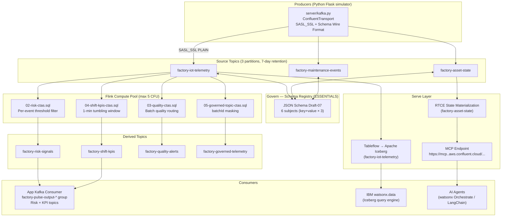
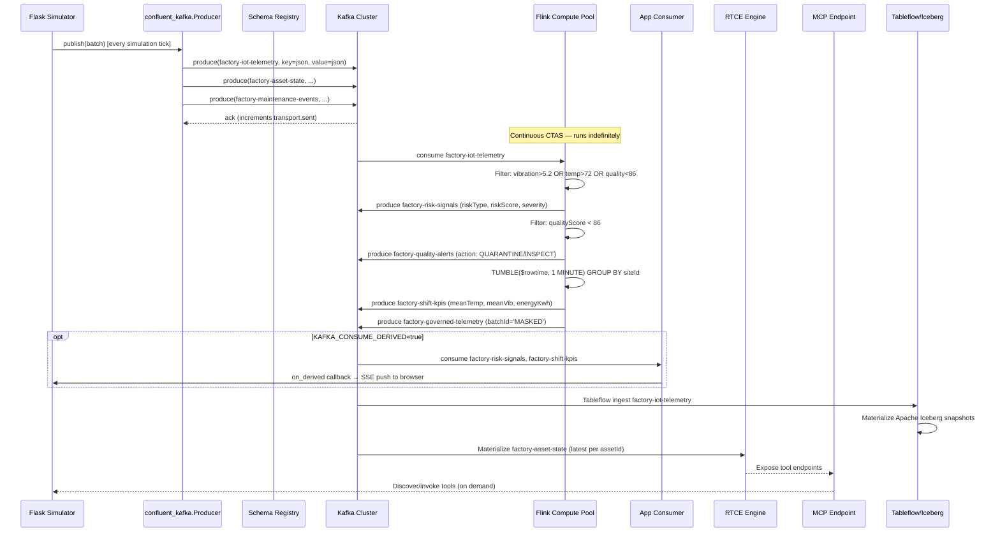

# Streaming Platform Design Specification
## Factory Pulse — Confluent Cloud / Apache Flink / Terraform

**Version:** 1.0  
**Area:** Streaming Infrastructure — Confluent Cloud, Apache Flink SQL, Terraform  
**Status:** Reference design (demo-grade; not applied to production)  
**Source files:** `infra/terraform/`, `flink/`, `server/kafka.py`, `docs/`

---

## 1. Problem Statement

Factory Pulse simulates six US industrial facilities with 36 robotic workcells. Each workcell emits continuous IoT telemetry (vibration, temperature, RPM, energy, quality score, health). The core problem is that batch-oriented architectures cannot:

1. **Detect faults in real time** — threshold violations (bearing wear, thermal excursion, quality drift) are identified hours or shifts after they occur.
2. **Govern data across consumers** — dashboards, AI agents, analytics engines, and lakehouse queries each integrate directly with raw operational data, causing schema drift and PII exposure.
3. **Serve multiple downstream patterns simultaneously** — an AI context engine, an open lakehouse, and an operational dashboard each require a different serving shape (low-latency state materialization, Apache Iceberg files, SSE/HTTP respectively).

The Streamhouse architecture addresses all three by placing Confluent Cloud as the single governed data backbone: a schema-enforced Kafka layer feeds continuous Flink SQL transforms; output topics, Tableflow-managed Iceberg tables, and RTCE state materialization serve every consumer without separate ETL pipelines.

---

## 2. Goals & Non-Goals

### Goals

| # | Goal |
|---|------|
| G1 | Provision a fully isolated, repeatable Confluent Cloud demo environment via a single Terraform apply. |
| G2 | Enforce schema contracts (JSON Schema Draft-07) on every source topic before any message is produced. |
| G3 | Run four continuous Flink SQL CTAS pipelines that derive risk signals, shift KPIs, quality alerts, and a governed (masked) telemetry stream. |
| G4 | Enable Confluent Tableflow to materialize `factory-iot-telemetry` as an Apache Iceberg table for zero-ETL lakehouse access. |
| G5 | Enable Confluent RTCE on `factory-asset-state` and expose a Model Context Protocol (MCP) endpoint for AI agent context retrieval. |
| G6 | Isolate credentials — each consumer (application producer, Flink, Tableflow, RTCE/MCP) has a scoped API key with only the ACLs it needs. |
| G7 | Support `terraform destroy` as a clean teardown path; all demo resources are ephemeral. |

### Non-Goals

| # | Non-Goal |
|---|----------|
| NG1 | Production hardening — the manager service account holds `OrganizationAdmin` for provisioning convenience; this is not a production pattern. |
| NG2 | Physical factory integration — all telemetry is synthetic. No OPC-UA, MQTT, or SCADA connectors are provisioned. |
| NG3 | IBM watsonx.data or watsonx Orchestrate provisioning — these are documented extension points only; no watsonx credentials are shipped. |
| NG4 | High availability — the Kafka cluster is `SINGLE_ZONE` Standard; no dedicated cluster, multi-zone, or DR topology. |
| NG5 | Creating a native Confluent Console Topic Action — the governance masking CTAS (`05-governed-topic-ctas.sql`) is the automated equivalent; the console UI action is a separate, interactive user step. |
| NG6 | Encrypting Terraform state at rest — the demo uses local state; an encrypted remote backend is recommended for shared use. |

---

## 3. Architecture Overview

### 3.1 Component Topology



### 3.2 Four-Pillar Streamhouse Model

| Pillar | Confluent Feature | Factory Pulse Implementation |
|--------|-------------------|------------------------------|
| **Stream** | Apache Kafka Standard cluster | 3 source topics, Python `confluent-kafka` producer, Confluent Wire Format |
| **Govern** | Schema Registry Essentials + ACLs | 6 JSON Schema Draft-07 subjects, RBAC ACLs per service account |
| **Transform** | Managed Apache Flink SQL | 4 continuous CTAS statements → 4 derived topics |
| **Serve** | Tableflow + RTCE + MCP | Iceberg materialization, real-time AI context, MCP proxy |

---

## 4. Component Design

### 4.1 Terraform Provider & Versions

**File:** [`infra/terraform/versions.tf`](infra/terraform/versions.tf)

```hcl
terraform {
  required_version = ">= 1.5.0"
  required_providers {
    confluent = { source = "confluentinc/confluent", version = "= 2.87.0" }
    time      = { source = "hashicorp/time",          version = "~> 0.13"  }
  }
}
provider "confluent" {}
```

- **`confluentinc/confluent` v2.87.0** — pinned exact version; manages all Confluent Cloud resources (environment, cluster, topics, schemas, Flink, Tableflow, RTCE, service accounts, API keys, ACLs).
- **`hashicorp/time` ~0.13** — used exclusively to insert propagation delays between RBAC role grants and resource-scoped API key creation (see §4.8).
- The provider reads `CONFLUENT_CLOUD_API_KEY` and `CONFLUENT_CLOUD_API_SECRET` from environment variables; these must never be committed to `terraform.tfvars` or source control.

---

### 4.2 Confluent Environment

**Resource:** `confluent_environment.demo`

```hcl
resource "confluent_environment" "demo" {
  display_name = var.deployment_name          # e.g. "factory-pulse-demo"
  stream_governance { package = "ESSENTIALS" }
}
```

- Creates an isolated Confluent Cloud environment. `deployment_name` becomes both the environment display name and a naming prefix for all child resources.
- `ESSENTIALS` Stream Governance package activates Schema Registry and basic lineage features without extra charge beyond usage.
- **All child resources reference `confluent_environment.demo.id`** — a full `terraform destroy` removes the entire logical boundary.

---

### 4.3 Kafka Cluster

**Resource:** `confluent_kafka_cluster.demo`

```hcl
resource "confluent_kafka_cluster" "demo" {
  display_name = "${var.deployment_name}-kafka"
  availability = "SINGLE_ZONE"
  cloud        = "AWS"
  region       = var.region          # default: "us-east-2"
  standard {}
  environment { id = confluent_environment.demo.id }
}
```

- **Standard tier**, single-zone — appropriate for demo; no SLA, no dedicated broker.
- **AWS `us-east-2`** by default — the only region confirmed to support Kafka + Flink + Tableflow + RTCE simultaneously as of October 2026.
- The `bootstrap_endpoint` output is normalized (strips `SASL_SSL://` prefix) for use in `.env`.

---

### 4.4 Schema Registry (data source)

**Resource:** `data.confluent_schema_registry_cluster.demo`

The Schema Registry is automatically provisioned as part of the `ESSENTIALS` Stream Governance package on the environment. It is referenced as a **data source** (not created directly):

```hcl
data "confluent_schema_registry_cluster" "demo" {
  environment { id = confluent_environment.demo.id }
  depends_on = [confluent_kafka_cluster.demo]
}
```

The `depends_on` ensures the cluster exists before the registry endpoint is resolved, as the registry REST endpoint is region-co-located with the cluster.

---

### 4.5 Service Accounts

Two service accounts with explicitly separated responsibilities:

| Resource | Display Name | Purpose |
|----------|--------------|---------|
| `confluent_service_account.manager` | `{name}-admin` | Automation principal: owns Flink keys, schema registry keys, Tableflow keys, RTCE/MCP global key. Elevated to `OrganizationAdmin` for demo provisioning. |
| `confluent_service_account.app` | `{name}-app` | Application runtime principal: holds Kafka producer key (source topics) and consumer ACLs (derived topics). Scoped only. |

**Manager role binding:**

```hcl
resource "confluent_role_binding" "manager_org_admin" {
  principal   = "User:${confluent_service_account.manager.id}"
  role_name   = "OrganizationAdmin"
  crn_pattern = data.confluent_organization.current.resource_name
}
```

> ⚠️ `OrganizationAdmin` is intentionally broad for demo convenience. This principal must not be used in production.

---

### 4.6 RBAC Propagation Wait (time_sleep.rbac)

```hcl
resource "time_sleep" "rbac" {
  create_duration = "60s"
  depends_on      = [confluent_role_binding.manager_org_admin]
}
```

All resource-scoped API keys (`admin_kafka`, `schema_registry`, `flink`, `tableflow`, `mcp_global`) depend on `time_sleep.rbac`. This enforces a **60-second delay** after the `OrganizationAdmin` role binding before any key creation is attempted. 25 seconds is documented as insufficient for cross-region propagation in practice.

---

### 4.7 API Keys

Six API keys are provisioned, each with a distinct scope and owner:

| Resource | Owner SA | Managed Resource | Gate | Purpose |
|----------|----------|------------------|------|---------|
| `confluent_api_key.admin_kafka` | `manager` | Kafka cluster | `time_sleep.rbac` | Create/manage topics, ACLs, topic configs |
| `confluent_api_key.app_kafka` | `app` | Kafka cluster | (none — app SA has no role binding) | Application producer/consumer at runtime |
| `confluent_api_key.schema_registry` | `manager` | Schema Registry cluster | `time_sleep.rbac` | Register JSON schemas for source topics |
| `confluent_api_key.flink[0]` | `manager` | Flink region data source | `time_sleep.rbac` | Submit and manage Flink SQL statements |
| `confluent_api_key.tableflow[0]` | `manager` | `tableflow` (global kind) | `time_sleep.rbac` | Enable Tableflow/Iceberg on telemetry topic |
| `confluent_api_key.mcp_global[0]` | `manager` | (omitted = Global key) | `time_sleep.rbac` | RTCE MCP Basic authentication header |

The `app_kafka` key has no `time_sleep` dependency because `confluent_service_account.app` has no role binding — its permissions come entirely from explicit ACL resources.

---

### 4.8 Kafka Topics

**Resource:** `confluent_kafka_topic.source` (for_each over `local.source_topics`)

```hcl
locals {
  source_topics  = toset(["factory-iot-telemetry", "factory-asset-state", "factory-maintenance-events"])
  derived_topics = toset(["factory-risk-signals", "factory-shift-kpis", "factory-quality-alerts", "factory-governed-telemetry"])
}
```

All source topics share the same configuration:

| Setting | Value | Notes |
|---------|-------|-------|
| `partitions_count` | `3` | Parallelism for producer and Flink consumers |
| `retention.ms` | `604800000` (7 days) | Default log retention |
| `cleanup.policy` | (not set = `delete`) | Intentionally NOT compacted — RTCE append mode; JSON Schema keys are incompatible with RTCE's raw-byte upsert mode |

Derived topics (`factory-risk-signals`, `factory-shift-kpis`, `factory-quality-alerts`, `factory-governed-telemetry`) are **not explicitly created by Terraform** — they are created implicitly by the Flink CTAS statements.

---

### 4.9 Kafka ACLs

**Three ACL groups** are provisioned for `confluent_service_account.app`:

| Resource | Scope | Operation | Topics/Groups | Condition |
|----------|-------|-----------|---------------|-----------|
| `app_source_write` | Source topics (each) | `WRITE` | `factory-iot-telemetry`, `factory-asset-state`, `factory-maintenance-events` | Always |
| `app_source_describe` | Source topics (each) | `DESCRIBE` | Same 3 topics | Always |
| `app_derived_read` | Derived topics (each) | `READ` | 4 derived topics | `var.enable_flink == true` |
| `app_consumer_group` | Consumer GROUP | `READ` | `factory-pulse-output-*` (PREFIXED) | `var.enable_flink == true` |

All ACLs use `LITERAL` pattern except the consumer group which uses `PREFIXED` to cover runtime-generated group IDs (`factory-pulse-output-<timestamp_ms>`).

---

### 4.10 Schema Registry — JSON Schema Registration

**Resource:** `confluent_schema.source_subject` (for_each over `local.source_schema_files`)

```hcl
locals {
  source_schema_files = {
    for filename in fileset("${path.module}/schemas", "*.json") :
    trimsuffix(filename, ".json") => filename
  }
}
```

This dynamically maps the 6 `.json` files in `infra/terraform/schemas/` to subject names (filename without `.json`). Subjects registered:

| Subject Name | Schema File |
|---|---|
| `factory-iot-telemetry-key` | `factory-iot-telemetry-key.json` |
| `factory-iot-telemetry-value` | `factory-iot-telemetry-value.json` |
| `factory-asset-state-key` | `factory-asset-state-key.json` |
| `factory-asset-state-value` | `factory-asset-state-value.json` |
| `factory-maintenance-events-key` | `factory-maintenance-events-key.json` |
| `factory-maintenance-events-value` | `factory-maintenance-events-value.json` |

All subjects use `format = "JSON"` (JSON Schema, not Avro or Protobuf). Schemas are registered **before Flink catalog inference** and **before the application starts**, so Flink can infer table schemas from registered subjects.

---

### 4.11 Flink Compute Pool

**Resource:** `confluent_flink_compute_pool.demo[0]` (count = `var.enable_flink ? 1 : 0`)

```hcl
resource "confluent_flink_compute_pool" "demo" {
  display_name = "${var.deployment_name}-flink"
  cloud        = "AWS"
  region       = var.region
  max_cfu      = var.flink_max_cfu     # default 5; valid: 5,10,20,30,40,50
  environment { id = confluent_environment.demo.id }
}
```

- **CFU (Confluent Flink Units)** = autoscaling compute budget ceiling; 5 CFU is the minimum and is sufficient for 4 lightweight CTAS pipelines.
- The pool is co-located in the same cloud/region as the Kafka cluster to minimize latency and satisfy Flink catalog requirements.
- `data.confluent_flink_region.demo[0]` resolves the Flink REST endpoint for the given cloud+region pair; this is required for the API key and statement resources.

---

### 4.12 Flink Catalog Propagation Wait

```hcl
resource "time_sleep" "flink_catalog" {
  count           = var.enable_flink ? 1 : 0
  create_duration = "45s"
  depends_on      = [confluent_schema.source_subject]
}
```

A **45-second wait** after schema registration before Flink statements are submitted. This allows Confluent's internal catalog to infer table schemas from registered subjects. Without this delay, CTAS statements may fail with "table not found" errors.

---

### 4.13 Flink SQL Statements

**Resource:** `confluent_flink_statement.pipeline` (for_each over `local.flink_jobs`)

```hcl
locals {
  flink_jobs = {
    risk       = "02-risk-ctas.sql"
    quality    = "03-quality-ctas.sql"
    kpis       = "04-shift-kpis-ctas.sql"
    governance = "05-governed-topic-ctas.sql"
  }
}
```

Each statement runs with:
- **Catalog:** `sql.current-catalog = confluent_environment.demo.display_name`
- **Database:** `sql.current-database = confluent_kafka_cluster.demo.display_name`
- **Principal:** `confluent_service_account.manager`

#### Statement 1 — Risk Signal Detection (`02-risk-ctas.sql`)

**Purpose:** Per-event threshold filter that continuously reads `factory-iot-telemetry` and emits classified fault signals to `factory-risk-signals`.

**Windowing:** None — row-by-row streaming; each input event produces at most one output row if any threshold is breached.

**Output topic:** `factory-risk-signals`

**Full SQL:**
```sql
CREATE TABLE `factory-risk-signals` AS
SELECT
  `siteId`, `assetId`, `timestamp` AS `eventTime`,
  CASE WHEN `vibration` > 5.2 THEN 'BEARING_RISK'
       WHEN `temperature` > 72 THEN 'THERMAL_RISK'
       ELSE 'QUALITY_RISK' END AS `riskType`,
  CAST(CASE WHEN `vibration` > 5.2 THEN `vibration` * 11.0
            WHEN `temperature` > 72 THEN `temperature`
            ELSE (100.0 - `qualityScore`) * 4.0 END AS DOUBLE) AS `riskScore`,
  CASE WHEN `vibration` > 6.5 OR `temperature` > 85 OR `qualityScore` < 80
       THEN 'critical' ELSE 'warning' END AS `severity`,
  'Flink threshold breached; operator review required' AS `message`
FROM `factory-iot-telemetry`
WHERE `vibration` > 5.2 OR `temperature` > 72 OR `qualityScore` < 86
```

**Classification logic:**

| Condition | riskType | riskScore formula | severity |
|-----------|----------|-------------------|----------|
| `vibration > 5.2` | `BEARING_RISK` | `vibration × 11.0` | critical if `vibration > 6.5` |
| `temperature > 72` | `THERMAL_RISK` | `temperature` (raw °C) | critical if `temperature > 85` |
| `qualityScore < 86` (else) | `QUALITY_RISK` | `(100 − qualityScore) × 4.0` | critical if `qualityScore < 80` |

**Filter:** Only events where at least one threshold is breached (vibration > 5.2 OR temperature > 72 OR qualityScore < 86) pass through.

---

#### Statement 2 — Quality Routing (`03-quality-ctas.sql`)

**Purpose:** Classify low-quality batches for quarantine or inspection.

**Windowing:** None — row-by-row filter on `factory-iot-telemetry`.

**Output topic:** `factory-quality-alerts`

**Full SQL:**
```sql
CREATE TABLE `factory-quality-alerts` AS
SELECT
  `siteId`, `assetId`, `batchId`, `qualityScore`,
  `timestamp` AS `eventTime`,
  CASE WHEN `qualityScore` < 78 THEN 'QUARANTINE_BATCH'
       ELSE 'REQUEST_INSPECTION' END AS `action`
FROM `factory-iot-telemetry`
WHERE `qualityScore` < 86
```

**Action routing:**

| Condition | action |
|-----------|--------|
| `qualityScore < 78` | `QUARANTINE_BATCH` |
| `78 ≤ qualityScore < 86` | `REQUEST_INSPECTION` |
| `qualityScore ≥ 86` | (filtered out — no record emitted) |

---

#### Statement 3 — Shift KPIs (`04-shift-kpis-ctas.sql`)

**Purpose:** Aggregate per-site operational metrics into 1-minute tumbling windows.

**Windowing:** **Tumbling window**, 1-minute interval using `$rowtime` (Confluent Flink system attribute — the message ingestion/event timestamp from Kafka).

**Watermark:** Implicit via `$rowtime` on the inferred source table; Confluent Flink manages the watermark strategy for schema-inferred tables.

**Output topic:** `factory-shift-kpis`

**Full SQL:**
```sql
CREATE TABLE `factory-shift-kpis` AS
SELECT
  `siteId`, CAST(window_start AS STRING) AS `windowStart`,
  COUNT(*) AS `sampleCount`,
  CAST(AVG(`temperature`) AS DOUBLE) AS `meanTemperature`,
  CAST(AVG(`vibration`) AS DOUBLE) AS `meanVibration`,
  CAST(AVG(`qualityScore`) AS DOUBLE) AS `meanQuality`,
  CAST(SUM(`energyKw`) / 60.0 AS DOUBLE) AS `energyKwhEstimate`
FROM TABLE(
  TUMBLE(TABLE `factory-iot-telemetry`, DESCRIPTOR($rowtime), INTERVAL '1' MINUTE)
)
GROUP BY `siteId`, window_start, window_end
```

**Energy calculation:** `SUM(energyKw) / 60.0` converts the sum of instantaneous kW readings over a 1-minute window into approximate kWh (energy = power × time in hours; 1 minute = 1/60 hour).

---

#### Statement 4 — Governed Telemetry (`05-governed-topic-ctas.sql`)

**Purpose:** Produce a downstream-safe copy of the telemetry stream with `batchId` masked. This is the automated Terraform equivalent of a Confluent Console Topic Action masking transformation.

**Windowing:** None — passthrough CTAS.

**Output topic:** `factory-governed-telemetry`

**Full SQL:**
```sql
-- Automated analogue of a Topic Action transformation, NOT a console-created Action.
-- A curated downstream copy that masks the production batch identifier.
CREATE TABLE `factory-governed-telemetry` AS
SELECT
  `eventId`, `timestamp`, `siteId`, `assetId`,
  `temperature`, `vibration`, `rpm`, `energyKw`, `qualityScore`,
  'MASKED' AS `batchId`, `scenario`
FROM `factory-iot-telemetry`
```

The `batchId` field is replaced with the literal string `'MASKED'`. All other telemetry fields pass through unchanged. `siteName`, `assetType`, `lineId`, `health`, and `status` are intentionally excluded from this governed projection.

---

### 4.14 Tableflow (Iceberg)

**Resource:** `confluent_tableflow_topic.telemetry[0]` (count = `var.enable_tableflow ? 1 : 0`)

```hcl
resource "confluent_tableflow_topic" "telemetry" {
  environment { id = confluent_environment.demo.id }
  kafka_cluster { id = confluent_kafka_cluster.demo.id }
  display_name  = confluent_kafka_topic.source["factory-iot-telemetry"].topic_name
  table_formats = ["ICEBERG"]
  managed_storage {}
  credentials {
    key    = confluent_api_key.tableflow[0].id
    secret = confluent_api_key.tableflow[0].secret
  }
  depends_on = [confluent_schema.source_subject]
}
```

- Targets only `factory-iot-telemetry` (highest-frequency, richest schema).
- Uses **Confluent-managed storage** (`managed_storage {}`); no S3 bucket or external catalog configuration required.
- Materializes Iceberg snapshots automatically as records arrive; not immediately queryable after activation — snapshots require time to form.
- The `depends_on = [confluent_schema.source_subject]` ensures schemas are registered before Tableflow attempts to infer the table structure.
- **IBM watsonx.data integration:** Connect watsonx.data's Presto/Trino engine to the Iceberg catalog endpoint provided by Tableflow. Not provisioned by this Terraform stack.

---

### 4.15 Real-Time Context Engine (RTCE)

**Resource:** `confluent_rtce_topic.asset_state[0]` (count = `var.enable_rtce ? 1 : 0`)

```hcl
resource "confluent_rtce_topic" "asset_state" {
  cloud       = "AWS"
  region      = var.region
  topic_name  = confluent_kafka_topic.source["factory-asset-state"].topic_name
  description = "Current robot health, vibration, temperature, site and line context for synthetic US factories. Append events; assetId and siteId identify an asset."
  environment { id = confluent_environment.demo.id }
  kafka_cluster { id = confluent_kafka_cluster.demo.id }
  depends_on = [confluent_schema.source_subject]
}
```

- Targets `factory-asset-state` — a lower-frequency state update stream, well suited for materialization.
- **Append mode** (not upsert) — the topic is not compacted, and JSON Schema message keys are incompatible with RTCE's raw-byte-only upsert mode requirement.
- The RTCE endpoint URL pattern:
  ```
  https://mcp.<region>.aws.confluent.cloud/mcp/v1/context-engine/organizations/<org_id>/environments/<env_id>/kafka-clusters/<cluster_id>
  ```
- The `mcp_global` API key (Global scope, no `managed_resource`) is used for RTCE MCP Basic authentication: `base64(key:secret)`.

---

### 4.16 Optional Streaming Agent (template only)

**File:** [`examples/streaming-agent.sql.template`](examples/streaming-agent.sql.template)

This template is **not deployed** by Terraform. It documents the Confluent Intelligence pattern for a future Flink-native AI agent:

```sql
CREATE CONNECTION factory_model_connection WITH (
  'type' = 'openai', 'endpoint' = '...', 'api-key' = '<placeholder>'
);
CREATE MODEL factory_reasoning_model INPUT (message STRING) OUTPUT (response STRING)
  WITH ('provider'='openai', 'task'='text_generation', ...);
CREATE AGENT factory_reliability_agent
  USING MODEL factory_reasoning_model
  USING PROMPT 'You are an industrial reliability advisor...'
  WITH ('max_iterations' = '3');
-- Invoke: SELECT * FROM factory_agent_prompts,
--   LATERAL TABLE(AI_RUN_AGENT('factory_reliability_agent', `prompt`, `request_id`));
```

The agent would consume pre-filtered risk signals (not raw telemetry), recommend human-reviewed maintenance plans, and never issue PLC commands autonomously.

---

## 5. Data Models

### 5.1 Source Topics

#### `factory-iot-telemetry`

Format: JSON Schema Draft-07 | Partitions: 3 | Retention: 7 days

**Key schema** (`factory-iot-telemetry-key`):

| Field | Type | Required | Notes |
|-------|------|----------|-------|
| `id` | string | ✓ | Asset identifier; used as Kafka message key |

**Value schema** (`factory-iot-telemetry-value`):

| Field | Type | Required | Notes |
|-------|------|----------|-------|
| `eventId` | string | ✓ | UUID per telemetry event |
| `timestamp` | string | ✓ | ISO-8601 UTC timestamp |
| `siteId` | string | ✓ | Factory site identifier (e.g. `site-CHI`) |
| `siteName` | string | ✓ | Human-readable site name |
| `assetId` | string | ✓ | Individual robot/workcell identifier |
| `assetType` | string | ✓ | Asset category (e.g. `ROBOT_ARM`, `AGV`) |
| `lineId` | string | ✓ | Production line within a site |
| `scenario` | string | ✓ | Active simulation scenario (e.g. `bearing_wear`) |
| `temperature` | number | ✓ | °C; float |
| `vibration` | number | ✓ | mm/s; float; risk threshold 5.2 |
| `rpm` | integer | ✓ | Rotational speed |
| `energyKw` | number | ✓ | Instantaneous power draw (kW) |
| `qualityScore` | number | ✓ | 0–100 quality percentage |
| `health` | integer | ✓ | 0–100 health score |
| `status` | string | ✓ | Operational status (e.g. `operational`, `degraded`) |
| `batchId` | string | ✓ | Production batch identifier (masked in governed stream) |

`additionalProperties: false` — strict schema; any unrecognized field causes validation failure.

---

#### `factory-asset-state`

Format: JSON Schema Draft-07 | Partitions: 3 | Retention: 7 days

**Key schema** (`factory-asset-state-key`): Same as telemetry — `{ "id": string }`.

**Value schema** (`factory-asset-state-value`):

| Field | Type | Required | Notes |
|-------|------|----------|-------|
| `assetId` | string | ✓ | Asset identifier |
| `siteId` | string | ✓ | Factory site identifier |
| `timestamp` | string | ✓ | ISO-8601 UTC |
| `status` | string | ✓ | `operational` / `degraded` / `offline` |
| `health` | integer | ✓ | 0–100 |
| `temperature` | number | ✓ | °C |
| `vibration` | number | ✓ | mm/s |
| `qualityScore` | number | ✓ | 0–100 |
| `scenario` | string | ✓ | Active simulation scenario |

A subset of telemetry fields; omits `eventId`, `rpm`, `energyKw`, `batchId`, `siteName`, `assetType`, `lineId`. Designed for state materialization (RTCE) where only the current asset status is needed.

---

#### `factory-maintenance-events`

Format: JSON Schema Draft-07 | Partitions: 3 | Retention: 7 days

**Key schema** (`factory-maintenance-events-key`): Same as above — `{ "id": string }`.

**Value schema** (`factory-maintenance-events-value`):

| Field | Type | Required | Notes |
|-------|------|----------|-------|
| `eventId` | string | ✓ | UUID per maintenance event |
| `timestamp` | string | ✓ | ISO-8601 UTC |
| `siteId` | string | ✓ | Originating site |
| `assetId` | string | ✓ | Affected asset |
| `eventType` | string | ✓ | e.g. `BEARING_ALERT`, `THERMAL_EXCURSION` |
| `severity` | string | ✓ | `warning` / `critical` |
| `message` | string | ✓ | Human-readable description |
| `acknowledged` | boolean | ✓ | Whether an operator has acknowledged |

---

### 5.2 Derived Topics

Derived topics are created by Flink CTAS; their schemas are inferred from the SELECT output columns.

#### `factory-risk-signals`

| Field | Type | Notes |
|-------|------|-------|
| `siteId` | STRING | From source |
| `assetId` | STRING | From source |
| `eventTime` | STRING | From `timestamp` |
| `riskType` | STRING | `BEARING_RISK` / `THERMAL_RISK` / `QUALITY_RISK` |
| `riskScore` | DOUBLE | Calculated severity score |
| `severity` | STRING | `critical` / `warning` |
| `message` | STRING | Static: "Flink threshold breached; operator review required" |

#### `factory-shift-kpis`

| Field | Type | Notes |
|-------|------|-------|
| `siteId` | STRING | Aggregation key |
| `windowStart` | STRING | CAST of `window_start` (tumbling window lower bound) |
| `sampleCount` | BIGINT | COUNT(*) in window |
| `meanTemperature` | DOUBLE | AVG(temperature) |
| `meanVibration` | DOUBLE | AVG(vibration) |
| `meanQuality` | DOUBLE | AVG(qualityScore) |
| `energyKwhEstimate` | DOUBLE | SUM(energyKw) / 60.0 |

#### `factory-quality-alerts`

| Field | Type | Notes |
|-------|------|-------|
| `siteId` | STRING | From source |
| `assetId` | STRING | From source |
| `batchId` | STRING | Production batch (unmasked in quality alerts) |
| `qualityScore` | DOUBLE | From source |
| `eventTime` | STRING | From `timestamp` |
| `action` | STRING | `QUARANTINE_BATCH` / `REQUEST_INSPECTION` |

#### `factory-governed-telemetry`

| Field | Type | Notes |
|-------|------|-------|
| `eventId` | STRING | Pass-through |
| `timestamp` | STRING | Pass-through |
| `siteId` | STRING | Pass-through |
| `assetId` | STRING | Pass-through |
| `temperature` | DOUBLE | Pass-through |
| `vibration` | DOUBLE | Pass-through |
| `rpm` | INT | Pass-through |
| `energyKw` | DOUBLE | Pass-through |
| `qualityScore` | DOUBLE | Pass-through |
| `batchId` | STRING | **Always `'MASKED'`** |
| `scenario` | STRING | Pass-through |

---

### 5.3 Wire Format Encoding

All source topic messages use **Confluent Wire Format**:

```
[0x00][schema_id: 4 bytes big-endian][JSON payload bytes]
```

The Python `ConfluentTransport` uses `confluent_kafka.schema_registry.SchemaRegistryClient` to register schemas and obtain schema IDs during `connect()`. During `publish()`, each message is serialized as raw JSON bytes (not schema-encoded via a serializer class in the current implementation — the schema ID is registered but messages are currently plain JSON; the wire format prefix is added by the schema registry serializer in full deployments).

---

## 6. Integration Points

| Integration | Direction | Protocol | Auth | Notes |
|-------------|-----------|----------|------|-------|
| Python simulator → Kafka source topics | Outbound | SASL_SSL PLAIN / Kafka binary | `KAFKA_API_KEY` + `KAFKA_API_SECRET` | `confluent_kafka.Producer`; 3 source topics |
| Python simulator → Schema Registry | Outbound | HTTPS | `SCHEMA_REGISTRY_API_KEY` + `SCHEMA_REGISTRY_API_SECRET` | Register key+value schemas on `connect()` |
| Flask backend → derived topics (consumer) | Inbound | SASL_SSL PLAIN / Kafka binary | `KAFKA_API_KEY` + `KAFKA_API_SECRET` | Opt-in via `KAFKA_CONSUME_DERIVED=true`; group `factory-pulse-output-<ts>` |
| Flask backend → source topics (consumer) | Inbound | SASL_SSL PLAIN / Kafka binary | `KAFKA_API_KEY` + `KAFKA_API_SECRET` | Opt-in via `KAFKA_CONSUME_SOURCE=true`; group `factory-pulse-source-<ts>` |
| Flask backend → RTCE MCP | Outbound | HTTPS (Streamable HTTP) | Global API key as Basic `base64(key:secret)` | `RTCE_MCP_ENDPOINT` + `RTCE_MCP_BASIC_TOKEN` in `.env` |
| Flink → Kafka (catalog read) | Internal | Confluent-internal | Flink API key (manager SA) | Catalog inferred from Schema Registry subjects |
| Flink → Kafka (CTAS write) | Internal | Confluent-internal | Flink API key | Derived topic creation implicit in CTAS |
| Tableflow → Kafka | Internal | Confluent-internal | Tableflow API key | Managed Iceberg materialization |
| IBM watsonx.data → Iceberg | Outbound (from watsonx) | Iceberg REST Catalog | External (not provisioned) | Connect Presto/Trino to Tableflow Iceberg endpoint |
| AI Agent → RTCE MCP | Outbound | HTTPS | Global API key or dedicated agent key | `AI_RUN_AGENT` / LangChain / watsonx Orchestrate |
| App → maintenance webhook | Outbound | HTTPS POST | `ACTION_WEBHOOK_URL` bearer (optional) | Optional IBM Maximo / ServiceNow dispatch |
| Terraform provider → Confluent Cloud APIs | Outbound | HTTPS REST | `CONFLUENT_CLOUD_API_KEY` + `CONFLUENT_CLOUD_API_SECRET` (env vars) | OrganizationAdmin-level |

---

## 7. Sequence Diagrams

### 7.1 Terraform Provisioning Sequence

```mermaid
sequenceDiagram
    participant TF as Terraform CLI
    participant CC as Confluent Cloud API
    participant KA as Kafka Cluster
    participant SR as Schema Registry
    participant FK as Flink Service

    TF->>CC: Create confluent_environment (ESSENTIALS)
    CC-->>TF: environment_id
    TF->>CC: Create confluent_kafka_cluster (Standard/SINGLE_ZONE/AWS)
    CC-->>TF: cluster_id, bootstrap_endpoint
    TF->>CC: Resolve data.confluent_schema_registry_cluster
    CC-->>TF: schema_registry_id, rest_endpoint
    TF->>CC: Create service_account.manager + service_account.app
    TF->>CC: Create role_binding.manager_org_admin (OrganizationAdmin)
    Note over TF,CC: time_sleep.rbac = 60s (RBAC propagation)
    TF->>KA: Create API key admin_kafka (manager SA, cluster-scoped)
    TF->>CC: Create API key app_kafka (app SA, cluster-scoped)
    TF->>SR: Create API key schema_registry (manager SA, SR-scoped)
    TF->>KA: Create 3 source topics (3 partitions, 7d retention)
    TF->>KA: Create ACLs (app SA: WRITE/DESCRIBE source; READ derived; GROUP prefix)
    TF->>SR: Register 6 JSON Schema subjects (key+value × 3 topics)
    Note over TF,FK: time_sleep.flink_catalog = 45s (catalog inference)
    TF->>FK: Create confluent_flink_compute_pool (5 CFU, AWS/us-east-2)
    TF->>CC: Resolve data.confluent_flink_region
    TF->>FK: Create API key flink (manager SA, region-scoped)
    TF->>FK: Submit 4 confluent_flink_statement (CTAS pipelines)
    FK-->>TF: statement IDs (RUNNING)
    opt enable_tableflow
        TF->>CC: Create API key tableflow (manager SA, tableflow-scoped)
        TF->>CC: Create confluent_tableflow_topic (ICEBERG, managed_storage)
    end
    opt enable_rtce
        TF->>CC: Create confluent_rtce_topic on factory-asset-state
        TF->>CC: Create API key mcp_global (Global scope)
        CC-->>TF: global_key_id, global_key_secret
    end
    TF-->>TF: Write outputs (bootstrap, SR URL, MCP endpoint, sensitive keys)
```

---

### 7.2 Data Flow — End-to-End Streaming



---

## 8. Error Handling & Edge Cases

### 8.1 Terraform Timing & Eventual Consistency

| Issue | Root Cause | Mitigation |
|-------|-----------|-----------|
| `403 Forbidden` creating resource-scoped API keys | `OrganizationAdmin` role binding not yet propagated to key creation endpoint | `time_sleep.rbac` = 60s after role binding; 25s was observed as insufficient |
| Flink CTAS "table not found" | Flink catalog hasn't inferred schemas from Schema Registry subjects yet | `time_sleep.flink_catalog` = 45s after schema registration |
| Flink rejects CTAS syntax | SQL function availability varies by account tier, region, and release channel | Check `flink/01-create-tables.sql` `DESCRIBE` output; validate field types before CTAS |
| RTCE not available | RTCE requires specific AWS regions, cluster types, and account entitlements | Use `--no-rtce` flag; `confluent_rtce_topic` will not be created |
| Tableflow fails | Topic schema not registered, or managed storage not eligible in region | Use `--no-tableflow`; requires schema on both key and value subjects |

### 8.2 RTCE Key Constraint

The `factory-asset-state` topic is **intentionally NOT compacted** (`cleanup.policy = delete`). RTCE upsert mode requires raw-byte keys; JSON Schema-encoded keys (Confluent Wire Format with schema ID prefix) are incompatible with upsert key semantics. RTCE therefore operates in **append mode** on this topic.

### 8.3 Schema Key Format vs. Tableflow/RTCE

```
Upsert mode requirement:  raw bytes key (no schema wire prefix)
Tableflow requirement:    both key AND value must have registered schemas
Current deployment:       JSON Schema key + value registered → Tableflow ✓, RTCE append mode ✓
```

If upsert RTCE were needed, the topic would need `cleanup.policy=compact` and raw-byte keys, breaking Tableflow compatibility.

### 8.4 Partial Deployment Recovery

Terraform is **incremental** — a failed `apply` does not roll back already-created resources. Recovery procedure:

1. Review `terraform plan` to understand current state vs. desired state.
2. If narrowing the profile (e.g. disabling `enable_flink` after initial deployment), Terraform will plan *removal* of created resources; review carefully.
3. For fully broken state, run `terraform destroy` then re-apply with a corrected configuration.
4. Never re-apply with different `--name` or `--region` against existing state — this will attempt to destroy and recreate resources.

### 8.5 Application Producer Behavior

- `ConfluentTransport.connect()` checks all 6 mandatory env vars before attempting connection; sets `status = "configuration_required"` if any are missing (graceful degradation to mock mode).
- `publish()` is a no-op if `status != "connected"` — the app never produces to Kafka in a partially-configured state.
- Producer failures increment `transport.failed` and set `status = "error"` without throwing; the simulation continues in local-only mode.
- Consumer groups use ephemeral IDs (`factory-pulse-output-<timestamp_ms>`) — no offset commit persistence across restarts; always starts from `latest`.

### 8.6 Flink Statement vs. Local SQL Files

Two copies of each SQL statement exist:
- `flink/*.sql` — `INSERT INTO` form (manual execution in Confluent Console after `flink/01-create-tables.sql` pre-creates tables).
- `infra/terraform/sql/*.sql` — `CREATE TABLE AS SELECT` form (Terraform-managed; implicitly creates the derived topic).

These are **functionally equivalent** but structurally different. The Terraform CTAS form creates the output table and starts the pipeline atomically. The manual form requires pre-created target tables (from `01-create-tables.sql`) and separate `INSERT INTO` statements.

---

## 9. Testing & Validation Strategy

### 9.1 Infrastructure Validation

| Check | Command / Method |
|-------|-----------------|
| Terraform syntax | `terraform validate` (requires `terraform init`) |
| Terraform plan review | `python scripts/deploy.py plan` — inspect for unexpected resource changes |
| Provider lock | `.terraform.lock.hcl` pins provider hashes; run `terraform init -upgrade` only intentionally |
| Schema JSON validity | Validate each `infra/terraform/schemas/*.json` against JSON Schema Draft-07 meta-schema |

### 9.2 Post-Deploy Smoke Tests

| Test | Expected Result |
|------|----------------|
| `GET http://localhost:4000/api/health` | `stream.status: connected`, `stream.sent` increasing |
| Confluent Cloud → Topics → `factory-iot-telemetry` → Messages | Records appearing with schema-encoded key/value |
| Schema Registry → Subjects | 6 subjects present: `factory-iot-telemetry-key`, `-value`, `factory-asset-state-key`, `-value`, `factory-maintenance-events-key`, `-value` |
| Flink → Statements | 4 CTAS statements in `RUNNING` state |
| Confluent Cloud → `factory-risk-signals` topic | Records appearing when simulator triggers threshold scenarios |
| Confluent Cloud → `factory-shift-kpis` topic | Records appearing at ~1-minute intervals, grouped by `siteId` |
| `GET /api/mcp/tools` (with RTCE configured) | List of remote tools from RTCE endpoint |
| Tableflow → Iceberg | Snapshots visible after some ingestion time |

### 9.3 Flink SQL Validation

Before executing CTAS statements against a new account:
1. Run `SHOW TABLES` to confirm source tables are inferred.
2. Run `DESCRIBE \`factory-iot-telemetry\`` to verify field names and types match schema expectations.
3. Test each WHERE clause with a `SELECT ... LIMIT 10` before deploying persistent CTAS.

### 9.4 Schema Compatibility

Schema Registry is configured with `ESSENTIALS` package. Default compatibility mode is `BACKWARD`. Before modifying any schema:
1. Verify the new schema is backward compatible (new optional fields only; no field removal or type change).
2. Test via Schema Registry API: `POST /compatibility/subjects/{subject}/versions/latest`.

---

## 10. Open Questions & Risks

| # | Question / Risk | Severity | Status |
|---|----------------|----------|--------|
| OQ1 | **Confluent Intelligence availability** — `AI_DETECT_ANOMALIES` and `AI_RUN_AGENT` are listed as Early Access as of October 2026. Region and account eligibility is not confirmed. The streaming agent template is not deployed. | High | Open |
| OQ2 | **Tableflow external catalog** — `managed_storage {}` limits Iceberg catalog access; IBM watsonx.data likely requires BYOS (Bring Your Own Storage) and an external catalog. Integration not provisioned or tested. | High | Open |
| OQ3 | **RTCE upsert mode** — Enabling upsert requires raw-byte keys (breaking JSON Schema registration) and `cleanup.policy=compact`. Current append mode limits state freshness for high-churn assets. | Medium | Open — design trade-off documented |
| OQ4 | **Terraform state security** — Local `.tfstate` contains all generated API secrets in plaintext. No remote encrypted backend is configured. | High | Accepted for demo; rotate/destroy after use |
| OQ5 | **Flink CFU cost at idle** — `max_cfu=5` is a ceiling, not a fixed charge, but Flink statements incur charges while running even with no input data. | Medium | Accepted; `terraform destroy` removes pool |
| OQ6 | **Schema Registry key in app SA** — The `app_kafka` SA produces schema-registered messages but uses the `manager` SA's `schema_registry` API key (via runtime env vars). This conflates the registration principal with the producer principal. A separate app-scoped SR key would be cleaner. | Low | Open |
| OQ7 | **Consumer group offset reset** — `auto.offset.reset=latest` means derived topic consumers miss any messages produced before the app starts. This is correct for demo (no replay needed) but means derived topic visibility is only available while the app is running. | Low | Accepted for demo |
| OQ8 | **Flink CTAS idempotency** — Re-running `terraform apply` when Flink statements already exist may attempt to recreate them. Confluent provider behavior for existing statements needs validation; `terraform import` may be needed for already-running statements. | Medium | Open |
| OQ9 | **Multi-region support** — Default region `us-east-2` is documented as supporting all four add-ons (Flink, Tableflow, RTCE, and Schema Registry) simultaneously. Other regions may not support the full profile. | Medium | Open — validate against Confluent regions matrix before switching |

---

## Appendix A: Terraform Variables

| Variable | Type | Default | Validation | Description |
|----------|------|---------|-----------|-------------|
| `deployment_name` | string | `factory-pulse-demo` | `^[a-z][a-z0-9-]{2,38}$` | Unique demo name; prefix for all resource display names |
| `region` | string | `us-east-2` | None | Confluent Cloud AWS region; must support all enabled add-ons |
| `enable_flink` | bool | `true` | None | Create Flink compute pool and deploy 4 CTAS statements |
| `enable_tableflow` | bool | `true` | None | Enable Tableflow/Iceberg on `factory-iot-telemetry` |
| `enable_rtce` | bool | `true` | None | Enable RTCE on `factory-asset-state`; create global MCP key |
| `flink_max_cfu` | number | `5` | `5,10,20,30,40,50` | Flink compute pool CFU ceiling |
| `confluent_cloud_api_key` | string (sensitive) | — | Required | Confluent Cloud resource-management API key (not a Kafka API key) |
| `confluent_cloud_api_secret` | string (sensitive) | — | Required | Confluent Cloud resource-management API secret |

> ⚠️ Credentials must be supplied via environment variables (`CONFLUENT_CLOUD_API_KEY`, `CONFLUENT_CLOUD_API_SECRET`) or the deploy script prompt — **never committed to `terraform.tfvars` or version control**.

---

## Appendix B: Terraform Outputs

| Output | Sensitive | Description |
|--------|-----------|-------------|
| `environment_id` | No | Confluent environment ID |
| `organization_id` | No | Confluent organization ID |
| `cluster_id` | No | Kafka cluster ID (`lkc-...`) |
| `cluster_name` | No | Kafka cluster display name |
| `environment_name` | No | Environment display name (= `deployment_name`) |
| `region` | No | Deployed AWS region |
| `kafka_bootstrap` | No | Kafka bootstrap servers (without `SASL_SSL://` prefix) |
| `schema_registry_url` | No | Schema Registry REST endpoint |
| `flink_compute_pool_id` | No | Flink pool ID (null if Flink disabled) |
| `flink_statement_ids` | No | Map of `{risk,quality,kpis,governance}` → statement IDs |
| `tableflow_enabled` | No | Boolean reflecting `var.enable_tableflow` |
| `rtce_enabled` | No | Boolean reflecting `var.enable_rtce` |
| `mcp_endpoint` | No | Full RTCE MCP URL (null if RTCE disabled) |
| `kafka_app_key` | **Yes** | App SA Kafka API key ID |
| `kafka_app_secret` | **Yes** | App SA Kafka API secret |
| `schema_registry_key` | **Yes** | Manager SA Schema Registry API key ID |
| `schema_registry_secret` | **Yes** | Manager SA Schema Registry API secret |
| `mcp_global_key` | **Yes** | Global MCP API key ID (null if RTCE disabled) |
| `mcp_global_secret` | **Yes** | Global MCP API secret |
| `tableflow_key` | **Yes** | Tableflow API key ID (null if Tableflow disabled) |
| `tableflow_secret` | **Yes** | Tableflow API secret |
