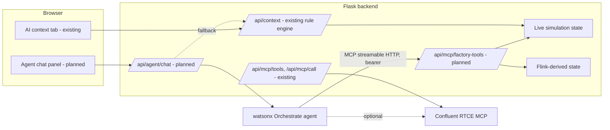
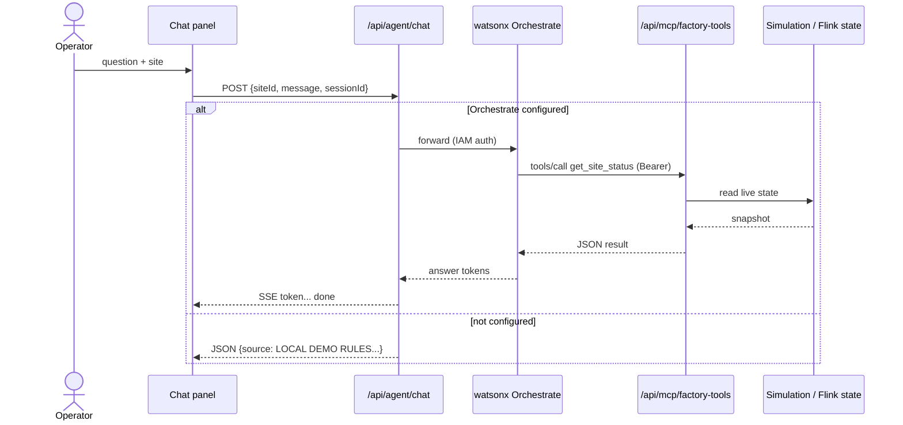

# watsonx Orchestrate Agent Integration — Technical Design Spec

> **Status: planned, not implemented.** The source for this design is `docs/watsonx-orchestrate-agent-spec.md` (v1.1, "awaiting developer implementation"). `server/app.py` has no `/api/agent/chat` or `/api/mcp/factory-tools` route today. What exists in code is the deterministic `POST /api/context` Q&A (`server/context.py`) and a proxy to Confluent's RTCE MCP (`server/mcp.py`). This spec is therefore split into **Existing** and **Planned** parts.

## 1. Problem Statement

The "AI context / MCP" tab answers operator questions with deterministic rules from `server/context.py`; the answers do not come from a model. The goal is a watsonx Orchestrate agent that reads live factory state through typed tools and returns grounded answers that cite real asset IDs, readings and timestamps.

## 2. Goals & Non-Goals

**Goals**
- Operator chat in the UI backed by a watsonx Orchestrate agent.
- Five read-only MCP data tools served by the Factory Pulse backend.
- A visible fallback to local rules when Orchestrate is not configured, labelled as such.
- Credentials server-side only.

**Non-Goals**
- Replacing the Confluent RTCE MCP integration (a parallel concern).
- Connecting to physical PLCs or safety systems.
- Persistent multi-session memory.
- New Kafka consumers or Flink jobs for the agent.
- Agent-triggered control actions (pause line, repair) without a separate operator confirmation step.

## 3. Architecture Overview

## 4. Component Design

### 4.1 Existing: `server/mcp.py` — `with_mcp(operation)`
- Reads `RTCE_MCP_ENDPOINT` and `RTCE_MCP_BASIC_TOKEN`. Raises `RuntimeError` if either is missing, if the endpoint is not `https://`, or if the `mcp` SDK is not installed.
- Opens `streamablehttp_client(endpoint, headers={"Authorization": f"Basic {token}"})`, then `ClientSession(read, write)`, then `session.initialize()`, then awaits `operation(session)`. It runs through `anyio.run`.
- Used by `GET /api/mcp/tools` (list tools) and `POST /api/mcp/call` (call a tool with validated arguments). Known defect: the module name `mcp.py` can shadow the `mcp` SDK package when launched as `python server/app.py` (see `backend-server.design.md`).

### 4.2 Existing: `POST /api/context`
Deterministic diagnostics over the current plant snapshot. This is the fallback target for the planned agent.

### 4.3 Planned: `POST /api/agent/chat`
Request `{ siteId, message, sessionId }`, all required. `siteId` is one of `DET AUS SEA PHX CLT CHI`; `sessionId` is a client-generated UUID used for correlation only.
- Orchestrate configured and reachable: respond `text/event-stream` with events `token` (`{"text": "..."}`) and a final `done` (`{"source":"WATSONX ORCHESTRATE","sessionId":"...","toolsUsed":[...]}`).
- Not configured (`WATSONX_ORCHESTRATE_URL` absent): respond `application/json` with `{source: "LOCAL DEMO RULES — NOT WATSONX ORCHESTRATE", title, risk, answer, evidence[], suggestion}`. The UI shows `source` as a visible badge.
- Rate limit: 30 requests per minute per `sessionId`.
- The UI rejects an empty message before sending.

### 4.4 Planned: MCP server `/api/mcp/factory-tools`
Streamable HTTP MCP endpoint. Every request needs `Authorization: Bearer <FACTORY_MCP_TOKEN>`, otherwise HTTP 401. Arguments are validated against each tool's input schema, and unknown fields are rejected. All tools are read-only.

| Tool | Input | Purpose |
|---|---|---|
| `get_site_status` | `siteId` (enum of the 6 codes) | Live snapshot for one site: OEE, throughput, robot conditions. |
| `get_all_sites_summary` | none | Cross-site rollup for network-wide questions. |
| `get_maintenance_alerts` | per `docs/watsonx-orchestrate-agent-spec.md` §5 | Active alerts and maintenance risk. |
| `get_robot_detail` | per spec §5 (site and robot) | Deep dive on one asset, e.g. `DET-R01`. |
| `get_flink_derived` | per spec §5 | Latest Flink risk signals and shift KPIs; returns `{available:false, reason}` (not an HTTP error) when Kafka is not connected. |

Exact parameter and response shapes for tools 2–5 are in the source doc §5 (lines ~115–400). Re-use them verbatim when implementing.

### 4.5 Planned: Chat panel (UI)
A chat panel inside the existing "AI context / MCP" tab. It sends the active `siteId` and a generated `sessionId`, shows a loading state for the whole 1–5s Orchestrate round trip, and renders streamed tokens and the `SOURCE` label.

## 5. Data Models

**Sites** (`siteId`): DET Detroit Assembly (automotive assembly); AUS Austin Gigafactory (battery/robotics); SEA Seattle Precision (precision components); PHX Phoenix Semicon (electronics); CLT Charlotte Manufacturing (industrial machinery); CHI Chicago Distribution (packaging/fulfilment).

**Robots**: 6 per site, `{SITE}-R{NN}`: R01 Welding robot, R02 Pick & place, R03 Quality scanner, R04 Assembly cobot, R05 AGV transporter, R06 Packaging arm. Check this against the real robot catalogue in `server/plants.py` and `server/simulation.py` before implementing, because the code defines the authoritative IDs and types.

**Scenarios**: `baseline`, `bearing`, `thermal`, `quality`, `surge`.

**Kafka events referenced**: `factory-iot-telemetry`, `factory-maintenance-events`, `factory-asset-state`, `factory-risk-signals`, `factory-shift-kpis` (field lists are in `streaming-platform.design.md`).

**Errors**
| Failure | Response |
|---|---|
| Orchestrate URL unset | Local rules answer, `source` shows local rules. |
| Orchestrate 4xx | `{error:"Agent unavailable", fallback:true}` plus a rule-based answer. |
| Tool call over 10s | Abort; partial answer with `timedOut:true`, `toolsUsed:[]`. |
| Invalid `siteId` | `{error:"Unknown siteId", valid:[DET,AUS,SEA,PHX,CLT,CHI]}`. |
| `get_flink_derived` with no Kafka | `{available:false, reason}`. |

## 6. Integration Points

| System | Direction | Protocol | Notes |
|---|---|---|---|
| watsonx Orchestrate | backend → | REST (IAM API key) | Deployment type undecided |
| Orchestrate → backend tools | inbound | MCP streamable HTTP + bearer | `FACTORY_MCP_TOKEN` |
| Confluent RTCE MCP | backend → | MCP streamable HTTP + Basic | Existing, optional; can also be registered with Orchestrate |
| Browser | ↔ backend | SSE/JSON | Never sees keys |

**Configuration (planned)**: `WATSONX_ORCHESTRATE_URL`, `WATSONX_ORCHESTRATE_API_KEY`, `WATSONX_ORCHESTRATE_AGENT_ID` (all required for the live path), `WATSONX_ORCHESTRATE_SPACE_ID` (optional), `FACTORY_MCP_TOKEN` (required). None of these appear in `.env.example` yet.

## 7. Sequence Diagram

## 8. Error Handling & Edge Cases
See the table in §5. Also:
- Missing or wrong bearer token returns 401 and no tool runs.
- Tool arguments that fail schema validation are rejected before execution.
- The agent must not be given write or control tools without a UI confirmation gate.
- The API key and bearer token must never appear in any response body, header or log line.

## 9. Testing Strategy
From the source doc §13:
- Functional: answers to the seven sample questions match live simulation values; all six site codes work; answers change per active scenario; `get_flink_derived` is `available:false` in simulation mode.
- Fallback: with `WATSONX_ORCHESTRATE_URL` unset all questions return local answers with the visible local-rules badge, with no crashes or empty responses.
- Security: tool endpoint without a bearer token returns 401; the API key never appears in network responses; an invalid `siteId` such as `XXX` gives a clear error.
- Unit: tool handlers with a stubbed simulation snapshot; rate limiter; SSE framing.
- Contract: MCP `tools/list` returns exactly the five tools and their schemas.

## 10. Open Questions & Risks
| # | Question | Owner |
|---|---|---|
| 1 | Orchestrate deployment type (embedded assistant vs standalone agent REST API), which determines URL and auth. | Developer, TBD |
| 2 | Should the agent trigger maintenance actions with operator confirmation? Currently out of scope. | Product, TBD |
| 3 | Is the RTCE MCP endpoint available in the demo environment, so both MCP servers can be registered? | Demo team, TBD |
| 4 | Does the Orchestrate API support SSE token streaming, or must the backend buffer? | Developer, TBD |
| 5 | Server-side conversation history, or Orchestrate session management? | Developer, TBD |
| 6 | Acceptable latency (local rules under 50 ms; Orchestrate 1–5 s). | UX, TBD |

Risks: the `server/mcp.py` module name shadows the `mcp` SDK when launched as a script; the doc's 6-robot-per-site table must be reconciled with the code's actual robot catalogue; a single-process, in-memory rate limiter does not work across multiple workers.
