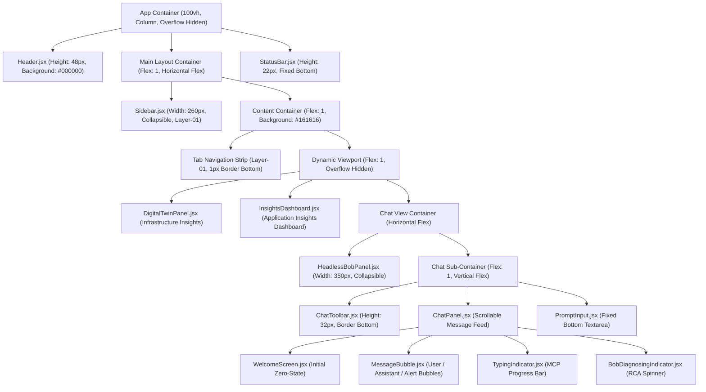
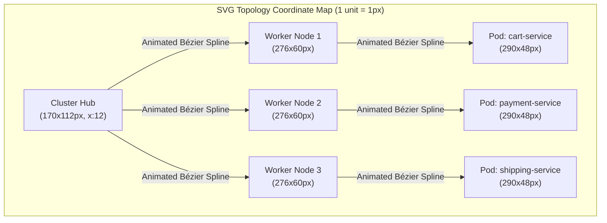

# Autonomous Instana Bob App — Comprehensive Skill & Operational Guide

> **Skill Identifier:** `autonomous-instana-bob-app`  
> **Source of Truth:** [`instana-bob-app/SPEC.md`](instana-bob-app/SPEC.md) & [`SPEC_UI.md`](SPEC_UI.md)  
> **Classification:** Project-Specific SRE Engineering, Architecture, UI/UX & Operations Reference  
> **Target Environment:** Node.js 20 LTS, React 18 / Vite 6, IBM Carbon Design System v11 (Gray 100 / `g100`), Python 3.11 (`mcp-instana`), IBM Bob Inference API (`claude-opus-4-5`)  

---

## 1. Skill Purpose & Activation Scenarios

### 1.1 Core Mission
This skill equips IBM Bob with the operational expertise, technical rules, API contracts, UI/UX design specifications, prompt structures, and verification workflows required to build, maintain, troubleshoot, and evolve the **Autonomous Instana Bob App**.

The application functions as an AI-powered autonomous Site Reliability Engineering (SRE) assistant that:
- Ingests APM telemetry from **IBM Instana** via the **Model Context Protocol (MCP)** using the `mcp-instana` STDIO server.
- Performs autonomous multi-turn diagnostic loops using the **IBM Bob Inference API** (`claude-opus-4-5`).
- Visualizes cluster topologies and application health via an **IBM Carbon Design System v11** dark theme (`g100`) dashboard.
- Operates in dual stream modes: a 100% offline simulation engine with 5 injectable failure scenarios (`STREAM_MODE=mock`) and a live enterprise telemetry pipeline (`STREAM_MODE=realtime`).

### 1.2 When to Activate This Skill
Bob should activate this skill when:
- Designing or implementing frontend components, views, or telemetry visualizations in `src/`.
- Styling UI elements to adhere strictly to IBM Carbon Design System v11 Gray 100 (`g100`) tokens and IBM Plex typography.
- Modifying backend routing, MCP tool calling, or LLM agent loops in `server/index.mjs`.
- Adding or adjusting failure scenarios in `server/mockData.mjs` or `server/mockRoutes.mjs`.
- Troubleshooting MCP connection failures, stdio buffer truncation, or SSE stream latency.
- Executing milestone builds (M0–M8), running smoke tests, or containerizing the app for Kubernetes/OpenShift.
- Integrating external Headless Bob daemon instances via the `/hb/*` proxy.

---

## 2. System Architecture & High-Level Flow

```
┌────────────────────────────────────────────────────────────────────────┐
│                              FRONTEND                                  │
│   React 18.3.1  •  Vite 6.0.3  •  @carbon/react 1.71.0 (Carbon v11)   │
│   @carbon/icons-react 11.54.0  •  IBM Plex Sans & Mono Typography      │
│   Fixed 100vh Viewport  •  g100 Dark Theme (#161616 / #262626)        │
└───────────────────────────────────┬────────────────────────────────────┘
                                    │ HTTP REST & SSE (/api/*, /hb/*)
┌───────────────────────────────────▼────────────────────────────────────┐
│                           EXPRESS BRIDGE                               │
│   Node.js 20 LTS (ES Modules mjs)  •  Express 4.21.2  •  cors 2.8.5   │
│   @modelcontextprotocol/sdk 1.10.2 •  openai 4.78.0 SDK (Bob Auth)     │
│   http-proxy-middleware 4.2.1      •  dotenv 16.4.7                    │
└───────────────────────┬───────────────────────────────┬────────────────┘
                        │ STDIO JSON-RPC                │ HTTPS /inference/v1
┌───────────────────────▼──────────────┐ ┌──────────────▼────────────────┐
│              MCP LAYER               │ │           AI INFERENCE         │
│  mcp-instana (Python 3.11 Package)   │ │  IBM Bob Inference API        │
│  Executed via uv / uvx               │ │  Model: claude-opus-4-5       │
└───────────────────────┬──────────────┘ └───────────────────────────────┘
                        │ HTTPS REST
┌───────────────────────▼──────────────┐
│           OBSERVABILITY              │
│  IBM Instana APM Enterprise Tenant   │
└──────────────────────────────────────┘
```

---

## 3. Repository Directory Layout & Component Hierarchy

### 3.1 File Structure
```
autonomous-instana-bob-app/
├── src/                               # Frontend Single Page Application (React 18 + Vite 6)
│   ├── main.jsx                       # Entrypoint: React DOM root mount & index.css import
│   ├── App.jsx                        # Root coordinator: active view, health check polling, mode sync
│   ├── index.css                      # IBM Carbon tokens, CSS custom properties, responsive grid
│   ├── assets/                        # Static logos & icons (instana.png, bob.png)
│   └── components/
│       ├── Header.jsx                 # Top bar (48px): logo, stream mode indicator pill, health dot
│       ├── StatusBar.jsx              # Global telemetry bar (22px): cluster health, error rate, P90 latency
│       ├── Sidebar.jsx                # Collapsible session list drawer and chat history manager (260px)
│       ├── DigitalTwinPanel.jsx       # Infrastructure View: OpenShift nodes, resource gauges, pods (SVG topology)
│       ├── InsightsDashboard.jsx      # Application Insights View: KPI cards, service bars, incidents
│       ├── ChatPanel.jsx              # Autonomous SRE Chat: conversational message stream & auto-scroll
│       ├── ChatToolbar.jsx            # Canned prompt chips, clear context, export chat JSON
│       ├── MessageBubble.jsx          # Markdown message bubble with collapsible tool-call steps
│       ├── PromptInput.jsx            # Prompt input text box with keyboard shortcut submit
│       ├── HeadlessBobPanel.jsx       # Autonomous Monitor: live SSE log feed, start/stop trigger (350px)
│       ├── ScenarioControl.jsx        # Mock failure scenario drawer (5 scenarios + reset)
│       ├── Icons.jsx                  # Carbon icons and custom SVG mascot wrappers
│       └── ErrorBoundary.jsx          # Top-level React error boundary
├── server/                            # Backend Express Bridge Server (Node.js 20 ESM)
│   ├── index.mjs                      # Bridge server: mode switcher, MCP connector, LLM agent loop, SSE
│   ├── mockRoutes.mjs                 # Express router mounted when STREAM_MODE=mock
│   ├── mockData.mjs                   # In-memory store: 5 failure scenarios, baseline telemetry, RCA
│   ├── package.json                   # Backend dependencies (@modelcontextprotocol/sdk, openai, express)
│   └── package-lock.json
├── Dockerfile                         # Production multi-stage Docker build (pinned digests & apt versions)
├── .dockerignore                      # Docker build exclusions
├── .gitignore                         # Git repository exclusions
├── .env.example                       # Reference environment configuration
├── vite.config.js                     # Vite dev server with /api and /hb reverse proxies to :3001
├── package.json                       # Root UI scripts and frontend dependencies
└── package-lock.json
```

### 3.2 Visual Component Hierarchy


---

## 4. IBM Carbon Design System v11 Tokens & Typography Standard

The user interface adheres to IBM Carbon Gray 100 (`g100`) dark theme tokens defined as CSS Custom Properties in `src/index.css`.

### 4.1 Carbon g100 Design Tokens Palette
| CSS Custom Property | Exact HEX / RGBA Value | Semantic Usage in UI |
| :--- | :--- | :--- |
| `--cds-background` | `#161616` | Global page background, Digital Twin canvas backing. |
| `--cds-background-hover` | `#1e1e1e` | Hover background for icon buttons and navigation elements. |
| `--cds-background-selected` | `#262626` | Selected session background in Sidebar. |
| `--cds-layer-01` | `#262626` | Secondary surfaces, Sidebar, Cards, Tab Bar, Toolbar. |
| `--cds-layer-02` | `#393939` | Nested containers, code block backgrounds, table headers, gauges. |
| `--cds-layer-03` | `#525252` | Scrollbar thumb background, deep nested layers. |
| `--cds-layer-hover-01` | `#333333` | Hover state for table rows, sidebar items, scenario options. |
| `--cds-border-subtle-01` | `#393939` | Card borders, horizontal dividers, table grid lines. |
| `--cds-border-subtle-02` | `#525252` | Selected card borders, input container resting border. |
| `--cds-border-strong-01` | `#6f6f6f` | High-contrast borders, scrollbar hover, prompt card hover. |
| `--cds-text-primary` | `#f4f4f4` | Primary headers, active values, user input text. |
| `--cds-text-secondary` | `#c6c6c6` | Body paragraphs, metric labels, inactive tabs, timestamps. |
| `--cds-text-placeholder` | `#6f6f6f` | Input placeholder text, disabled text, secondary metadata. |
| `--cds-text-disabled` | `#525252` | Disabled button icons, inactive indicator states. |
| `--cds-text-on-color` | `#ffffff` | Text rendered on solid primary blue buttons and badges. |
| `--cds-icon-primary` | `#f4f4f4` | Top-level navigation and system icons. |
| `--cds-icon-secondary` | `#c6c6c6` | Secondary icon buttons, status indicators. |
| `--cds-interactive` | `#4589ff` | Focus rings, text selection, blockquote borders. |
| `--cds-link-primary` | `#78a9ff` | Hyperlinks inside markdown responses, active sub-titles. |
| `--cds-link-primary-hover` | `#a6c8ff` | Hover state for hyperlinks inside markdown responses. |
| `--cds-button-primary` | `#0f62fe` | Primary action buttons, active tab indicators, user chat bubbles. |
| `--cds-button-primary-hover`| `#0050e6` | Hover state for primary action buttons. |
| `--cds-button-primary-active`| `#002d9c`| Active/pressed state for primary action buttons. |
| `--cds-button-disabled` | `#525252` | Disabled submit and action buttons. |
| `--cds-field-01` | `#262626` | Textarea and input container resting fill. |
| `--cds-field-hover-01` | `#333333` | Hover fill for input elements. |

### 4.2 Semantic Status & Severity Colors
| Severity Level | Color Code | Background Fill | Border Style | Badge / Text Display |
| :--- | :--- | :--- | :--- | :--- |
| **Critical / Error** | `#da1e28` / `#ff8389` | `#2d0709` (`rgba(218, 30, 40, 0.12)`) | `1px solid #da1e28` | `🔴 Critical` / `🔴 CRITICAL ALERT` |
| **Warning** | `#f1c21b` | `#1c1500` (`#2d1f00`) | `1px solid #f1c21b` | `🟡 Warning` / `🟡 WARNING` |
| **Healthy / OK** | `#24a148` / `#42be65` | `#071908` (`rgba(36, 161, 72, 0.15)`) | `1px solid #24a148` | `✅ Healthy` / `✅ OK` |
| **Informational / Blue** | `#0f62fe` / `#4589ff` | `#001141` (`rgba(15, 98, 254, 0.15)`) | `1px solid #0f62fe` | `🔵 Info` / `GenAI Engine` |
| **Mock Simulation** | `#f1c21b` (Yellow) | `#f1c21b` (Gold solid badge) | `1px dashed #f1c21b` | `MOCK DATA` (Dark text `#161616`) |

### 4.3 Typography Scale Standards
Loaded via IBM Carbon standard font pairings (`IBM Plex Sans` and `IBM Plex Mono`):
| UI Element | Font Family | Size | Weight | Line Height | Color |
| :--- | :--- | :--- | :--- | :--- | :--- |
| **App Title** | `IBM Plex Sans` | `15px` (`0.95rem`) | `600` (Semi-Bold) | `1.3` | `#ffffff` |
| **Section Headings (H1)** | `IBM Plex Sans` | `24px` (`1.5rem`) | `300` (Light) | `1.2` | `#f4f4f4` |
| **Card / Panel Titles (H2)**| `IBM Plex Sans` | `15px` | `600` (Semi-Bold) | `1.3` | `#f4f4f4` |
| **Subheadings (H3)** | `IBM Plex Sans` | `13px` | `600` (Semi-Bold) | `1.4` | `#f4f4f4` |
| **KPI Big Numbers** | `IBM Plex Sans` | `26px` | `300` (Light) | `1.0` (tabular) | Dynamic / `#f4f4f4` |
| **Body Paragraphs** | `IBM Plex Sans` | `14px` (`0.875rem`) | `400` (Regular) | `1.5` – `1.6` | `#c6c6c6` |
| **Tab Navigation Labels** | `IBM Plex Sans` | `13px` | `400` / `600` | `1.0` | `#c6c6c6` / `#0f62fe` |
| **Table Header Cells** | `IBM Plex Sans` | `12px` | `600` (Semi-Bold) | `1.2` | `#c6c6c6` |
| **Table Data Cells** | `IBM Plex Sans` | `12px` | `400` / `500` | `1.4` (tabular) | `#f4f4f4` / `#c6c6c6` |
| **Code Spans (`<code>`)** | `IBM Plex Mono` | `11.5px` (`0.82rem`)| `400` (Regular) | `1.0` | `#78a9ff` / `#a8c7fa` |
| **Tool Parameters / Logs**| `IBM Plex Mono` | `10px` – `11px` | `400` (Regular) | `1.3` | `#78a9ff` / `#6f6f6f` |
| **Status Bar Metrics** | `IBM Plex Mono` | `9.5px` (`0.68rem`) | `400` (Regular) | `1.0` | `rgba(255,255,255,0.85)`|
| **Metadata / Timestamps** | `IBM Plex Sans` | `11px` (`0.68rem`) | `400` (Regular) | `1.0` | `#6f6f6f` |
| **Badges & Severity Pills**| `IBM Plex Sans` | `10px` | `700` (Bold) | `1.0` | `#ffffff` / `#161616` |

---

## 5. Global 3-Pane Viewport Architecture

The application viewport is constrained to a fixed 100% viewport height (`100vh`) with hidden outer overflow to prevent window scrolling.

```
┌──────────────────────────────────────────────────────────────────────────────────┐
│ HEADER: 48px #000000 — Menu Toggle • App Title • Headless Bob Toggle • Mode Pill  │
├──────────────┬───────────────────────────────────────────────────────────────────┤
│ SIDEBAR      │ MAIN CONTENT AREA (Tab Navigation + Active View)                  │
│ 260px        ├───────────────────────────────────────────────────────────────────┤
│ Layer-01     │ TAB BAR: ☸️ Infrastructure • 📊 Application • 🤖 SRE Chat          │
│              ├───────────────────────────────────────────────────────────────────┤
│ New Chat     │ Active View:                                                      │
│ Recent Chats │ 1. Digital Twin Panel (SVG Cluster Topology + Node Telemetry)     │
│ Quick        │ 2. Insights Dashboard (KPI Cards + Service Table + Incidents)     │
│ Prompts      │ 3. Autonomous SRE Chat (Headless Bob Column + Chat Feed + Input)  │
├──────────────┴───────────────────────────────────────────────────────────────────┤
│ STATUS BAR: 22px — Connection Status • Active Host • Model ID • Message Counter  │
└──────────────────────────────────────────────────────────────────────────────────┘
```

---

## 6. Exhaustive UI Component Specifications & Visual Anatomy

### 6.1 Global Header (`src/components/Header.jsx`)
- **Dimensions:** Fixed height `48px`, full width (`100%`), `z-index: 100`, `flexShrink: 0`.
- **Background:** `#000000` (Solid Black), border bottom `1px solid var(--cds-border-subtle-01)` (`#393939`).
- **Internal Elements (Left to Right):**
  1. **Sidebar Toggle Button:** `20x20px` SVG hamburger icon (transitions to an X when open), hover background `#1e1e1e`.
  2. **Product Logo:** 26px `InstanaMcpIcon` (rendered from `assets/instana.png`).
  3. **Title Text Group:**
     - `"IBM Instana Observability"`: White (`#ffffff`), `13px`, Weight `600`.
     - Divider `"|"`: `#c6c6c6`, Weight `300`.
     - `"Autonomous SRE Platform"`: `#78a9ff`, Weight `500`.
     - Badge `"GENAI SRE ENGINE"`: Monospace, `9px`, Weight `600`, background `rgba(15, 98, 254, 0.2)`, border `1px solid rgba(15, 98, 254, 0.4)`, color `#a6c8ff`.
  4. **Headless Bob Panel Toggle Button (Visible only on Chat Tab):**
     - Background: `rgba(15, 98, 254, 0.2)` when active, border `rgba(15, 98, 254, 0.6)`.
     - Label: `"Contract Bob Panel"` or `"Expand Bob Panel"`.
  5. **Stream Mode Status Pill:**
     - **Mock Mode:** Background `rgba(241, 194, 27, 0.12)`, border `#8e6a00`, text `#f1c21b`, label `"MOCK DATA"`, `6px` pulsing yellow dot.
     - **Realtime Mode (Connected):** Background `#071908`, border `#0e4e2a`, text `#42be65`, label `"Instana MCP · 11 tools"`, `6px` green dot.
     - **Realtime Mode (Disconnected):** Background `#2d0709`, border `#5a1e22`, text `#ff8389`, label `"MCP Disconnected"`, `6px` red dot.

---

### 6.2 Global Status Bar (`src/components/StatusBar.jsx`)
- **Dimensions:** Fixed height `22px`, full width (`100%`), fixed to viewport bottom.
- **Background State Colors:**
  - Connecting / Pending: `#393939`
  - Mock Mode: `#8e6a00` (Dark Mustard Amber)
  - Realtime Connected: `#0f62fe` (Carbon Interactive Blue)
  - Disconnected / Error: `#6f1d1d` (Dark Red)
- **Typography:** `IBM Plex Mono`, `9.5px` (`0.68rem`), letter spacing `0.02em`, color `rgba(255,255,255,0.85)`.
- **Data Sections (Left to Right):**
  1. Connection Indicator: `5px` round colored dot + status string (`"STREAM_MODE=mock · mock data"` or `"MCP Connected · 11 tools"`).
  2. Active Instana Tenant Endpoint (Realtime only, e.g., `"⬡ instana.example.com"`).
  3. Active LLM Foundation Model (Realtime only, e.g., `"◆ claude-opus-4-5"`).
  4. Conversation Message Counter (`"N messages"`).
  5. Branding: `"Instana AI · Bob Inference · MCP"`.

---

### 6.3 Sidebar Navigation (`src/components/Sidebar.jsx`)
- **Dimensions:** Fixed width `260px`, height `calc(100vh - 70px)`, border right `1px solid #393939`, background `var(--cds-layer-01)` (`#262626`).
- **Internal Elements:**
  1. **New Conversation Button:** Width `100%`, height `36px`, background `#0f62fe`, hover `#0050e6`, text `#ffffff`, border radius `2px`, 16px Plus SVG icon.
  2. **Recent Chat Sessions List:** Section Header `"RECENT"` (`10px`, weight `600`, uppercase `#c6c6c6`). Active session background `#262626` (selected) with `1px solid #525252`, hover background `#333333`. Title `11px` (ellipsis), time `9.5px` `#6f6f6f`.
  3. **Quick Prompts Shelf:** Section Header Lightning SVG + `"QUICK PROMPTS"`. Prompt buttons with border `1px solid #393939`, hover background `#333333`, hover text `#f4f4f4`.

---

### 6.4 Primary Tab Bar Navigation (`src/App.jsx`)
- **Container:** Full width, height `40px`, background `var(--cds-layer-01)` (`#262626`), border bottom `1px solid #393939`.
- **Tab Buttons:**
  - `☸️ Infrastructure Insights` (`id: 'infrastructure'`)
  - `📊 Application Insights Dashboard` (`id: 'dashboard'`)
  - `🤖 Autonomous SRE Chat` (`id: 'chat'`)
- **Styling Rules:**
  - Active Tab: Bottom border `2px solid #0f62fe`, text `#0f62fe`, weight `600`.
  - Inactive Tab: Bottom border `2px solid transparent`, text `#c6c6c6`, weight `400`.
  - Hover: Text color transitions to `#f4f4f4`.

---

### 6.5 Infrastructure Insights (`src/components/DigitalTwinPanel.jsx`)

#### 1. Header Toolbar
- Title: `15px`, weight `600`, with icon `☸️`.
- Cluster Status Indicator: Pulsing pill (`HEALTHY` in `#24a148` or `CRITICAL` in `#da1e28` with keyframe glow animation).
- Cluster Selector Dropdown: Native select element, background `#393939`, text `#f4f4f4`, border `1px solid #393939`.
- Manual Refresh Button: 32x32px square button with reload glyph `↻`.

#### 2. Interactive SVG Cluster Topology
- **Dimensions:** Width matches container (minimum `900px`), height dynamically calculated (`Math.max(200, ...)`).
- **Visual Encoding:**
  - **Cluster Hub (Left Column, `x: 12`, `w: 170`, `h: 112`):** Rounded rectangle (`rx: 8`), fill `var(--cds-layer-01)`, stroke `var(--cds-border-subtle-01)`.
  - **Worker Nodes (Center Column, `w: 276`, `h: 60`):** Rounded rectangle (`rx: 6`), hover fill `#333333`, focus-visible stroke `#ffffff` with stroke-width `3`. Features colored severity indicator ring and real-time CPU/Mem metrics.
  - **Hosted Pods (Right Column, `w: 290`, `h: 48`):** Rounded rectangles displaying microservice pod names, namespace, and container restart counters.
  - **Animated Connection Splines:** SVG Bézier curves connecting Cluster -> Nodes -> Pods. Features animated stroke dashflow (`animation: flow-dash-normal 2s linear infinite`).



#### 3. Worker Node Detail Telemetry Card
- **Circular Resource Gauges (`CircularGauge`):**
  - Dimensions: `80px` diameter, stroke-width `7px`.
  - Color Transition: `<65%` = Green (`#24a148`), `65%-80%` = Yellow (`#f1c21b`), `>80%` = Red (`#da1e28`).
  - Drop Shadow: `drop-shadow(0 0 5px ${color}88)`.
  - Displays: **CPU requested**, **Memory requested**, **Pod allocation**.
- **Linear Resource Bars (`AnimatedBar`):**
  - Height `6px`, background `#2c2c2c`, border-radius `3px`.
  - Displays **CPU limits vs allocatable** and **Disk IOPS**.
- **Open Instana Issues List:**
  - Cards with left border `3px solid ${severityColor}`, background `#393939`, suggestion text in secondary grey.
- **Action Button:**
  - `"🤖 Ask Autonomous SRE Agent to Diagnose <node-name>"`: Full width, height `38px`, background `#0f62fe`, hover `#0050e6`, text `#ffffff`, weight `600`.

---

### 6.6 Application Insights Dashboard (`src/components/InsightsDashboard.jsx`)

#### 1. Top KPI Summary Cards (`KpiCard`)
Grid layout with `gap: 10px`, min-width `140px`, flex `1 1 140px`.

```
┌─────────────────┬─────────────────┬─────────────────┬─────────────────┬─────────────────┬─────────────────┐
│ TOTAL CALLS     │ TOTAL ERRORS    │ ERROR RATE      │ TOP P90 LATENCY │ OPEN INCIDENTS  │ OPEN ISSUES     │
│ 284,500         │ 9,920           │ 3.49%           │ 3,420 ms        │ 1               │ 1               │
│ [Primary White] │ [Critical Red]  │ [🟡 Warning]    │ [Critical Red]  │ [Critical Red]  │ [🟡 Warning]    │
└─────────────────┴─────────────────┴─────────────────┴─────────────────┴─────────────────┴─────────────────┘
```

#### 2. Time Window Selector Strip
- Button group with 5 timeframes: `5m` (300,000ms), `15m` (900,000ms), `1h` (3,600,000ms), `3h` (10,800,000ms), `24h` (86,400,000ms).
- Active item styled in `#0f62fe` with white text.
- Cooldown countdown badge: `"⏳ Cooldown (42s)"` rendered when Instana API rate limit is active.

#### 3. Microservices Performance Table (`ServiceTable`)
- Table columns: `Service`, `Calls`, `Volume` (with `MiniBar` visualizer), `Errors`, `Error Rate`, `P90 Latency`, `Mean Latency`.
- Error rates highlighted: `>=10%` = `#da1e28` (Bold), `3%-10%` = `#f1c21b`, `<3%` = `#24a148`.
- Row hover state: Background `#333333`.

#### 4. Incidents & Issues Split Feeds (`EventList`)
- Side-by-side flex containers (`flex: 1`).
- Card layout with severity pill (`🔴 Critical`, `🟡 Warning`, `🔵 Info`), relative timestamp (`"6m ago"`), and direct `"🤖 Investigate"` action button.

---

### 6.7 Autonomous SRE Chat Interface (`src/components/ChatPanel.jsx`)

#### 1. Zero-State Welcome Screen
- Center-aligned container (`max-width: 480px`).
- Circular Mascot Badge: `64x64px`, radial gradient background `linear-gradient(135deg, rgba(15,98,254,0.2) 0%, rgba(0,45,156,0.35) 100%)`, box-shadow `0 0 20px rgba(15, 98, 254, 0.3)`.
- Suggested Prompt Cards: 2x2 CSS Grid (`gap: 0.75rem`), background `#262626`, hover background `#333333`, hover border `#6f6f6f`.

#### 2. Message Bubbles (`src/components/MessageBubble.jsx`)
- **User Bubble:** Right-aligned, max-width `72%`, background `#0f62fe`, text `#ffffff`, border-radius `4px 4px 0 4px`.
- **Assistant Telemetry Bubble:**
  - Left-aligned, avatar: 28px `InstanaMcpIcon`.
  - Header: `"Instana Assistant"` (`12px`, weight `600`), step counter (`"2 steps"` in monospace pill), timestamp.
  - Tool Execution Badge (`ToolCallsBadge`): Accordion button (`"2 tool calls ▾"`), expandable to show MCP tool names and JSON parameter payloads.
  - Markdown Body: Custom renderer supporting headings, lists, inline monospace code, syntax-highlighted code blocks, blockquotes, and tables.
- **Headless Bob Autonomous Alert Card:**
  - Avatar: 32px circular Bob Robot Mascot (`BobAvatar`).
  - Title: `"Headless Bob — Autonomous Alert"`.
  - Severity Tag: `🔴 CRITICAL ALERT` (Red background `#da1e28`) or `🟡 WARNING` (Amber `#f1c21b`).
  - Container Border: Left accent bar `4px solid #da1e28` (or `#f1c21b`), background `rgba(218, 30, 40, 0.08)`.
  - CTA Button: `"🔍 Investigate Root Cause in Chat"` (styled with `#0f62fe` border).

#### 3. Typing & Progress Indicators
- **`TypingIndicator`:** 3 pulsing blue dots (`#4589ff`) with rotating text:
  1. `"⚡ Connecting to Instana MCP server…"`
  2. `"🔧 Selecting Instana MCP tools for your question…"`
  3. `"📊 Querying Instana telemetry…"`
  4. `"⚙️ Correlating results and writing the report…"`
- **`BobDiagnosingIndicator`:** Pulsing red dot (`#da1e28`) with blue-bordered card and rotating text:
  1. `"🤖 Headless Bob: reviewing the Instana findings…"`
  2. `"🤖 Headless Bob: correlating evidence and dependencies…"`
  3. `"🤖 Headless Bob: drafting Root Cause Analysis (RCA) & remediation plan…"`

---

### 6.8 Prompt Input Bar (`src/components/PromptInput.jsx`)
- **Container:** Fixed bottom dock, background `var(--cds-layer-01)` (`#262626`), border top `1px solid #393939`, padding `12px 24px 16px`.
- **Input Field:**
  - Auto-resizing textarea: Height expands from `24px` to `180px` based on content (`Math.min(scrollHeight, 180)`).
  - Background: `var(--cds-field-01)` (`#262626`), border `1px solid #525252`, focus border `1px solid #4589ff`.
  - Placeholder: Auto-rotates through 4 example prompts every 4,000ms.
- **Send Button:**
  - Dimensions: `36px` width, `32px` height, border radius `2px`.
  - Active: Background `#0f62fe`, hover `#0050e6`, text `#ffffff`.
  - Disabled / Loading: Background `#525252`, text `#6f6f6f`, cursor `not-allowed`.
  - Loading State: Animated SVG circular spinner.
- **Keyboard Shortcut Helper:**
  - Footnote: `"Press Enter to send · Shift+Enter for new line"`.
  - Character counter: Displays `"<N> chars"` dynamically.

---

### 6.9 Headless Bob Autonomous Monitor Column (`src/components/HeadlessBobPanel.jsx`)
- **Dimensions:** Width `350px` (min `320px`, max `420px`), full height, border right `1px solid #393939`, background `var(--cds-layer-01)`.
- **Collapsed Tab Bar Variant:** Contracted to a `46px` slim bar with vertical text `"HEADLESS BOB SRE"` and circular avatar badge.
- **Internal Panels:**
  1. **Health Ring Gauge (`HealthRing`):** `120px` SVG circle with pulse glow and needle/arc animation reflecting current cluster health score.
  2. **Autonomous Alerts Feed (`AlertCard`):** Collapsible alert cards with color-coded left borders, severity badges, error rate percentages, and P90 latency meters.
  3. **Manual Investigation History (`RunCard`):** Displays previous LLM diagnostic thread runs with token consumption metrics (`usage.total_tokens`).
  4. **Connection Controls:** URL input (`http://127.0.0.1:8000`), optional Bearer token field, Connect / Disconnect actions.
  5. **Auto-Monitor Controls:** Start / Stop auto-monitor toggle button connected to `/api/monitor/stream`.

---

### 6.10 Mock Scenario Injection Drawer (`src/components/ScenarioControl.jsx`)
- **Visibility:** Rendered ONLY when `STREAM_MODE=mock`.
- **Trigger Button:** `"🧪 Select SRE Anomaly Scenario ▾"` (Border `1px solid #0f62fe`, background `rgba(15,98,254,0.12)`, text `#78a9ff`, font-weight `600`).
- **Dropdown Listbox:** Absolute positioning (`top: 100%`, `z-index: 50`, `width: 380px`), background `#262626`, shadow `0 4px 16px rgba(0,0,0,0.5)` (`-4px 0 24px rgba(0,0,0,0.5)`).
- **Scenario Cards:**
  1. `🐘 DB Connection Pool Exhaustion (shipping-service)`
  2. `☕ Java JVM Memory Leak & Stop-the-World GC (payment-service)`
  3. `⚡ Redis Cache Stampede & Thundering Herd (cart-service)`
  4. `💳 3rd-Party Payment Gateway Rate Limit (payment-service)`
  5. `☸️ Kubernetes CFS CPU Throttling & Pod Eviction (order-service)`
- **Reset Button:** `"↺ Reset Baseline"` (Disabled when already at baseline).

---

## 7. Visual Effects, Animations & Transitions

### 7.1 Keyframe Animations Table
```css
/* Red Critical Anomaly Pulse */
@keyframes pulse-glow-red {
  0% { box-shadow: 0 0 0 0 rgba(218, 30, 40, 0.7); }
  70% { box-shadow: 0 0 0 10px rgba(218, 30, 40, 0); }
  100% { box-shadow: 0 0 0 0 rgba(218, 30, 40, 0); }
}

/* Green Healthy Baseline Pulse */
@keyframes pulse-glow-green {
  0% { box-shadow: 0 0 0 0 rgba(36, 161, 72, 0.6); }
  70% { box-shadow: 0 0 0 6px rgba(36, 161, 72, 0); }
  100% { box-shadow: 0 0 0 0 rgba(36, 161, 72, 0); }
}

/* SVG Topology Connection Dash Flow */
@keyframes flow-dash-normal {
  to { stroke-dashoffset: -40; }
}

/* SVG Topology High-Speed Dash Flow */
@keyframes flow-dash-fast {
  to { stroke-dashoffset: -60; }
}

/* Three-Dot Loading Pulse */
@keyframes pulse {
  0%, 80%, 100% { opacity: 0.3; transform: scale(0.8); }
  40% { opacity: 1; transform: scale(1.1); }
}

/* Spinner Spin */
@keyframes spin {
  to { transform: rotate(360deg); }
}
```

### 7.2 Motion Accessibility (`prefers-reduced-motion`)
When the operating system requests reduced motion, all animations are automatically suppressed:
```css
@media (prefers-reduced-motion: reduce) {
  .dt-flow, .dt-pulse {
    animation: none !important;
  }
  .dt-node, .dt-node .dt-node-bg {
    transition: none !important;
  }
}
```

---

## 8. Responsive Breakpoints & Accessibility (a11y)

### 8.1 Breakpoint Scale
| Breakpoint Range | Target Form Factor | Layout Behavior & Adaptations |
| :--- | :--- | :--- |
| **`>= 1440px`** (Wide Desktop) | 4K / WQHD / UltraWide Displays | Full layout: Sidebar (260px) + 3-column topology/dashboard + Headless Bob column (350px) + Chat panel. |
| **`1024px` – `1439px`** (Standard Desktop)| Laptops & Desktop Monitors | Standard view: Full SVG topology renders, Headless Bob panel contracts to 46px toggle rail when space is constrained. |
| **`768px` – `1023px`** (Tablet Landscape) | iPads / Tablets | Sidebar auto-collapses via hamburger menu toggle; KPI cards wrap to 2 columns; Digital Twin node cards stack vertically. |
| **`< 768px`** (Mobile / Small Window)| Mobile Viewports | Sidebar hidden by default; Headless Bob panel collapses; tables enable horizontal touch scrolling; SVG topology scales to minimum 900px scrollable canvas. |

### 8.2 Accessibility Standards (WCAG 2.1 AA)
1. **Semantic HTML5:** All major sections utilize semantic landmarks: `<header>`, `<aside>`, `<nav>`, `<main>`, `<div role="status">`, and `<table role="table">`.
2. **ARIA Roles & States:**
   - Tabs: `role="tab"`, `aria-selected="true|false"`.
   - Modals / Drawers: `role="listbox"`, `aria-haspopup="listbox"`, `aria-expanded="true|false"`.
   - Indicators: `role="status"`, `aria-live="polite"`.
   - SVG Gauges: `role="img"`, `aria-label="CPU requested: 86 percent"`.
3. **Keyboard Navigation:**
   - Topology nodes focusable via `Tab` and activatable via `Enter` or `Space`.
   - Prompt input submittable via `Enter` (with `Shift+Enter` for multi-line newline insertion).
   - Clear chat action requires explicit two-step confirmation dialog with auto-focused `"Clear"` button.
4. **Color Contrast Compliance:**
   - Text contrast on `#161616` and `#262626` backgrounds exceeds WCAG 2.1 AA requirements (ratio > 4.5:1 for body text `#f4f4f4` and `#c6c6c6`).
   - Links in `#78a9ff` provide 5.8:1 contrast on dark layers.

---

## 9. Dual Stream Mode Implementation Rules

### 9.1 `STREAM_MODE=mock` (Offline Simulation Engine)
1. **Zero Credential Requirement:** The bridge MUST boot cleanly without requiring any Instana or Bob API credentials.
2. **Deterministic Data Routing:** `server/mockRoutes.mjs` intercepts all `/api/*` endpoints. Live MCP subprocesses and LLM calls are never initialized.
3. **In-Memory Scenario State:** `server/mockData.mjs` manages `currentScenarioId`.
4. **The 5 Injectable Demo Scenarios:**

```
┌────────────────────────────────────────────────────────────────────────────────────────┐
│                               5 INJECTABLE DEMO SCENARIOS                              │
├─────────────────────────┬───────────────────┬──────────────┬───────────────────────────┤
│ Scenario ID             │ Target Service    │ Node Target  │ Primary Failure Mechanism │
├─────────────────────────┼───────────────────┼──────────────┼───────────────────────────┤
│ db_pool_exhaustion      │ shipping-service  │ node-1       │ PostgreSQL RDS HikariCP   │
│                         │ payment-service   │              │ pool saturated (10/10)    │
├─────────────────────────┼───────────────────┼──────────────┼───────────────────────────┤
│ jvm_memory_leak         │ payment-service   │ node-1       │ Old Gen heap saturated    │
│                         │ order-service     │              │ (96.4%) with 4.8s STW GC  │
├─────────────────────────┼───────────────────┼──────────────┼───────────────────────────┤
│ redis_cache_failure     │ cart-service      │ node-0       │ Key TTL storm; hit rate   │
│                         │ catalog-service   │              │ drops 98.4% -> 28.1%      │
├─────────────────────────┼───────────────────┼──────────────┼───────────────────────────┤
│ gateway_rate_limit      │ payment-service   │ node-1       │ 3rd-party banking gateway │
│                         │                   │              │ returns HTTP 429 errors   │
├─────────────────────────┼───────────────────┼──────────────┼───────────────────────────┤
│ cpu_throttling_eviction │ order-service     │ node-2       │ Linux CFS 12.8% throttled │
│                         │ user-auth-service │              │ leading to pod eviction   │
└─────────────────────────┴───────────────────┴──────────────┴───────────────────────────┘
```

- **Scenario Specifications:**
  - `db_pool_exhaustion`: PostgreSQL connection pool exhausted (10/10 active connections); worker threads blocked on `getConnection()` wait queues exceeding 30s; 14.0% error rate on `POST /api/v1/shipping/dispatch`; P90 latency climbs from 380ms to 3,420ms.
  - `jvm_memory_leak`: Static `PaymentSessionCache` retains payment tokens without TTL expiration; Old Gen memory reaches 96.4%; recurring 4.8s Stop-the-World Major GCs cause 16.2% error rate on `POST /api/v1/payment/process`.
  - `redis_cache_failure`: High-velocity promotional keys expire simultaneously without mutex recomputation; cache stampede floods backing database with 12,000 queries/sec; 18.5% error rate on cart additions.
  - `gateway_rate_limit`: Third-party payment gateway returns `HTTP 429 Too Many Requests`; downstream order checkout retries amplify ingress queue depth; 8.4% error rate.
  - `cpu_throttling_eviction`: Kubernetes container CPU limit set too strictly (`500m`); CFS quota enforces 12.8% throttling periods; pod memory pressure leads to eviction and `CrashLoopBackOff`; P90 latency climbs to 4,180ms.

---

### 9.2 `STREAM_MODE=realtime` (Live Enterprise Engine)
1. **MCP Subprocess Spawning:**
   - Spawns `mcp-instana` using `@modelcontextprotocol/sdk` (`StdioClientTransport`).
   - Command: `process.env.INSTANA_MCP_COMMAND || 'uv'`
   - Args: `JSON.parse(process.env.INSTANA_MCP_ARGS || '["tool", "run", "mcp-instana"]')`
   - Passes credentials in environment: `INSTANA_BASE_URL`, `INSTANA_API_TOKEN`, `INSTANA_SSL_VERIFY`.
2. **Tool Schema Mapping:**
   - Discovers all 11 MCP tools on connection: `manage_applications`, `manage_events`, `manage_infrastructure`, `manage_releases`, `manage_slo`, `manage_synthetics`, `manage_websites`, `manage_automation`, `manage_custom_dashboards`, `manage_maintenance_windows`, `manage_mobile_apps`.
   - Converts MCP tool schemas into OpenAI Function Calling format (`type: 'function'`, `function: { name, description, parameters }`).
3. **Application Scoping Rules:**
   - **Crucial Rule:** All metrics and event queries MUST be filtered specifically for `application.name = 'Retail Application'` (or configured `INSTANA_APP_NAME`).
   - Cross-tenant incidents and foreign service telemetry must be discarded by `isEventForApplication()` before rendering to users.
4. **In-Memory KPI Caching:**
   - `server/index.mjs` maintains a 30-second TTL cache (`INSIGHTS_CACHE_TTL_MS = 30_000`) for `/api/insights` grouped call metrics to reduce redundant MCP roundtrips.

---

## 10. Autonomous LLM Agent Loop & Prompting Standards

### 10.1 Multi-Turn Tool Calling Execution
The autonomous agent loop manages up to 10 iterations of tool calls with IBM Bob:

```javascript
let response;
let iterations = 0;
const MAX_ITERATIONS = 10;
const toolCallsSummary = [];

while (iterations < MAX_ITERATIONS) {
  iterations++;
  response = await bobClient.chat.completions.create({
    model: BOB_MODEL, // 'claude-opus-4-5'
    max_tokens: 8096,
    tools: mcpTools.length > 0 ? mcpTools : undefined,
    tool_choice: mcpTools.length > 0 ? 'auto' : undefined,
    messages,
  });

  const choice = response.choices[0];

  // Stop condition: Agent generated the final response
  if (choice.finish_reason === 'stop' || choice.finish_reason === 'end_turn') {
    break;
  }

  // Tool execution condition: Agent requested one or more MCP tools
  if (choice.finish_reason === 'tool_calls' && choice.message.tool_calls?.length) {
    messages.push(choice.message);

    for (const toolCall of choice.message.tool_calls) {
      const toolName = toolCall.function.name;
      const toolInput = JSON.parse(toolCall.function.arguments || '{}');
      toolCallsSummary.push({ tool: toolName, input: toolInput });

      let toolResult;
      try {
        toolResult = await callMCPTool(toolName, toolInput);
      } catch (err) {
        toolResult = `Error calling tool ${toolName}: ${err.message}`;
      }

      messages.push({
        role: 'tool',
        tool_call_id: toolCall.id,
        content: toolResult,
      });
    }
    continue;
  }
  break;
}
```

---

### 10.2 Standard Prompt Templates

#### 1. Interactive SRE Telemetry Assistant
```text
You are the Instana Assistant. You have access to Instana MCP tools to query live APM metrics, service calls, error rates, latencies, traces, and open incidents EXCLUSIVELY for "${RETAIL_APP_NAME}".

When the user asks a question about application health, incidents, or performance:
1. **Query Instana via MCP Tools (Strictly Scoped to ${RETAIL_APP_NAME})**:
   - For application metrics (get_grouped_calls_metrics), ALWAYS scope using:
     tag_filter_expression: { type: 'TAG_FILTER', name: 'application.name', operator: 'EQUALS', entity: 'DESTINATION', value: '${RETAIL_APP_NAME}' }
     group: { groupbyTag: 'service.name', groupbyTagEntity: 'DESTINATION' }
   - For events / incidents (get_events), ONLY consider and report events that explicitly belong to "${RETAIL_APP_NAME}" or its constituent microservices/components. Completely ignore and omit any events or incidents from other applications, hosts, or foreign services.

2. **Present a Clean Observability Report for "${RETAIL_APP_NAME}"**:
   - Provide a clear, well-structured response with markdown tables summarizing services, call volumes, error rates, and latencies.
   - Highlight open incidents or warnings for "${RETAIL_APP_NAME}" clearly.

3. **Status Tag (MANDATORY)**:
   - At the very end of your response, on a new line, output a hidden status JSON tag:
   <!--STATUS:{"hasCriticalIssues":true|false,"severity":"critical"|"warning"|"healthy","summary":"Brief description of critical issue if any"}-->
   - Mark hasCriticalIssues: true if ${RETAIL_APP_NAME} error rate ≥ 5%, severe latency spike, or critical incidents for ${RETAIL_APP_NAME} are present.

Current Instana environment: ${process.env.INSTANA_BASE_URL || 'configured via env'}
Primary monitored application: ${RETAIL_APP_NAME}
```

#### 2. Headless Bob Autonomous Root Cause Analysis (RCA)
```text
You are Headless Bob, an autonomous Site Reliability Engineering (SRE) diagnostic agent.
A critical anomaly has been detected in "${RETAIL_APP_NAME}".

Generate a structured, professional SRE Root Cause Analysis and Remediation Report:
1. 📊 **Executive Summary**: Core failure summary with severity (🔴 CRITICAL).
2. 🔍 **Root Cause Analysis (RCA)**: Deep technical explanation of the failure mechanism, erroneous endpoints, and downstream database/service cascade.
3. 📉 **Impact Assessment**: Blast radius on users, checkout flows, and dependent microservices.
4. 🛠️ **Remediation & Step-by-Step Fixes**: Concrete, prioritized mitigation steps (e.g. database pool resizing, circuit breakers, code patches, rollback).
```

#### 3. Proactive Autonomous Monitor (60s Polling Cycle)
```text
You are an autonomous health monitor EXCLUSIVELY for the "${appName}" application running in Instana.

Your job every cycle:
1. Query live metrics strictly for "${appName}":
   - Call manage_applications (resource_type="metrics", operation="get_grouped_calls_metrics") with:
     tag_filter_expression: { type: "TAG_FILTER", name: "application.name", operator: "EQUALS", entity: "DESTINATION", value: "${appName}" }
     group: { groupbyTag: "service.name", groupbyTagEntity: "DESTINATION" }
     time_frame: { windowSize: 300000 }
     include_internal: false, include_synthetic: false
     metrics: [{ metric: "calls", aggregation: "SUM" }, { metric: "erroneousCalls", aggregation: "SUM" }, { metric: "latency", aggregation: "P90" }]
2. Query open events and incidents:
   - Call manage_events (operation="get_events") with filters: { time_range: "last 5 minutes", event_type_filters: ["INCIDENT", "ISSUE"], state: "open" }
   - CRITICAL APPLICATION SCOPING: ONLY analyze incidents and issues that belong directly to "${appName}" or its microservices (such as shipping-service, payment-service, order-service, catalog-service, cart-service, etc.).
   - YOU MUST COMPLETELY IGNORE all incidents, issues, or alerts for any other applications, foreign microservices, or unrelated infrastructure in the Instana tenant.
3. Analyse what you find for "${appName}":
   - If "${appName}" error rate ≥ 10% OR P90 latency ≥ 3000ms OR open critical incidents exist for "${appName}" → severity: CRITICAL 🔴
   - If "${appName}" error rate ≥ 3% OR P90 latency ≥ 1500ms OR open warning incidents exist for "${appName}" → severity: WARNING 🟡
   - Otherwise → report health as OK ✅ for "${appName}" in one sentence and stop.

If severity is CRITICAL or WARNING:
- Clearly state that this alert is for "${appName}".
- Output a concise alert (max 200 words):
  - Severity badge: 🔴 CRITICAL or 🟡 WARNING
  - What is wrong: specific metric values and affected service(s) within ${appName}
  - Likely impact on ${appName} users and business
  - Immediate recommended action

Always end your response with a machine-readable JSON block on its own line:
{"severity":"critical"|"warning"|"ok","errorRate":<number|null>,"p90Latency":<number|null>,"hasIncidents":<boolean>}
```

---

## 11. API Contracts & Wire Formats

### 11.1 `GET /api/health`
- **Method:** `GET`
- **Response Format:** `application/json`
- **Schema:**
```json
{
  "status": "ok",
  "streamMode": "mock",
  "simulated": true,
  "isLoaded": true,
  "activeScenario": "db_pool_exhaustion",
  "mcpConnected": false,
  "timestamp": 1741000000000
}
```

### 11.2 `GET /api/mode` & `POST /api/mode`
- **`GET /api/mode` Response:**
```json
{
  "streamMode": "mock",
  "isMock": true,
  "isRealtime": false,
  "description": "Running in offline demo mode with simulated Retail Application data."
}
```
- **`POST /api/mode` Request Payload:** `{"mode": "realtime"}`
- **`POST /api/mode` Response Payload:**
```json
{
  "success": true,
  "previousMode": "mock",
  "currentMode": "realtime",
  "message": "Stream mode updated to realtime."
}
```

### 11.3 `POST /api/chat` (SSE Stream)
- **Method:** `POST`
- **Headers:** `Content-Type: application/json`
- **Request Payload:**
```json
{
  "prompt": "What is the health of Retail Application?",
  "conversationHistory": []
}
```
- **Response Format:** `text/event-stream` (`X-Accel-Buffering: no`)
- **Event Sequence:**
  - `tool_call`: `data: {"type":"tool_call","tool":"manage_applications","input":{...}}\n\n`
  - `tool_result`: `data: {"type":"tool_result","tool":"manage_applications","status":"success"}\n\n`
  - `text_chunk`: `data: {"type":"text_chunk","chunk":"Markdown text..."}\n\n`
  - `status`: `data: {"type":"status","hasCriticalIssues":true,"severity":"critical","summary":"..."}\n\n`
  - `done`: `data: {"type":"done","iterations":2}\n\n`

### 11.4 `GET /api/scenarios`, `POST /api/demo/load-data`, `POST /api/demo/reset-data`
- **`GET /api/scenarios` Response:**
```json
{
  "scenarios": [
    {
      "id": "db_pool_exhaustion",
      "name": "Scenario 1: DB Connection Pool Exhaustion (shipping-service)",
      "shortName": "DB Pool Exhaustion",
      "icon": "🐘",
      "description": "PostgreSQL RDS connection pool saturated (10/10)...",
      "affectedServices": ["shipping-service", "payment-service"],
      "primaryNodeId": "node-1"
    }
  ],
  "activeScenarioId": "db_pool_exhaustion"
}
```
- **`POST /api/demo/load-data` Payload:** `{"scenarioId": "db_pool_exhaustion"}`
- **`POST /api/demo/reset-data` Response:** `{"success": true, "loaded": false, "activeScenario": null}`

### 11.5 `GET /api/digital-twin`
- **Method:** `GET`
- **Response Schema:**
```json
{
  "cluster": {
    "name": "ocp-production-us-south",
    "version": "OpenShift 4.14.18",
    "status": "Degraded",
    "totalNodes": 3,
    "healthyNodes": 2,
    "totalPods": 58
  },
  "nodes": [
    {
      "id": "node-1",
      "name": "ocp-worker-02.retail.internal",
      "ip": "10.240.0.15",
      "zone": "us-south-2",
      "status": "MemoryPressure / DB Lock",
      "metrics": {
        "cpuPercent": 86,
        "memoryPercent": 89,
        "diskPercent": 68,
        "netInMbps": 480,
        "netOutMbps": 520,
        "podsRunning": 24,
        "maxPods": 110
      },
      "pods": [
        {
          "name": "shipping-service-7f8849-c92xa",
          "namespace": "retail-app",
          "status": "Degraded (14% Errors)",
          "restarts": 2,
          "cpuUsage": "84%",
          "memoryUsage": "910 MiB",
          "severity": "critical"
        }
      ]
    }
  ]
}
```

### 11.6 `GET /api/dashboard` & `GET /api/insights`
- **Method:** `GET`
- **Query Params:** `?window=3600000&force=false`
- **Schema:**
```json
{
  "timeframe": { "windowSizeMs": 3600000, "from": 1741000000000, "to": 1741003600000 },
  "summary": {
    "totalCalls": 284500,
    "totalErrors": 9920,
    "overallErrorRate": 3.49,
    "topP90LatencyMs": 3420,
    "openIncidentsCount": 1,
    "openIssuesCount": 1
  },
  "services": [
    {
      "name": "shipping-service",
      "calls": 42100,
      "errors": 5890,
      "errorRate": 14.0,
      "p90LatencyMs": 3420,
      "meanLatencyMs": 890,
      "status": "critical"
    }
  ],
  "incidents": [
    {
      "id": "inc-retail-8849",
      "title": "shipping-service - High Erroneous Call Rate (14.0%) & DB Connection Pool Saturation",
      "severity": "critical",
      "entity": "shipping-service (retail-app/shipping-service-7f8849)",
      "startTime": 1741003240000,
      "duration": "6 mins"
    }
  ]
}
```

### 11.7 `GET /api/monitor/stream`, `POST /api/monitor/register`, `ALL /hb/*`
- **`GET /api/monitor/stream` SSE Events:**
  - `connected`: `{"type":"connected","running":true,"ts":1741000000000}`
  - `status_tick`: `{"type":"status_tick","ts":1741000000000,"severity":"critical","errorRate":14.0,"p90Latency":3420}`
  - `alert`: `{"type":"alert","ts":1741000000000,"severity":"critical","message":"Markdown RCA...","source":"headlessbob"}`
- **`POST /api/monitor/register` Payload:** `{"url": "http://127.0.0.1:8000", "token": "optional-token"}`
- **`ALL /hb/*` Proxying:** Handled by `http-proxy-middleware` forwarding path and headers directly to the registered Headless Bob daemon.

---

## 12. Milestone Implementation Guide (M0 - M8)

| Milestone | Deliverables | Verification Command |
| :--- | :--- | :--- |
| **M0: Scaffolding** | Directory layout, `package.json`, `server/package.json`, `.gitignore`, `.env.example`. | `npm install && cd server && npm install` |
| **M1: Bridge & Mock** | Implement `mockData.mjs`, `mockRoutes.mjs`, `index.mjs` with `/api/health`. | `node server/index.mjs` & `curl http://localhost:3001/api/health` |
| **M2: React Shell** | Vite config, Carbon theme reset, `Header.jsx`, `StatusBar.jsx`. | `npm run dev` & verify browser loads UI without errors |
| **M3: Dashboards** | `DigitalTwinPanel.jsx` (topology) & `InsightsDashboard.jsx` (KPIs). | Verify graphs, node gauges, and service tables render |
| **M4: SRE Chat** | `ChatPanel.jsx`, `MessageBubble.jsx`, connect to `/api/chat` SSE. | Send prompt; confirm Markdown response and tool accordions |
| **M5: Scenarios** | `ScenarioControl.jsx` failure injection drawer and state sync. | Inject `db_pool_exhaustion`; verify UI updates to critical state |
| **M6: Realtime MCP** | Connect `StdioClientTransport` to `mcp-instana`; add 30s `/api/insights` cache. | Verify `11 tools available` logged in console in realtime mode |
| **M7: Bob LLM Loop** | `runAgentLoop()` multi-turn tool calling & proactive 60s monitor. | Test conversational prompt against live Instana tenant |
| **M8: Containerize** | Multi-stage Dockerfile (`node:20-bookworm-slim@sha256:...`, apt pinning, `USER node`). | `docker build -t autonomous-instana-bob-app .` |

---

## 13. Verification, Smoke Testing & UI Fidelity Checklist

### 13.1 Automated Smoke Test Script (`smoke-test.sh`)

```bash
#!/usr/bin/env bash
set -euo pipefail

BASE_URL="${1:-http://127.0.0.1:3001}"
echo "======================================================"
echo " Running Autonomous Instana Bob App Smoke Tests"
echo " Target: ${BASE_URL}"
echo "======================================================"

# 1. Healthcheck
echo -n "Checking /api/health ... "
HEALTH=$(curl -sSf "${BASE_URL}/api/health")
if echo "${HEALTH}" | grep -q '"status":"ok"'; then
  echo "PASS (mode: $(echo "${HEALTH}" | grep -o '"streamMode":"[^"]*"' | cut -d'"' -f4))"
else
  echo "FAIL: ${HEALTH}"
  exit 1
fi

# 2. Digital Twin Endpoint
echo -n "Checking /api/digital-twin ... "
TWIN=$(curl -sSf "${BASE_URL}/api/digital-twin")
if echo "${TWIN}" | grep -q '"nodes"'; then
  echo "PASS"
else
  echo "FAIL"
  exit 1
fi

# 3. Application Insights Dashboard Endpoint
echo -n "Checking /api/dashboard ... "
DASH=$(curl -sSf "${BASE_URL}/api/dashboard")
if echo "${DASH}" | grep -q '"services"'; then
  echo "PASS"
else
  echo "FAIL"
  exit 1
fi

# 4. Scenario List Endpoint
echo -n "Checking /api/scenarios ... "
SCENARIOS=$(curl -sSf "${BASE_URL}/api/scenarios")
if echo "${SCENARIOS}" | grep -q '"db_pool_exhaustion"'; then
  echo "PASS"
else
  echo "FAIL"
  exit 1
fi

# 5. Inject Scenario Test
echo -n "Testing Scenario Injection (db_pool_exhaustion) ... "
INJECT=$(curl -sSf -X POST "${BASE_URL}/api/demo/load-data" \
  -H "Content-Type: application/json" \
  -d '{"scenarioId":"db_pool_exhaustion"}')
if echo "${INJECT}" | grep -q '"loaded":true'; then
  echo "PASS"
else
  echo "FAIL"
  exit 1
fi

# 6. Reset Scenario Test
echo -n "Testing Scenario Reset ... "
RESET=$(curl -sSf -X POST "${BASE_URL}/api/demo/reset-data")
if echo "${RESET}" | grep -q '"loaded":false'; then
  echo "PASS"
else
  echo "FAIL"
  exit 1
fi

# 7. SRE Chat SSE Stream Test
echo -n "Testing SRE Chat SSE Stream (/api/chat) ... "
CHAT_STREAM=$(curl -sSf -N -X POST "${BASE_URL}/api/chat" \
  -H "Content-Type: application/json" \
  -d '{"prompt":"health check"}' --max-time 10 | head -n 15)
if echo "${CHAT_STREAM}" | grep -q 'data:'; then
  echo "PASS"
else
  echo "FAIL"
  exit 1
fi

echo "======================================================"
echo " ALL SMOKE TESTS PASSED SUCCESSFULLY!"
echo "======================================================"
```

### 13.2 Visual & UI Fidelity Verification Checklist
Before deploying UI updates or refactoring components, verify against this visual checklist:

- [ ] **Background Contrast:** Global background is `#161616` and panels use `#262626` (no pure grey or light backgrounds).
- [ ] **Header Alignment:** 48px height, `#000000` fill, 26px Instana icon, correct stream mode status pill colors.
- [ ] **Status Bar Accuracy:** 22px height, pinned to bottom, background color reflects mode (`#8e6a00` in mock, `#0f62fe` in realtime).
- [ ] **SVG Topology Splines:** Animated Bézier dash flows connect Cluster -> Nodes -> Hosted Pods without layout jitter.
- [ ] **Circular Gauges:** Smooth stroke transitions, correct severity color thresholds (<65% green, 65-80% yellow, >80% red).
- [ ] **Markdown Tables:** Renders with alternating borders (`#393939`), bold headers, and `#333333` hover states.
- [ ] **Tool Call Accordions:** Collapsible tool badges display exact MCP tool names and JSON argument payloads.
- [ ] **Autonomous Alert Styling:** Left accent border `4px solid #da1e28`, pulsing red severity tag, and working `"Investigate Root Cause"` CTA.
- [ ] **Scenario Control:** In mock mode, selecting any scenario instantly updates metrics across Digital Twin, Dashboard, and Chat.

### 13.3 Operational Troubleshooting & Pitfalls

1. **SSE Buffering in Reverse Proxies (Nginx / OpenShift Ingress):**
   - *Symptom:* Chat tokens and background monitor ticks appear all at once after a delay.
   - *Fix:* Ensure `res.setHeader('X-Accel-Buffering', 'no')` and `res.flushHeaders()` are invoked immediately when initializing SSE streams.
2. **Subprocess stdio Permission in Container:**
   - *Symptom:* Server crashes with `spawn uv ENOENT` or permission denied.
   - *Fix:* Ensure `mcp-instana` and `uv` binaries are placed in `/usr/local/bin` and permissions in `/opt/uv-tools` are world-readable/executable (`chmod -R a+rX /opt/uv-tools`).
3. **Cross-Tenant Telemetry Pollution:**
   - *Symptom:* Telemetry from unrelated applications appears in chat reports.
   - *Fix:* Ensure the system prompt strictly enforces `tag_filter_expression: { type: 'TAG_FILTER', name: 'application.name', operator: 'EQUALS', entity: 'DESTINATION', value: '${RETAIL_APP_NAME}' }`.
4. **Vite Dev Server Proxy Routing:**
   - *Symptom:* API calls fail with 404 in development mode.
   - *Fix:* Verify `vite.config.js` contains proxy configurations routing `/api` and `/hb` to `http://localhost:3001`.
5. **Docker Build devDependencies:**
   - *Symptom:* `npm run build` fails during Docker multi-stage build.
   - *Fix:* In the `ui-build` stage, execute `npm ci --include=dev` so build-time tools (Vite, Rollup) are installed even if `ENV NODE_ENV=production` is active.

---

## 14. Capability Evolution: Implemented vs. Proposed Roadmap

### 14.1 Existing Implemented Capabilities
- Dual stream mode engine (`mock` vs `realtime`) with runtime switching.
- 5 deterministic failure scenarios with interactive fault injection and live topology synchronization.
- Multi-turn autonomous tool calling loop with IBM Bob inference and MCP telemetry tools.
- Real-time SSE streaming for chat responses with collapsible tool step accordions.
- 60-second autonomous proactive health monitoring with automatic severity classification.
- Interactive SVG Digital Twin OpenShift cluster topology with live gauges and animated splines.
- Comprehensive Application Insights Dashboard with KPI cards, sparklines, and sortable service tables.
- In-memory 30-second TTL KPI caching.
- Reverse proxy integration for external Headless Bob daemon instances.
- Pinned, multi-stage production Dockerfile (`node:20-bookworm-slim@sha256:...`, non-root user).

### 14.2 Proposed Future Enhancements (Non-Breaking Roadmap)
- **Automated Remediation Execution:** Adding an authorized action dispatch loop (via `mcp-instana` automation actions) with human-in-the-loop confirmation buttons in the chat UI.
- **Multi-Application Perspective Switcher:** Dynamic dropdown in the UI allowing SREs to switch target applications beyond `Retail Application`.
- **Persistent Chat History & Session Storage:** Backing conversation sessions with Redis or PostgreSQL rather than in-memory state.
- **SLO & Error Budget Burn Rate Visualizations:** Dedicated UI widgets tracking Instana Service Level Objectives and burn rate alerts.
