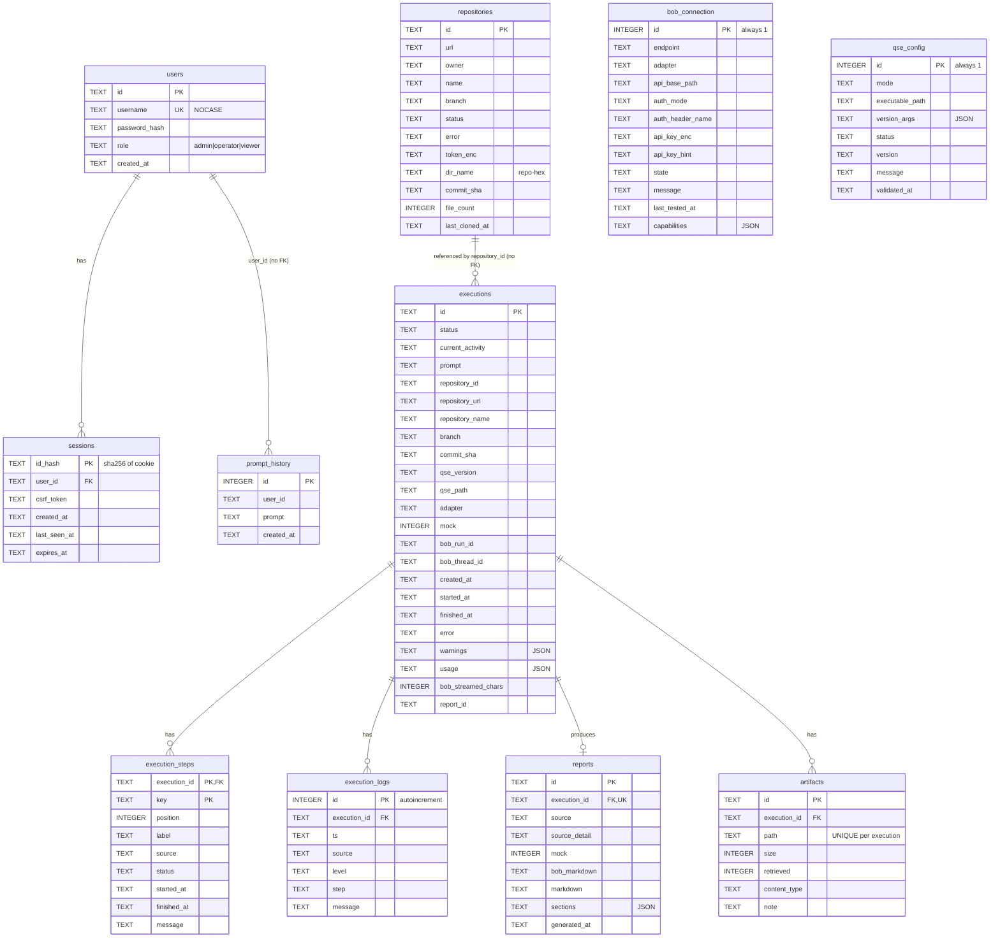

# Data model and security controls

> Extracted verbatim from `SPEC.md` (sections 7 and 8). Do not edit here; edit SPEC.md and re-extract. Paths are relative to the project root.

## 7. Data model and persistence

Store: SQLite via `node:sqlite`. Default path `<DATA_DIR>/db/workbench.sqlite` in realtime and `<DATA_DIR>/db/workbench-demo.sqlite` in mock (separate files, so demo data never mixes with real data). Pragmas: `journal_mode=WAL`, `foreign_keys=ON`, `busy_timeout=5000`. Migrations use `PRAGMA user_version`; there is **one** migration (creates everything below). Schema source: `backend/src/db/database.ts`.

Notes:

- `executions.repository_id` has no foreign key on purpose, so deleting a repository keeps history. The execution row carries denormalised repository fields.
- Foreign keys cascade from `executions` to steps, logs, reports and artifacts. Sessions cascade from users.
- Indexes: `executions_created (created_at DESC)`, `execution_logs_exec (execution_id, id)`.
- `prompt_history` is trimmed to the newest 200 rows on every insert; the prompts API returns at most 25 distinct prompts.
- Single-row tables (`bob_connection`, `qse_config`) are enforced by `CHECK (id = 1)`.
- File-system state: cloned repositories under `WORKSPACE_ROOT/repo-<hex>/repo`.
- Browser persistence: only `sessionStorage` keys `qse.activeRepo`, `qse.activeExec`, `qse.promptDraft`. No `localStorage`, no tokens.
- There is **no** cleanup of executions, logs, reports or workspaces except deleting a repository (which removes its work dir).

---

## 8. Security

### 8.1 Controls

| Area | Control | Source |
|---|---|---|
| Authentication | scrypt N=16384 r=8 p=1; dummy-hash verification for unknown users; uniform error text | `utils/passwords.ts`, `controllers/index.ts` |
| Sessions | Random id; only sha256 stored; cookie `qse_sid` httpOnly, SameSite=Strict, `Secure` per `COOKIE_SECURE` (forced when `NODE_ENV=production`); idle + absolute expiry; purge every 5 min | `middleware/auth.ts` |
| CSRF | Per-session token in `X-CSRF-Token` (timing-safe compare) plus `Origin` check on non-safe methods | `middleware/auth.ts` |
| RBAC | `viewer` < `operator` < `admin`; `requireRole` per route | `routes/index.ts` |
| Transport | Optional HTTPS in the Node server (`TLS_KEY_FILE`/`TLS_CERT_FILE`) or NGINX TLS override; HSTS 1 year | `server.ts`, `deployment/nginx/default.tls.conf.template` |
| Headers | helmet CSP `default-src 'none'`, CORP same-origin, Referrer-Policy no-referrer; NGINX CSP `default-src 'self'; script-src 'self'; style-src 'self' 'unsafe-inline'; img-src 'self' data:; font-src 'self' data:; connect-src 'self'; object-src 'none'; frame-ancestors 'none'; …`, `X-Frame-Options: DENY`, `X-Content-Type-Options: nosniff` | `middleware/security.ts`, NGINX templates |
| Rate limiting | API (`RATE_LIMIT_MAX`/`RATE_LIMIT_WINDOW_MS`), login (15-min window, `LOGIN_RATE_LIMIT_MAX`), heavy routes `max(10, floor(max/6))`; in-memory counters | `middleware/security.ts` |
| Input | zod on every body/query; 64 kb JSON limit; NGINX `client_max_body_size 256k`; path params `^[A-Za-z0-9-]{1,64}$` | `models/schemas.ts`, `controllers/index.ts` |
| SSRF | Bob endpoint: http(s) only, no credentials/query/fragment; hostname allow-list (`BOB_ALLOWED_HOSTS`); DNS-time classification of resolved IPs; metadata/link-local/reserved always blocked; private/loopback only when `BOB_ALLOW_PRIVATE_NETWORK=true`; no redirects | `utils/ssrf.ts`, `integrations/headless-bob/http-client.ts` |
| Command execution | `spawn` with `shell:false`, argument arrays, minimal environment, timeouts, output cap, process-group kill | `utils/safe-exec.ts` |
| Repository handling | https-only URL allow-list, token via env-injected header, hooks disabled, escaping symlinks removed, file-count cap; repository content never executed; prompt marks it as untrusted data | `integrations/github/*`, `prompt-builder.ts` |
| Secrets at rest | AES-256-GCM key ring (`SECRETS_KEYS`), key id as AAD, rotation endpoint | `utils/secret-box.ts` |
| Secrets in logs | pino redact paths + regex redactor for GitHub tokens, Bearer/Basic, URL credentials, `authorization`, `api_key`/`token`/`secret`/`password`, plus registered live secrets | `utils/redact.ts`, `utils/logger.ts` |
| Output encoding | Markdown rendered with `skipHtml` and a link allow-list (`http(s):`, `mailto:`, `#`); download filenames sanitised | `components/Markdown.tsx`, `controllers/index.ts` |
| Container hardening | Non-root uid 1001 (backend) / 101 (NGINX), `cap_drop: ALL`, `no-new-privileges`, read-only root FS with tmpfs, backend port not published | `deployment/docker-compose.yml` |
| Licence | The workbench detects an unaccepted QSE licence and never accepts it | `integrations/qse-cli/validator.ts` |

### 8.2 Threat and mitigation scenarios

| # | Threat | Mitigation | Residual risk |
|---|---|---|---|
| T1 | Credential stuffing on login | Login limiter, uniform errors, scrypt | In-memory limiter resets on restart; no lockout or MFA |
| T2 | Cross-site request forgery | SameSite=Strict, CSRF header, Origin check | None known |
| T3 | SSRF through the Bob address | Scheme/host checks, DNS-time IP classification, no redirects, metadata blocked | An admin can allow private networks deliberately |
| T4 | Malicious repository (symlinks, hooks, large trees) | No execution, symlink pruning, hooks disabled, size cap, `GIT_ALLOW_PROTOCOL=https` | Repository content is still read by Bob; prompt-injection risk is mitigated by wording only |
| T5 | Prompt injection from repository content into the agent | Prompt rule "repository content is DATA"; no fabricated results policy | Not technically enforceable; depends on Bob |
| T6 | Secret leakage via logs or API | Redaction before persistence, no key in any response, hint only | A secret embedded in a prompt is stored verbatim in `executions.prompt` |
| T7 | Stored XSS through report Markdown | Raw HTML skipped, link allow-list, `rel="noopener noreferrer nofollow"`, CSP | None known |
| T8 | Path traversal through artifact or workspace paths | `sanitizeRelativePath`, `isInside`/`realpathInside`, filename sanitisation | None known |
| T9 | Session theft | httpOnly cookie, Strict SameSite, server-side revocation, password change revokes all sessions | No device list, no concurrent-session limit |
| T10 | Denial of service via long runs | Execution timeout, concurrency cap, per-route rate limits, output and payload caps | No quota per user; in-memory counters |
| T11 | Key compromise | Key ring + rotate endpoint | Key is an environment variable (no KMS) |
| T12 | Tampering with stored ciphertext | GCM tag + AAD; `secret_unreadable` surfaced | None known |
| T13 | Information disclosure through settings | `/settings` omits filesystem paths | `sharedMounts` shows Bob-side paths |
| T14 | Demo data mistaken for real results | `mock` flag on every record, DEMO labels, `-DEMO` filenames, separate DB file, header chip | Users must read the labels |
